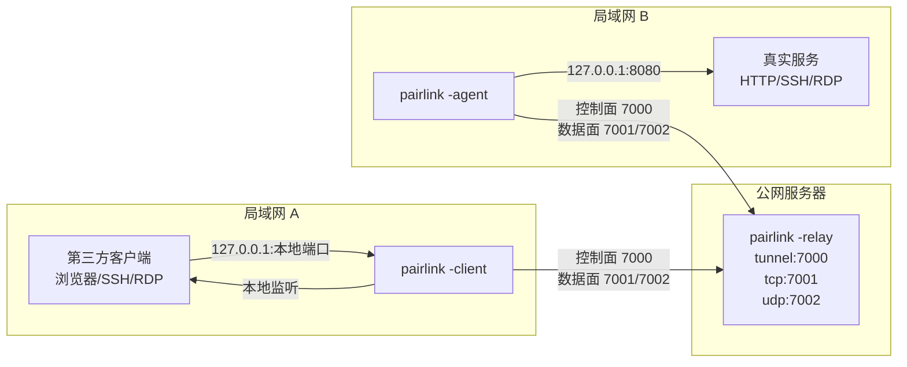
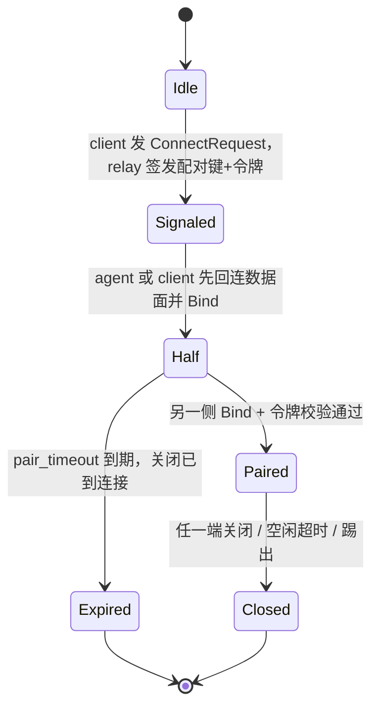

# PairLink

**PairLink 是配对式中继系统，不是 P2P NAT 穿透工具**：所有流量都经过中继服务器，
两个不同局域网、都没有公网 IP 的端点通过一台公网 relay 用"配对键"匹配后通信。

PairLink 是一个**协议无关的字节流中转**：同一套系统可以承载 HTTP、SSH、RDP/VNC、
数据库、自定义 TCP/UDP 服务，中继不解析也不终止上层协议（HTTPS/SSH 的端到端加密由
第三方客户端与真实服务自行完成，中继透明转发）。

- 版本：`v0.5.1`
- 许可证：Apache-2.0
- 语言：Go 1.24.4，单二进制三模式
- 唯一第三方依赖：`golang.org/x/sys`（Windows 服务 SCM）

---

## 1. 与 P2P NAT 穿透的区别

| | PairLink（配对式中继） | P2P NAT 穿透（如 frp P2P、WireGuard 直连） |
| --- | --- | --- |
| 流量路径 | **始终经过 relay** | 尽量点对点直连 |
| 依赖 | 一台公网 relay（只需普通 TCP/UDP 端口） | 需要可打洞的 NAT、STUN/TURN 等 |
| 适用 | 对称 NAT、企业防火墙、无公网 IP、只需要"能用" | 低延迟、大带宽、可控网络 |
| 安全边界 | relay 是明文哑管道，端到端加密靠上层协议 | 由隧道协议自身加密 |
| 鉴权 | 隧道 `auth_token` + 一次性配对令牌 | 各协议自己的密钥体系 |

PairLink 的取舍很明确：**放弃直连优化，换取"任何网络都能连、部署一个公网端口即可"**。

---

## 2. 架构



- **控制面**（`tunnel_listen`）：agent/client 接入、服务注册、服务列表/订阅、接入请求、
  配对信息下发、心跳、错误、踢出。
- **TCP 数据面**（`tcp_listen`）：纯字节流。连接建立瞬间只发一帧 `MsgBind`（配对键+令牌），
  之后双向 `io.Copy` 原样透传；**relay 在配对成功前不写任何字节**。
- **UDP 数据面**（`udp_listen`，可选）：配置了就走原生 UDP——**v0.5.0 起默认由 DTLS-PSK 包住**
  （`udp_dtls = true`）：DTLS 会话建立后，首个内层数据报是 `MsgBind`，relay 记录两侧 `(IP,Port)`
  建立会话映射，之后按源地址反查配对键转发数据报；未配置则复用 `tcp_listen`，UDP 数据报封装进
  UDP 隧道帧（见 §3.4）。
- 详细协议见 [`docs/protocol.md`](docs/protocol.md)，架构与并发模型见
  [`docs/architecture.md`](docs/architecture.md)，阶段 2 契约见 [`docs/contract.md`](docs/contract.md)。

---

## 3. 三种模式职责

| 模式 | 角色 | 做的事 |
| --- | --- | --- |
| `-relay` | 公网中继服务器 | 监听隧道/TCP/UDP 三个端口；维护服务注册表、agent 连接表、待配对表、UDP 会话表、一次性令牌表；下发配对信息；双向转发；管理页与踢出 |
| `-agent` | 服务提供者侧 | 连 relay 控制面并注册服务；收到接入通知后携带配对键+令牌回连数据面；在数据面连接与本地目标之间双向转发 |
| `-client` | 访问侧 | 连 relay 控制面、拉取/订阅服务列表；为配置的服务在本机开监听；第三方连本地端口时发起接入请求，配对后双向转发 |

同一份 ini 同时包含三段配置；**每种模式只读取自己的段**与 `[common]`。

### 3.1 连接注册表与并发保护（relay）

relay 的共享状态全部在内存中，按职责拆成 5 个并发安全结构（实现位于 `internal/registry`、
`internal/pairing`、`internal/token`）：

| 结构 | 键 | 内容 | 并发保护 | 清理方式 |
| --- | --- | --- | --- | --- |
| `ServiceRegistry` | `service_id` | 服务ID、协议、所属 agent、在线状态、注册时间 | `sync.RWMutex`（读多写少），变更时 `revision++` 并通知订阅者 | agent 断开/注销时 `Unregister`/`UnregisterAgent` |
| `AgentRegistry` | `agent_id` | 控制连接、远端地址、连接时间、最后活跃、服务列表 | `sync.RWMutex`，`Add`/`Get` 存取副本 | 控制连接关闭或心跳判死时 `Remove` |
| `PairingTable` | `PairingKey` | 已到侧、peer 对象、创建/截止时间、是否完成 | 单把 `sync.Mutex`，临界区只做 map 操作 | 单一 ticker 调 `Sweep(pair_timeout/2)`，回调 `OnExpire` 关闭占位连接 |
| `UDPTable` | `PairingKey` + `netip.AddrPort` | 两侧 UDP 端点、完整标记、最后活跃 | 单把 `sync.Mutex`，双索引（key→会话、endpoint→key） | 半会话 `pair_timeout`、完整会话 `udp_session_timeout`，`Sweep` 返回被清理键 |
| `token.Store` | `PairingKey` | 令牌 SHA-256、签发/过期时间、是否已消费 | 单把 `sync.Mutex`，`subtle.ConstantTimeCompare` | 单一 ticker 调 `Sweep()` 清理过期 |

原则：**不在锁内做 IO**；订阅回调与 `OnExpire` 在锁外执行；所有 `Get/List/Snapshot`
返回副本；清理顺序固定为"关连接 → 等转发返回 → 删表项"。详见
[`docs/architecture.md`](docs/architecture.md) §4、§5。

### 3.2 协议速览

帧格式（控制面信令与数据面报到共用）：

```
type(1B) | payload_len(4B, big-endian) | payload(JSON, ≤ 1 MiB)
```

| type | 消息 | 方向 | 用途 |
| --- | --- | --- | --- |
| `0x01` | Hello | agent/client → relay | 接入（role / token / version） |
| `0x02` | HelloOK | relay → agent/client | 分配 ID、心跳建议 |
| `0x03` | RegisterService | agent → relay | 注册服务 |
| `0x04` | ServiceRegistered | relay → agent | 注册确认 |
| `0x05` | ListServices | client → relay | 查服务列表 |
| `0x06` | ServiceList | relay → client | 服务列表 + revision |
| `0x07` | Subscribe | client → relay | 订阅变更 |
| `0x08` | ServiceEvent | relay → client | added/removed/updated |
| `0x09` | ConnectRequest | client → relay | 请求接入 |
| `0x0A` | PairResult | relay → client | 配对键 + 一次性令牌 |
| `0x0B` | Incoming | relay → agent | 接入通知（配对键 + 令牌） |
| `0x0C` | Bind | agent/client → relay | 数据面报到（仅一次；`carrier` 区分 `tcp` / `udp-over-tcp`） |
| `0x0D` | BindOK | relay → agent/client | UDP 报到应答（纯 TCP 数据面不发） |
| `0x0E` / `0x0F` | Heartbeat / HeartbeatAck | 双向 | 心跳 |
| `0x10` | Error | 双向 | 错误码 + 信息 |
| `0x11` | Kicked | relay → agent/client | 被管理页踢出 |
| `0x12` | ServerShutdown | relay → agent/client | relay 停机通知 |

TCP 配对状态机（完整版与 UDP 状态机见 [`docs/protocol.md`](docs/protocol.md) §5）：



关键不变量：一个配对键最多成功配对一次；令牌恰好消费一次；配对完成前 relay 不向数据面
写任何字节；报到帧只出现在连接建立瞬间，之后字节原样透传。relay 的三个监听器类型名固定为
`TunnelListener`、`TCPDataListener`、`UDPDataListener`。

订阅推送的一致性：订阅成功后 relay 立即下发一次**全量** `ServiceList` 作为基线；之后只在
`revision` 严格连续时推单条 `ServiceEvent`。若事件断档（推送队列满丢弃）或乱序（多个写入者
并发 dispatch），relay 改发一次全量 `ServiceList` 让 client 整体重同步——因此丢事件不会让
client 永久停留在旧视图，`MsgServiceEvent.revision` 仍然单调递增。

`MsgError` 可选携带 `client_conn_id`（阶段 4 新增，向后兼容）：relay 应答某个
`ConnectRequest` 的错误时填入该请求的 ID，client 据此**精确**关闭对应本地连接；旧 relay
不填时 client 回退到"最早等待的连接"的 FIFO 近似匹配。

**客户端连接ID 由 client 生成（设计选择）**：`client_conn_id` **不是** relay 分配的——
client 每次本地接入都取 8 字节 `crypto/rand` 并转成 16 位小写 hex（字符集落在
`[a-z0-9]`，满足配对键格式），随 `MsgConnectRequest` 上报；relay 只用
`(service_id, client_conn_id)` 组成**配对键**并签发一次性令牌，自己不再生成 ID。
这样 client 在请求发出前就已知自己的连接标识，重试、日志与管理页无需等 relay 回包即可定位；
relay 也无需维护"请求 → ID"的反查表。重复 ID 会被 relay 的 `PairingTable` 拒绝
（`already_paired`），8 字节随机的碰撞概率可忽略。

`HelloOK` 还会携带 `udp_mode`（`native` / `tcp_tunnel`）与 `tcp_data_port` / `udp_data_port`，
agent/client 据此选择 UDP 数据面承载方式并推导数据面拨号地址（无需在 agent/client 的 ini 里
重复写 `[relay]` 端口）。

### 3.3 数据面 TLS（阶段 8D）

默认 `data_tls = auto`：relay 跟随隧道 TLS 判定（`tls = true`，或 `auto` + 证书 → 数据面 TLS），
agent/client 跟随 `HelloOK.data_tls`。启用后 TCP 数据面（配对报到 `MsgBind` + 业务字节 +
UDP-over-TCP 承载帧）全部走 TLS，`pairing_token` 不再明文；证书与 `minVersion TLS 1.2`
与隧道完全相同（relay 复用 `tls_cert`/`tls_key`，agent/client 复用 `tls_ca` /
`tls_insecure_skip_verify`）。

| 配置 | relay 行为 | agent/client 行为 |
| --- | --- | --- |
| `auto`（默认） | 隧道 TLS 开 → 数据面 TLS；隧道明文 → 数据面明文 | 跟随 `HelloOK.data_tls`；旧 relay 未下发 → 明文 + WARN |
| `true` | 强制 TLS；缺证书对 → 启动校验失败 | 必须 TLS；relay 未启用 → 拨号永久失败（可读错误） |
| `false` | 强制明文（即使隧道 TLS），启动 WARN | 强制明文；relay 要求 TLS → 明确报错，不静默降级 |

**原生 UDP 数据面的加密（v0.5.0，SEC-D3）**：`udp_mode = native` 时默认 `udp_dtls = true`，
UDP 数据面外层是 **DTLS 1.2 + PSK**（`TLS_PSK_WITH_AES_128_GCM_SHA256`）：

- PSK = `HKDF-SHA256(auth_token, info="pairlink-udp-dtls/v1|" + pairing_key)`，客户端把
  `pairing_key` 作为 PSK identity 发出，relay 按同一公式派生；identity 不认识的握手直接失败。
- 内层仍是原来的 `len(4B)|sess_len(1B)|session|payload` 帧与 `MsgBind` 握手，**鉴权逻辑不变**；
  DTLS 只负责"证明对端持有 `auth_token`" + 机密性 + 完整性 + 重放保护。
- 效果：链路上的第三方既读不到 UDP 业务数据与 `pairing_token`，也无法伪造源地址注入数据报。
- **三端必须一致**：v0.4.0 及更早的对端不认 DTLS，握手失败（relay 记
  `udp_dtls_handshake_fail` WARN）；混跑期间把三端一起设 `udp_dtls = false`，并接受明文风险
  （启动会 WARN）。

启用 TCP 数据面 TLS（`data_tls`）要求 relay/agent/client 三端 ≥ v0.4.0：旧端忽略
`HelloOK.data_tls`，会以明文连 TLS 端口并握手失败，relay 记录 `data_plane_tls_handshake_fail`
WARN 便于定位。

### 3.4 UDP 数据面承载模式与取舍

`[relay] udp_listen` 是**可选**的。relay 启动时确定模式，并通过
`HelloOK` / `ServiceRegistered` / `ServiceList` 的 `udp_mode` 字段下发给 agent/client：

| 模式 | 触发条件 | 数据面 | 取舍 |
| --- | --- | --- | --- |
| `native` | 配置了 `udp_listen` | 原生 UDP 端口 | **无队头阻塞**、延迟最低；公网需要多放行一个 UDP 端口 |
| `tcp_tunnel` | 未配置 `udp_listen` | 复用 `tcp_listen`，UDP 数据报封装进 UDP 隧道帧（一条 TCP 连接可复用多个 UDP 会话） | **省一个公网端口**，只需放行 TCP；但 TCP 是有序字节流，丢包/阻塞会拖慢同连接上的所有 UDP 会话（**队头阻塞**） |

> **取舍**：UDP over TCP 省一个公网端口，但引入队头阻塞；实时性敏感场景（语音、游戏、
> 高频遥测）应配置原生 `udp_listen`。两种模式的配对键、令牌、超时语义完全一致，
> agent/client 自动按 `udp_mode` 选择承载方式，无需改配置。

阶段 6C 起，UDP over TCP 的**承载连接发送侧**改为"每条连接一个 writer goroutine + 有界队列"
（数据帧 1024 帧 / 8 MiB、控制帧独立优先队列 256 帧，满则丢弃并记 `tunnel_drop`、限速 WARN），
读循环不再被慢对端阻塞：慢会话最多丢掉自己的帧，不会拖住同一条承载连接上的其它会话。
**TCP 级队头阻塞本身仍然存在**（同一条 TCP 上的丢包/重排会拖慢所有复用会话），实时性敏感场景
仍建议配置原生 `udp_listen`。


---

## 4. 快速开始

### 4.1 编译

```bash
# 任意平台构建当前平台二进制
go build -o pairlink .

# 交叉编译（Linux / Windows）
GOOS=linux   GOARCH=amd64 go build -o pairlink-linux .
GOOS=windows GOARCH=amd64 go build -o pairlink.exe .
```

要求 Go 1.24.4+；依赖只有 `golang.org/x/sys`（`go mod tidy` 已生成 `go.sum`）。

### 4.2 三份示例 ini

**relay.ini（公网服务器）**

```ini
[common]
manage_listen = 127.0.0.1:9000
pprof         = false

[relay]
tunnel_listen     = 0.0.0.0:7000
tcp_listen        = 0.0.0.0:7001
; udp_listen 可选：配置则走原生 UDP；留空/删除则 UDP 数据面走 TCP 隧道（省一个公网端口）
udp_listen        = 0.0.0.0:7002
; 原生 UDP 数据面的传输层加密：true（默认，DTLS 1.2 + PSK，v0.5.0）| false（明文，仅过渡用）
; 三端必须一致
udp_dtls          = true
; 按来源 IP 的配对令牌签发限速（令牌桶）；0 = 不限制
token_rate_per_ip = 10
token_burst_per_ip = 30
; 三态开关：auto（默认，按证书推断）| true（强制 TLS）| false（强制明文）
tls               = true
tls_cert          = /etc/pairlink/cert.pem
tls_key           = /etc/pairlink/key.pem
auth_token        = 请改成随机长字符串
pair_timeout      = 10s
idle_timeout      = 300s
heartbeat_timeout = 90s
udp_session_timeout = 60s
token_ttl         = 15s
```

**server.ini（agent 侧，服务提供者）**

```ini
[common]
manage_listen = 127.0.0.1:9100

[server]
relay_addr = relay.example.com:7000
token      = 与 relay 的 auth_token 一致
protocol   = tcp
local      = 127.0.0.1:8080
; 三态开关：auto（默认，按 CA 推断）| true（强制 TLS）| false（强制明文）
; 公网 CA 场景写 tls = true 且不要配 tls_ca（用系统根证书校验）
tls        = auto
; 自签/私有 CA 时指定；只有 tls = auto 或 true 时才生效
; tls_ca   = /etc/pairlink/ca.pem
heartbeat  = 30s

; 附加服务：服务ID = 协议:本地端口（也支持 协议:主机:端口）
service.dsh  = tcp:18080
service.rdp  = tcp:10.0.0.5:3389
service.game = udp:19000

; 可选：agent 侧本地 UDP 会话空闲清理（默认 60s）
udp_session_timeout = 60s
```

**client.ini（访问侧）**

```ini
[common]
manage_listen = 127.0.0.1:9200

[client]
relay_addr = relay.example.com:7000
token      = 与 relay 的 auth_token 一致
; 三态开关：auto（默认，按 CA 推断）| true（强制 TLS）| false（强制明文）
tls        = auto
; 自签/私有 CA 时指定；公网 CA 场景写 tls = true、不要配 tls_ca
; tls_ca   = /etc/pairlink/ca.pem
subscribe  = true
heartbeat  = 30s

; 服务ID = 本地监听地址（缺 host 时补 127.0.0.1）
service.dsh = 127.0.0.1:8080
service.rdp = 127.0.0.1:13389
service.game = 127.0.0.1:19000

; 可选：client 侧本地 UDP 会话空闲清理（默认 60s，必须 > 0）
udp_session_timeout = 60s
```

然后分别启动：

```bash
./pairlink -relay  -config relay.ini
./pairlink -agent  -config server.ini
./pairlink -client -config client.ini
```

第三方客户端直接连 `127.0.0.1:8080`（client 侧）即可，无任何改造。

### 4.3 命令行参数

| 参数 | 说明 |
| --- | --- |
| `-relay` / `-agent` / `-client` | 必须且只能指定一个模式 |
| `-config <path>` | ini 配置文件路径（必填） |
| `-version` | 打印 `pairlink v0.4.0` 并退出（退出码 0） |
| `-service <op>` | 仅 Windows：`install` / `start` / `stop` / `uninstall`（另有内部使用的 `run`） |

退出码：`0` 正常；`1` 运行/配置错误；`2` 参数用法错误（会打印帮助）。

---

## 5. ini 配置格式

### 5.1 语法规则

- 一行一个 `key = value`，键与值两侧空白会被裁剪；
- 整行注释用 `;` 或 `#`（行首，允许前导空白）；**不支持行尾注释**
  （值里出现的 `;`/`#` 属于值本身，因为令牌可能包含它们）；
- `[section]` 段名大小写不敏感；同名段重复出现会合并；
- 同一段内重复键**后者覆盖**（`service.<ID>` 也是后者覆盖且保留首次出现的位置）；
- 未知段、未知键**不报错**，只在启动时打印警告（`event=config_warning`）；
- 值不做引号/转义处理，直接取字符串（v0.5.0 起改用 `gopkg.in/ini.v1` 解析：以 `"""` 或反引号
  `` ` `` 开头的值按库的"带引号值"语义处理，行尾 `\` **不**续行；其余不变，值两侧空白会被裁剪）；
- 证书/CA 路径支持 `/` 分隔符，**相对路径相对于 ini 文件所在目录**解析为绝对路径
  （服务模式下工作目录不是 exe 目录，这一点很重要）。

### 5.2 `[common]`（三种模式共享）

| 键 | 类型 | 必填 | 默认 | 说明 |
| --- | --- | --- | --- | --- |
| `manage_listen` | `host:port` | 否 | 空 | 管理页监听地址；为空表示不启动管理页。建议只监听 `127.0.0.1`；**绑定回环时管理页可写，否则只读**（§6） |
| `pprof` | bool | 否 | `false` | 为 `true` 时在管理端口挂载 `/debug/pprof/` |
| `log_level` | string | 否 | `info` | `debug` / `info` / `warn` / `error` |
| `log_format` | string | 否 | `text` | `text` / `json` |

### 5.3 `[relay]`（relay 模式）

| 键 | 类型 | 必填 | 默认 | 说明 |
| --- | --- | --- | --- | --- |
| `tunnel_listen` | `host:port` | **是** | — | 控制面（信令）监听地址 |
| `tcp_listen` | `host:port` | **是** | — | TCP 数据面监听地址 |
| `udp_listen` | `host:port` | 否 | 空 | 原生 UDP 数据面监听地址；为空表示不监听 UDP，UDP 走 TCP 隧道（`udp_mode = tcp_tunnel`） |
| `tls` | enum | 否 | `auto` | TLS 三态开关：`auto`（按 `tls_cert`/`tls_key` 推断；**非回环监听且无证书时启动校验失败**，必须改 `true` 或显式 `false`，SEC-T2）/ `true`（强制 TLS，证书必须成对且路径非空，否则启动校验失败）/ `false`（强制明文，证书被忽略；非回环监听会额外 WARN 明文风险）；只接受 `auto`/`true`/`false` |
| `tls_cert` | 路径 | `tls=true` 时是 | 空 | 隧道 TLS 证书；`tls = true` 时必须与 `tls_key` 成对，`auto` 下都为空则明文并 WARN |
| `tls_key` | 路径 | `tls=true` 时是 | 空 | 隧道 TLS 私钥；`tls = true` 时必须与 `tls_cert` 成对 |
| `data_tls` | enum | 否 | `auto` | TCP 数据面 TLS 三态：`auto`（跟随隧道 TLS，启用则数据面也 TLS）/ `true`（强制 TLS，复用 `tls_cert`/`tls_key`，缺证书对启动失败）/ `false`（强制明文，即使隧道 TLS，启动 WARN）；只接受 `auto`/`true`/`false`。原生 UDP 不受影响（SEC-T1） |
| `auth_token` | string | 公网**是** | 空 | agent/client 接入密钥。**为空时只允许回环来源**（`127.0.0.0/8`、`::1`）接入，非回环一律 `auth_failed`（SEC-A1）；非回环 `tunnel_listen` + 空 token 直接启动校验失败。公网请用 `openssl rand -hex 32` 生成 |
| `udp_dtls` | bool | 否 | `true` | 原生 UDP 数据面（`udp_listen`）的 DTLS-PSK 加密开关（v0.5.0，只接受 `true`/`false`）。`true`：DTLS 1.2 + `TLS_PSK_WITH_AES_128_GCM_SHA256`，PSK = `HKDF(auth_token, "pairlink-udp-dtls/v1|" + pairing_key)`；`false`：退回 v0.4.0 明文并启动 WARN。三端必须一致（§3.4） |
| `token_rate_per_ip` | int | 否 | `10` | 单个来源 IP 每秒可签发的配对令牌数（令牌桶速率）；`0` = 不限制。超限不签发并记 `event=token_rate_limited` |
| `token_burst_per_ip` | int | 否 | `30` | 单个来源 IP 的签发突发上限；`token_rate_per_ip = 0` 时忽略；`rate > 0` 时必须 ≥ 1 |
| `pair_timeout` | duration | 否 | `10s` | 待配对表占位超时 / 数据面报到读帧超时（可在管理页修改） |
| `idle_timeout` | duration | 否 | `300s` | TCP 数据面空闲超时（无流量即断开）（可在管理页修改） |
| `heartbeat_timeout` | duration | 否 | `90s` | 控制面无心跳判死时间（可在管理页修改） |
| `udp_session_timeout` | duration | 否 | `60s` | UDP 完整会话空闲超时（可在管理页修改） |
| `token_ttl` | duration | 否 | `15s` | 一次性配对令牌有效期（可在管理页修改） |
| `max_conns` | int | 否 | `1024` | 隧道控制面 + TCP 数据面的并发连接总数上限；`0` = 不限制。超限立即关闭新连接并限速 WARN（SEC-D2） |
| `max_conns_per_ip` | int | 否 | `128` | 单来源 IP 的并发连接上限（隧道与 TCP 数据面合计）；`0` = 不限制 |
| `max_pending_pairs` | int | 否 | `4096` | 待配对占位 + 已签发未消费令牌的总数上限；超限对新 `ConnectRequest` 回 `too_many_pending`；另有单连接「未完成请求 ≤ 64」的硬上限；`0` = 不限制 |
| `service_allow` | list | 否 | 空 | 允许注册的服务名白名单（逗号分隔，自动去重）；空 = 允许任意服务名但启动 WARN；不在名单内的 `RegisterService` 回 `bad_request`（`detail=service_denied`）（SEC-A2） |
| `max_services_per_agent` | int | 否 | `64` | 单个 agent 可注册的服务数上限；`0` = 不限制；超限回 `bad_request`（`detail=service_limit`，消息带上限值）；同一服务重复注册不重复计数 |

### 5.4 `[server]`（agent 模式）

| 键 | 类型 | 必填 | 默认 | 说明 |
| --- | --- | --- | --- | --- |
| `relay_addr` | `host:port` | **是** | — | relay 隧道地址 |
| `token` | string | **是** | — | 接入密钥，需与 relay 的 `auth_token` 一致 |
| `protocol` | `tcp`/`udp` | 否 | `tcp` | **主服务**协议；配置了 `local` 而未写 `protocol` 时按 `tcp`（可在管理页修改） |
| `local` | `host:port` / 端口 | 否 | 空 | **主服务**的本地目标地址（缺 host 补 `127.0.0.1`）（可在管理页修改） |
| `service.<ID>` | `<proto>:<port>` 或 `<proto>:<host>:<port>` | 否 | — | 附加服务映射；见 §5.6；**可在管理页新增/修改/删除** |
| `tls` | enum | 否 | `auto` | TLS 三态开关：`auto`（有 `tls_ca` 或 `tls_insecure_skip_verify` 才 TLS，否则明文）/ `true`（强制 TLS；`tls_ca` 为空时用**系统根证书**做标准校验，公网 CA 场景写这个）/ `false`（强制明文，`tls_ca`/insecure 被忽略并 WARN）；只接受 `auto`/`true`/`false` |
| `tls_ca` | 路径 | 否 | 空 | 校验 relay 证书的 CA；`tls = auto` 时为空且未开 `tls_insecure_skip_verify` 则走**明文**，`tls = true` 时为空则用**系统根证书**校验（见 §7.1） |
| `tls_insecure_skip_verify` | bool | 否 | `false` | 跳过 relay 证书校验（仅测试，启动 WARN） |
| `data_tls` | enum | 否 | `auto` | 数据面 TLS 三态：`auto`（跟随 `HelloOK.data_tls`；旧 relay 未下发则明文 + WARN）/ `true`（必须 TLS，relay 未启用时拨号永久失败）/ `false`（强制明文，relay 要求 TLS 时明确报错，不静默降级）；复用 `tls_ca`/`tls_insecure_skip_verify` 与 `minVersion TLS 1.2` |
| `heartbeat` | duration | 否 | `30s` | 控制面心跳间隔 |
| `udp_dtls` | bool | 否 | `true` | 原生 UDP 数据面的 DTLS-PSK 开关（v0.5.0）；**必须与 relay 一致**。`false` 时与 v0.4.0 明文互通，实际部署应保持 `true` |
| `dial_timeout` | duration | 否 | `10s` | 连接 relay / 本地目标超时 |
| `pair_timeout` | duration | 否 | `10s` | 等待 relay 数据面报到应答（`MsgBindOK`）的超时；v0.5.1 起从 `[server]` 读取（此前误读 `[relay] pair_timeout`，配置被静默忽略） |
| `udp_session_timeout` | duration | 否 | `60s` | agent 侧本地 UDP 会话空闲清理 |
| `reconnect` | bool | 否 | `true` | 控制连接断开后是否自动重连（指数退避：1s 起、每次 ×2、上限 `reconnect_max_backoff`、±20% 抖动）；`false` = 阶段 6C 之前的旧行为（断开即 `Run` 返回错误，由守护进程重启） |
| `reconnect_max_backoff` | duration | 否 | `60s` | 自动重连退避上限，必须 > 0；重连成功后重新 Hello + 重新注册全部服务 + 重建心跳，重连期间关闭在途会话（`reason=reconnect`，不做迁移） |

### 5.5 `[client]`（client 模式）

| 键 | 类型 | 必填 | 默认 | 说明 |
| --- | --- | --- | --- | --- |
| `relay_addr` | `host:port` | **是** | — | relay 隧道地址 |
| `token` | string | **是** | — | 接入密钥 |
| `service.<ID>` | `host:port` / 端口 | 否 | — | 本地监听地址（缺 host 补 `127.0.0.1`）；见 §5.6；**可在管理页新增/修改/删除** |
| `tls` | enum | 否 | `auto` | TLS 三态开关：`auto`（有 `tls_ca` 或 `tls_insecure_skip_verify` 才 TLS，否则明文）/ `true`（强制 TLS；`tls_ca` 为空时用**系统根证书**做标准校验，公网 CA 场景写这个）/ `false`（强制明文，`tls_ca`/insecure 被忽略并 WARN）；只接受 `auto`/`true`/`false` |
| `tls_ca` | 路径 | 否 | 空 | 校验 relay 证书的 CA；`tls = auto` 时为空且未开 `tls_insecure_skip_verify` 则走**明文**，`tls = true` 时为空则用**系统根证书**校验（见 §7.1） |
| `tls_insecure_skip_verify` | bool | 否 | `false` | 跳过证书校验（仅测试，启动 WARN） |
| `data_tls` | enum | 否 | `auto` | 数据面 TLS 三态：`auto`（跟随 `HelloOK.data_tls`；旧 relay 未下发则明文 + WARN）/ `true`（必须 TLS，relay 未启用时拨号永久失败）/ `false`（强制明文，relay 要求 TLS 时明确报错，不静默降级）；复用 `tls_ca`/`tls_insecure_skip_verify` 与 `minVersion TLS 1.2` |
| `udp_dtls` | bool | 否 | `true` | 原生 UDP 数据面的 DTLS-PSK 开关（v0.5.0）；**必须与 relay 一致**。`false` 时与 v0.4.0 明文互通，实际部署应保持 `true` |
| `heartbeat` | duration | 否 | `30s` | 控制面心跳间隔 |
| `subscribe` | bool | 否 | `true` | 是否订阅服务列表变更 |
| `dial_timeout` | duration | 否 | `10s` | 连接 relay / 数据面超时 |
| `pair_timeout` | duration | 否 | `10s` | 从发起接入请求到数据面绑定成功的超时 |
| `udp_session_timeout` | duration | 否 | `60s` | client 侧本地 UDP 转发会话空闲清理（必须 > 0；阶段 4 新增） |
| `reconnect` | bool | 否 | `true` | 控制连接断开后是否自动重连（同 `[server]`）；`false` = 断开即退出进程（旧行为） |
| `reconnect_max_backoff` | duration | 否 | `60s` | 自动重连退避上限，必须 > 0；重连后重新 Hello / ListServices / Subscribe，**本地监听不重建**（端口不变），并强制接受 relay 的新服务列表基线（relay 重启 revision 归零也能恢复） |

### 5.6 `service.<ID>` 点号键语义

**主服务（默认服务ID `default`）**

- `[server]` 的 `protocol` + `local` 是主服务，服务ID 恒为 **`default`**（常量
  `config.DefaultServiceID`），在服务列表中就是 `default`。
- 不允许显式写 `service.default`（会直接报错，提示改用 `protocol` + `local`）。
- `service.default` 保留给主服务，其它ID 均不可使用该名字。

**附加服务（`[server]`）**

```ini
; 等价于 tcp:127.0.0.1:18080
service.dsh  = tcp:18080
; 指定主机
service.rdp  = tcp:10.0.0.5:3389
; UDP，裸端口默认 127.0.0.1
service.game = udp:19000
; IPv6 需加方括号
service.v6   = tcp:[::1]:19001
```

- 服务ID 规则：`[a-z0-9-_]{1,64}`；`default` 保留；
- 协议只允许 `tcp` / `udp`；
- 条目按 ini 中出现顺序保留（管理页与日志顺序稳定）；重复ID 后者覆盖；
- `local` 只是**本地目标**，relay/agent 不会把它暴露给 client。

**本地监听（`[client]`）**

```ini
; 完整地址
service.dsh = 127.0.0.1:8080
; 裸端口 → 127.0.0.1:13389
service.rdp = 13389
; 缺 host → 127.0.0.1:2222
service.ssh = :2222
```

- 每个条目会在 client 本机开一个监听端口，把本地连接映射到同名远端服务；
- 同一 `host:port` 重复监听会**校验失败并退出**（启动即暴露端口冲突）；
- 若 `service.<ID>` 在 relay 服务列表中不存在，client 仍会按 TCP 监听并 WARN，
  第三方连接时收到 `service_not_found`。

### 5.7 校验规则（启动时）

- 地址必须能被 `net.SplitHostPort` 解析，端口 1..65535；
- `[server] protocol` 只能是 `tcp`/`udp`；
- `[client]` 本地监听地址不能重复；
- `[relay]` 中**已配置**的监听地址不能重复（`udp_listen` 可省略）；
- duration 必须带单位（`10s`/`5m`/`1h`）且 > 0；
- `manage_listen` 监听 `0.0.0.0` 会 WARN（管理页无鉴权）；
- 证书/CA 文件不存在只 WARN（允许先写配置后拷证书）；
- `[server]`/`[client]` 的 `reconnect_max_backoff` 必须是 > 0 的 duration（`0s`、负值、无单位都直接报错）；
- `tls` 只能是 `auto` / `true` / `false`（大小写不敏感），其它值（`on`、`yes`、`1` 等）直接报错；
- `[relay] tls = true` 要求 `tls_cert` 与 `tls_key` 成对且路径非空（文件不存在仍只 WARN）；
- **SEC-A1**：`[relay] auth_token` 为空且 `tunnel_listen` 非回环（含 `0.0.0.0`/`::`/具体网卡 IP）→ **直接报错**，
  提示配置 `auth_token` 或把隧道绑回环；回环 + 空 token 仅 WARN（只允许回环来源接入）。
- **SEC-T2**：`[relay] tls = auto`（或未写）且未配置成对证书、`tunnel_listen` 非回环 → **直接报错**，
  提示「公网监听必须配置证书，或显式写 tls = false 承担明文风险」；回环监听保持 WARN。
- `[relay] max_conns` / `max_conns_per_ip` / `max_pending_pairs` 必须是非负整数（`0` = 不限制），负数/非整数报错。
- `[server]`/`[client] tls = false` 时已配置的 `tls_ca`/`tls_insecure_skip_verify` 被忽略并 WARN；
  `tls = true` 且 `tls_insecure_skip_verify = true` 允许但 WARN（开关多余）。

---

## 6. 管理页

三种模式都在 `[common] manage_listen` 上提供 HTML 管理页。**阶段 7 起可修改部分配置并写回 ini**：
写能力**仅在 `manage_listen` 绑定回环地址**（`127.0.0.0/8`、`::1`、`localhost`）时启用；
绑定非回环（如 `0.0.0.0`）时整页只读并显示红色横幅，所有写接口返回 **403**。

| 模式 | 页面内容 | 可写操作 |
| --- | --- | --- |
| relay | 服务注册表（服务ID、协议、在线状态、所属 agent）、在线 agent 列表、当前配对表、UDP 会话表 | **踢出**（agent / 配对 / 承载连接）+ **参数配置区**：`pair_timeout`、`idle_timeout`、`heartbeat_timeout`、`udp_session_timeout`、`token_ttl` 的修改 |
| agent | 本机已注册服务列表、到 relay 的控制连接状态、当前活跃数据连接 | **服务表**：`service.<id>` 新增/修改/删除；**主服务** `protocol` + `local` 修改 |
| client | relay 返回的可用服务列表、本地端口映射表、当前活跃配对 | **映射表**：`service.<id>` 本地监听地址的新增/修改/删除（含主服务 `default`，与 ini 写法一致；v0.5.1 前该行在页面上是只读的） |

- 顶栏显示模式、版本、运行时长与刷新开关。**只读页默认 1 秒自动刷新**；
  **可写页（回环 `manage_listen`）或含写表单的页面默认暂停刷新**，避免整页重载清空正在输入的值（P1-2）；
  点右上角「开启自动刷新」即可临时恢复（`?refresh=1`），`?refresh=0` 强制关闭。
- **持久化**：写操作同时改运行时并**写回 ini**。写回用 `gopkg.in/ini.v1` 读取后**重新生成整份
  文件**，因此**会重写该 ini**：注释尽量保留，但空行、键顺序、`=` 对齐、LF/CRLF、键名大小写、
  重复键/重复段的写法都可能被归一（换行统一为 LF，文件以换行结尾）；保证的是**原子替换**
  （同目录临时文件 + `Rename` + 父目录 `fsync`）**与权限位不变**，且写回后能重新 `Load` 到目标值。
  仍**不支持行尾注释**（值中的 `;`/`#` 属于值本身），值两侧空白会被裁剪；含段前键值或
  `[DEFAULT]`/`[default]` 段的文件会拒绝写回。
  写回要求 **ini 所在目录对服务进程可写**（临时文件 + `rename` 必须能建/改名）：
  - systemd 启用 `User=pairlink` 时，`/etc/pairlink` 需 `2775`（或 `chown -R pairlink:pairlink`），
    且 unit 里必须放行 `ReadWritePaths=/etc/pairlink`（`ProtectSystem=strict` 下默认只读，P1-1）；
  - Docker 部署用**目录读写挂载**（`-v ./config:/etc/pairlink`），容器 uid `65532` 需可写该目录。
  目录只读时页面保存会明确报错（`EROFS`/`permission denied`），运行时状态保持不变。
- **一致性**：relay 参数先校验 → 写 ini → 改运行时（写 ini 失败则不改运行时）；agent 服务改动
  需先得到 relay 确认（3s 超时）才落盘，失败回滚内存；client 映射先开监听成功才落盘，失败回滚旧监听。
- **鉴权**：管理页**没有账号体系**，写能力的边界就是"只能绑回环"。写操作仍走一次性 CSRF 令牌 +
  POST，禁止 GET 触发写；**所有写 Action 额外校验 `Host` 必须是回环名**（`127.0.0.1` / `[::1]` /
  `localhost` + 可选端口），**且 `Origin`（若存在）必须等于 `http://` + 同一 Host**——防 DNS
  rebinding 与跨站写，伪造一律 403（SEC-M1）。每次写操作记审计日志 `event=admin_action`（含 `remote`/`action`/
  `target`/`old`/`new`），被拒记 `admin_action_denied`，失败记 `admin_action_failed`。
- 其它字段（`relay_addr`、`token`、监听端口、`tls*`、`reconnect` 等）**不在页面开放**，仍改 ini + 重启。
- `pprof = true` 时额外提供 `/debug/pprof/`；生产环境建议关闭，或只监听 `127.0.0.1`。
  该调试端点的 CSP 单独放宽 `script-src 'unsafe-inline'`/`img-src`（否则 pprof 图表脚本被禁），
  业务页面仍严格 `default-src 'none'`。
- **安全响应头（SEC-M1）**：所有响应统一加
  `Content-Security-Policy: default-src 'none'; style-src 'unsafe-inline'; form-action 'self'; frame-ancestors 'none'`、
  `X-Frame-Options: DENY`、`X-Content-Type-Options: nosniff`、`Referrer-Policy: no-referrer` 与 `Cache-Control: no-store`。

**HTML 组织方式（设计选择）**：三种模式共用 `internal/admin` 的**一套内联布局**——统一的
`<html lang="zh-CN">` 外壳、内联 CSS、顶栏（模式 / 版本 / 运行时长 / 刷新开关），不引用任何
外部 JS、CSS 或 CDN，离线内网可用、也便于安全审计（e2e 会断言页面不含 `<script src=`）。
每个模式只实现自己的**页面正文**（一个 `<section>`），不写 `<html>/<head>/<body>`；
路径分别是 relay 的 `/relay`（另有 `/` 概览）、agent 的 `/status`、client 的 `/client`。
表格数据取自各模式内存快照（注册表 / 配对表 / UDP 会话表 / 本地映射表），渲染时对来自配置与
对端的字符串做 HTML 转义以防 XSS；新增页面只需 `admin.AddPage`，布局、CSRF 与刷新由框架统一处理。

---

## 7. 安全说明

1. **隧道 TLS（阶段 6G：三态显式开关）**：公网部署必须配置 `tls_cert`/`tls_key`，
   并建议 relay / agent / client 三端都显式写 `tls = true`。`tls` 取值（只接受这三个字面量）：
   - `auto`（默认，向后兼容）：按材料推断——relay 的 `tls_cert`+`tls_key` 均非空才 TLS；
     agent/client 的 `tls_ca` 非空或 `tls_insecure_skip_verify = true` 才 TLS，否则明文；
   - `true`（强制 TLS）：relay 缺证书对直接启动失败；agent/client 必须 TLS，
     `tls_ca` 非空时只信任该 CA，**为空时使用系统根证书做标准校验**——
     公网 CA 场景就写 `tls = true` 且不要配 `tls_ca`，更不要打开 `tls_insecure_skip_verify`；
   - `false`（强制明文）：即使配了证书/CA 也不启用 TLS，并 WARN 提示材料被忽略。
   两侧配置不匹配时 TLS 握手直接失败并报可读错误（提示检查 relay 的 tls 与本端 tls/tls_ca），
   属预期行为（不会自动降级、不做协议探测）。
2. **接入密钥（SEC-A1）**：`[relay] auth_token` 是 agent/client 接入隧道的共享密钥，务必改成随机长串
   并与两端一致。**为空时不再等于"人人可接入"**：relay 只允许回环来源（`127.0.0.0/8`、`::1`）接入，
   非回环来源一律回 `auth_failed` 并记 WARN（含 `remote`）；非回环 `tunnel_listen` + 空 `auth_token`
   会在启动校验阶段直接失败，只有「绑回环 + 空 token」的本机调试组合被允许（并 WARN）。
   密钥比较先做 SHA-256 再常量时间比较。
3. **一次性配对令牌**：与配对键绑定、32 字节 `crypto/rand`、短有效期（默认 15s）、
   用后即焚（Consume）、存储只保留 SHA-256、常量时间比较；TCP/UDP 数据面都强制校验。
4. **数据面 TLS（SEC-T1，阶段 8D）**：`data_tls` 三态默认 `auto`——隧道启用 TLS 时 TCP 数据面
   自动加密（`MsgBind`、`pairing_token`、业务字节与 UDP-over-TCP 承载帧都在 TLS 内），relay
   复用隧道证书、agent/client 复用 `tls_ca` 与 `minVersion TLS 1.2`。`false` 强制明文会 WARN；
   两端不匹配时握手失败并给出可读错误（不静默降级）。**原生 UDP（`udp_mode = native`）
   自 v0.5.0 起默认由 DTLS-PSK 加密**（`udp_dtls = true`，见 §3.3/§10.1 第 20 条），
   只有显式 `udp_dtls = false` 或与 v0.4.0 老端混跑时才回到明文（启动 WARN）。
   HTTPS/SSH 等端到端加密仍应由业务自身完成，relay 始终是哑管道、不解密。
5. **管理页无鉴权**：只监听 `127.0.0.1`；不要 `0.0.0.0:9000` 直接暴露。写 Action 另有
   Host/Origin 回环校验 + 一次性 CSRF（SEC-M1）；所有响应带 CSP/X-Frame-Options/nosniff。
6. **日志（SEC-M2）**：不打印 `pairing_token` 明文；`auth_token` 也不打印。来自对端的字符串
   （`client_name`/`agent_id`/错误信息/踢出原因）统一经 `logx.CleanN` 去除控制字符并按 64 字符
   截断——1 MiB 的 `client_name` 只会产生 < 512 字节的单行日志，`\n` 也无法伪造额外日志行。
7. **连接与配额（SEC-D2）**：隧道与 TCP 数据面受 `max_conns`/`max_conns_per_ip` 限制；
   `ConnectRequest` 受 `max_pending_pairs` 与「单连接 ≤ 64 个未完成请求」限制；agent 并发处理
   `MsgIncoming` 上限 256（超出丢弃并 WARN，不 panic）。超限日志按 5 秒一条限速。
8. **最小暴露面**：agent 的本地目标地址只在 agent 本地；relay 只看到服务ID与协议。
9. **服务名归属（SEC-A2，阶段 8D）**：`service_allow` 限定可注册的服务名，`max_services_per_agent`
   （默认 64）限制单 agent 数量；同名服务同时只允许一个在线 owner，异 owner 在线时注册被拒
   （`service_conflict`），原 owner 离线才允许接管（`service_takeover`）。**未配置 `service_allow`
   时只 WARN**：任何持有 `auth_token` 的接入者仍可注册任意服务名，多租户部署应显式配置。

---

## 8. 部署

### 8.0 运维件一览

仓库已提供可直接使用的部署件，不必再从 README 手抄片段：

| 路径 | 用途 |
| --- | --- |
| `deploy/systemd/pairlink-{relay,agent,client}.service` | Linux systemd unit（`Type=simple`、`Restart=on-failure`、日志进 journal） |
| `deploy/linux/install-{relay,agent,client}.sh` + `common.sh` | Linux **按角色**安装/卸载（每个脚本只装自己那个服务；幂等、`--dry-run`、`--no-systemd`、`--no-start`、`--purge`） |
| `deploy/windows/install-{relay,agent,client}.ps1` + `common.ps1` | Windows SCM **按角色**安装/卸载（管理员 PowerShell，服务名 `pairlink-<mode>`） |
| `Dockerfile` / `.dockerignore` / `deploy/docker-compose.yml` | 多阶段容器镜像 + relay/agent/client/nginx 演示编排 |
| `examples/*.ini` | 主机侧 7 份模板（relay / relay-no-udp / relay-tls / agent / agent-tls / client / client-udp） |
| `examples/docker/*.ini` | 容器侧 3 份模板（管理页绑 `0.0.0.0`） |

> **一台机器通常只部署一个角色**：Linux 的三个 `install-<mode>.sh` 与 Windows 的三个
> `install-<mode>.ps1` **各自只安装/启动自己的服务**，不会顺带拉起另外两个角色。

> 所有模板的 token 都是 `CHANGE-ME-...` 占位符，投产前必须替换（`openssl rand -hex 32`）。
> 模板使用 17000 段端口；§8.3 的 7000/7001/7002 是默认生产端口示例，防火墙按实际 ini 放行。
> 详细说明见 [`deploy/README.md`](deploy/README.md)。

### 8.1 Linux（systemd）

按角色选一个脚本：安装共享二进制 + `/etc/pairlink/<mode>.ini` + `pairlink-<mode>.service`，
`enable` 并默认 `start`（`--no-start` 只 enable）：

```bash
./deploy/linux/install-relay.sh --dry-run                  # 预览，可非 root
sudo ./deploy/linux/install-relay.sh --binary ./pairlink   # relay 机器
sudo ./deploy/linux/install-agent.sh --binary ./pairlink   # agent 机器
sudo ./deploy/linux/install-client.sh --binary ./pairlink  # client 机器
sudo systemctl status pairlink-relay --no-pager
sudo journalctl -u pairlink-relay -f
```

- 三个脚本**不会互相安装/启动**；单机只跑 relay 时不会出现 agent/client 的 unit 或 ini。
- 共享二进制 `/usr/local/bin/pairlink`；卸载时仅当没有任何其它 `pairlink-*.service` 残留才删除。
- `/etc/pairlink` 为 `0750 root:pairlink`，ini 为 `0640`；非 root 运行需在 unit 启用 `User=pairlink`/`Group=pairlink`（见 `deploy/systemd/README.md`）。
- **管理页写回需要可写目录**（P1-1）：启用 `User=pairlink` 后，`/etc/pairlink` 需对服务用户可写
  （`sudo chmod 2775 /etc/pairlink`，或 `chown -R pairlink:pairlink`；ini 改 `0660` / `0640` 视需要而定）。
  unit 已在 `ProtectSystem=strict` 旁放行 `ReadWritePaths=/etc/pairlink`；不用写页面时可注释掉它恢复全只读。
  目录只读时页面保存会报 `permission denied`/`EROFS`，运行时不会半更新。
- 默认以 root 运行；`Restart=on-failure` + `RestartSec=3s` + 60s/5 次启动限制兜底；agent/client 自身也会自动重连（`reconnect`/`reconnect_max_backoff`，见 §5.4/§5.5 与 §10 #1）。
- `--no-systemd` 只放二进制与配置；卸载用 `sudo ./deploy/linux/install-<mode>.sh --uninstall`，默认保留 `/etc/pairlink`，`--purge` 只删本模式 ini/证书。

### 8.2 Windows（SCM）

用**管理员** PowerShell，按角色执行一个脚本：

```powershell
.\deploy\windows\install-relay.ps1 -Config C:\PairLink\relay.ini
.\deploy\windows\install-agent.ps1 -Config C:\PairLink\agent.ini -Binary C:\PairLink\pairlink.exe
.\deploy\windows\install-relay.ps1 -Config C:\PairLink\relay.ini -Force   # 重装
.\deploy\windows\install-relay.ps1 -Uninstall -KeepLogs
```

- 每个脚本只操作 `pairlink-<mode>` 一个服务；服务名固定、启动类型自动；
- 日志在 **exe 同目录的 `pairlink-<mode>-YYYY-MM-DD.log`**（按日期分文件，`log_keep_days` 默认保留 7 天，0 = 永久）；`-Config` 解析为绝对路径；
- `-NoStart` 只注册不启动；服务已存在默认提示，`-Force` 才 stop+uninstall+重装；
- 查看：`sc.exe query pairlink-relay` / `Get-Service pairlink-relay`；
- 非管理员会被 `#Requires -RunAsAdministrator` 直接拦截；详见 `deploy/windows/README.md`。
- 也可以直接调二进制：`pairlink.exe -relay -config C:\PairLink\relay.ini -service install|start|stop|uninstall`；
  非 Windows 平台执行 `-service` 会提示"仅支持 Windows"并以退出码 1 结束。

### 8.3 防火墙与网络

| 位置 | 需要放行 | 说明 |
| --- | --- | --- |
| relay 服务器 | `7000/tcp`（隧道）、`7001/tcp`（数据面）；`7002/udp`（原生 UDP，可选）；可选 `9000/tcp`（管理页，仅内网） | 三个业务端口默认都需要公网可达；不配置 `udp_listen` 时只需 7000/7001 两个 TCP 端口 |
| agent 侧 | 出站到 relay 的 7000/7001（原生模式下再加 7002/udp） | 一般无需入站 |
| client 侧 | 本机本地监听端口（默认只 `127.0.0.1`） | 无需入站，第三方就在本机/同机 |
| Windows | `New-NetFirewallRule -DisplayName PairLink -Direction Inbound -Protocol TCP -LocalPort 7000,7001 -Action Allow` 及 UDP 7002 | 记得同时放行 UDP |

注意：
- client 的 `service.<ID>` 默认监听 `127.0.0.1`，同局域网其它机器访问不到（这是有意的安全默认）；
  若必须开放，显式写 `0.0.0.0:端口` 并自行评估风险。
- 公网 relay 只暴露 7000/7001/7002，管理页不要映射到公网。
- 云厂商安全组/防火墙与系统防火墙都要放行。

### 8.4 容器（Docker）

```bash
docker build -t pairlink:v0.4.0 .
docker compose -f deploy/docker-compose.yml up -d --build
curl -fsS http://127.0.0.1:18080/ | grep -qi 'welcome to nginx' && echo 'e2e OK'
docker compose -f deploy/docker-compose.yml down
```

- 运行时 `gcr.io/distroless/static-debian12:nonroot`（uid 65532），`CGO_ENABLED=0` 静态编译；
- 容器内 `127.0.0.1` 是容器自己，不是宿主机；`examples/docker/*.ini` 管理页绑 `0.0.0.0`，宿主机用 `127.0.0.1:端口:端口` 限制来源；
- **配置目录以读写方式挂载**（`../examples/docker:/etc/pairlink:rw`）：管理页写回 ini 需要
  「临时文件 + rename」，单文件 `:ro` 挂载做不到。容器以 uid 65532 运行，宿主机需
  `sudo chown -R 65532:65532 examples/docker`（或 `chmod 0775` + 同组），否则页面保存报权限错误；
  根文件系统仍保持 `read_only: true`（P1-1）；
- 只映射管理页 17090/17091/17092 与演示入口 18080；
- **镜像未在开发机验证（无容器运行时）**，验证命令与限制见 `deploy/README.md`。

---

## 9. 日志

- 使用 Go 标准库 `log/slog`，`[common] log_format = text|json`，`log_level` 控制级别。
- 统一字段：`mode`、`agent_id`、`client_id`、`service_id`、`pairing_key`、`remote`、`event`、
  `err`（详见 [`docs/architecture.md`](docs/architecture.md) §6）。
- 关键事件：连接建立 `tunnel_accept`、接入 `hello_ok`、注册 `service_register`、
  通知 `pair_issue`、报到 `bind_ok`/`bind_fail`、配对 `pair_complete`、断开 `data_close`、
  超时清理 `pair_timeout`/`idle_timeout`/`udp_evict`、踢出 `kick`，
  重连 `reconnect_scheduled`/`reconnect_ok`/`reconnect_failed`、
  本地监听热切换 `listen_hot_switch`、隧道发送队列丢弃 `tunnel_drop`、
  原生 UDP 重复报到帧丢弃 `bind_dup_drop`（阶段 6C 新增）。
- **按日期分文件（v0.5.0）**：`log_path` 视为**基名**，实际写 `<base>-YYYY-MM-DD<ext>`，
  日期取**本地时区**：`/var/log/pairlink/relay.log` → `relay-2026-11-15.log`；
  无扩展名时 `C:\Logs\relay` → `relay-2026-11-15`。写入时发现日期变化就关闭旧文件、
  打开新文件（多 goroutine 安全，不丢行）；**不做体积切割**，单文件体积上限仍需 logrotate。
- **保留 N 天**：`[common] log_keep_days`（默认 `7`，`0` = 永久保留，负数启动校验失败）。
  启动与每次跨天切换时清理同目录、同基名且日期早于 `today - log_keep_days` 的日文件；
  只删严格匹配 `<base>-YYYY-MM-DD[.ext]` 的文件（`other-2026-01-01.log`、原始 `relay.log`、
  日期格式非法的文件一律不动）；删除失败（Windows 文件被占用等）只 WARN，不影响服务。
- **Windows 服务模式**：日志文件为 exe 同目录的 `pairlink-<mode>-YYYY-MM-DD.log`；
  各包内 `logx.New` 的默认输出也指向同一个日文件（`logx.SetDefaultOutput`），保证日志落盘。
- 前台模式：日志输出到标准错误（text）或标准输出 JSON，交给 systemd/容器收集。

---

## 10. 已知限制（第一版，诚实清单）

1. **自动重连内置且默认开启（阶段 6C）**：agent/client 控制连接断开（非踢出、非 relay 停机）后
   按指数退避重连（base 1s、每次 ×2、上限 `reconnect_max_backoff` 默认 60s、±20% 抖动），
   重连后重新握手/注册/订阅并重建心跳；重连期间进程存活、client 本地端口保持不变。
   - 重连期间关闭全部在途数据连接与本地会话（日志 `reason=reconnect`），**不做会话迁移**，
     重连后的新连接照常走完整配对；
   - 断开窗口内 client 的新本地接入会因"控制面未就绪"被立即关闭（fail fast），第三方需重试；
   - 以下情况**不重连**、`Run` 直接返回：被踢出、relay 停机（返回 `nil`）、鉴权失败
     `auth_failed`、版本不兼容 `unsupported_version`、TLS 握手失败（配置不匹配）；
   - `reconnect = false` 可恢复阶段 6C 之前的行为（断开即退出，由 systemd/Windows 服务重启）；
   - 订阅到 `proto` 变化现在会**热切换**本地监听（见第 6 条）。
2. **UDP over TCP 有队头阻塞**：未配置 `udp_listen` 时多个 UDP 会话复用一条 TCP 连接，
   丢包/阻塞会拖慢同连接的所有会话；实时性敏感场景请配置原生 `udp_listen`。
3. **UDP over TCP 承载连接不迁移**：承载 TCP 断开后该连接上的 UDP 会话即失效，
   需要重新走控制面配对（第一版不做会话迁移/自动重建）。
4. **UDP 源地址漂移不支持**：同一侧端点变化会被拒绝，只能等会话超时后重新接入。
5. **原生 UDP 报到有丢包重传（最多 3 次）**：发 `MsgBind` 后每约 300ms 未收到应答就重发（最多 3 次），
   收到 `MsgBindOK` **或首个业务数据报**即视为就绪；relay 半开会**重复回** `BindOK`，
   `Full` 后丢弃同一配对键的重复 `MsgBind` 帧（只嗅探 5 字节帧头，其余数据报不解析）。
   仍存在的边界：若 `BindOK` 与随后转发的业务数据报乱序（同一 socket 顺序写出，实际几乎不可能），
   迟到的 `BindOK` 会被当作业务数据转给本地目标；`pair_timeout` 到期才放弃会话。
6. **client 本地监听协议以 relay 服务列表为准，并支持热切换（阶段 6C）**：订阅到 `added`/`updated`
   事件且 `proto` 与当前监听不一致时，关旧监听并在**原地址**按新协议重开（配置为 `:0` 时复用旧端口），
   成功记 `listen_hot_switch`；新监听打不开（端口被占等）则**回滚**到旧协议并 WARN，本地服务不会消失。
   仍存在的限制：切换只关监听 socket，已建立的会话继续自然结束、不迁移；服务从列表消失时保留当前
   协议（不切回 TCP 占位），启动时缺失的服务仍按 TCP 占位监听；订阅事件本身可能因推送队列满而丢
   （relay 会改发全量 `ServiceList` 兜底，见 §3.2）。
7. **管理页无账号鉴权，写能力仅限回环**：`manage_listen` 绑定 `127.0.0.0/8`、`::1`、`localhost` 时页面可写，
   绑定 `0.0.0.0`/`::` 时只读且所有写 Action 返回 403。可写时表单仍受一次性 CSRF 保护，
   写操作会同时更新运行时并写回 ini；**写回会重写该 ini 文件**（注释与原有排版可能丢失/归一，
   换行统一为 LF），但保证原子替换、权限位不变、写回后仍能 `Load`；**不支持行尾注释**（值中的
   `;`/`#` 属于值本身）与跨行值，含段前键值或 `[DEFAULT]`/`[default]` 段的文件拒绝写回；
   同一 ini 被其它进程或编辑器同时修改时**后写覆盖先写**。页面自动刷新：只读页 1s，
   可写页/含表单页默认暂停（`?refresh=1` 恢复、`?refresh=0` 强制关闭），间隔 1s 不可配置。
8. **relay 状态全在内存**：重启后服务注册与配对关系丢失，agent/client 需要重启恢复。
9. **单 relay 进程**：没有集群/多活；relay 是单点。
10. **数据面默认加密（TCP `data_tls` 跟随隧道，原生 UDP 自 v0.5.0 默认 DTLS）**：启用隧道 TLS 后 TCP 数据面
    默认也加密（`data_tls = auto`）；`udp_mode = native` 的原生 UDP 数据面自 v0.5.0 起
    默认由 DTLS-PSK 加密（`udp_dtls = true`）；两者都显式设 `false` 时才是明文（启动 WARN）。
11. **Linux 已在真机（WSL2 Ubuntu）验证**：阶段 6A 起在 WSL2 的 Ubuntu 26.04
    （`go1.24.4 linux/amd64` / `gcc 15.2` / `CGO_ENABLED=1`）上跑通了全量单测、`-race`
    （真跑，非 `CGO_ENABLED=0` 降级）与真实三进程端到端（HTTP / TCP echo / UDP 两种承载 /
    三个管理页 / 踢出 / SIGTERM 优雅关停 / 端口释放），并做了跨 OS 联调与 TLS 复核，
    详见 §13.15。systemd 真实托管已由阶段 6D 在 WSL2 验证（见 §13.16）；仍未覆盖非 loopback 多网卡、长时间 soak、非 root `User=pairlink` 运行。
12. **Windows 服务未做完整生命周期验证**：本机非管理员，只验证了 `-service install` 的
    "需要管理员权限"错误路径与服务命名 `pairlink-<mode>`；install→start→stop→uninstall
    的实际 SCM 状态、`pairlink-<mode>-YYYY-MM-DD.log` 落盘（按日期分文件）需管理员环境复核。阶段 6F 已把脚本拆为
    `deploy/windows/install-{relay,agent,client}.ps1`（每个只操作自己的服务），
    但真实 SCM 生命周期仍需管理员环境复核。
13. **只在 loopback 验证**：未模拟公网 NAT、防火墙、丢包/延迟、真实多网卡；广域网下的
    TCP/UDP 行为（尤其 UDP over TCP 的队头阻塞）可能不同。
14. **TLS 公网 CA 正向路径仍未实测**：e2e 覆盖自签 CA（`tls_ca`）、`tls_insecure_skip_verify`、
    `tls = true` 且不配 `tls_ca`（用系统根证书**拒绝**自签证书的负向断言），以及
    "明文连 TLS / TLS 连明文"的失败路径；但没有用真实公网 CA 证书跑通系统根证书的**正向**路径
    （本机无公网域名/证书）。另外 `relay_addr` 若写 IP，relay 证书必须带该 IP 的 SAN，
    否则系统根证书校验同样会失败。
15. **soak 只跑了 2–3 分钟短版**：`test/soak_test.go`（`-tags soak`）可参数化长跑；本机实测
    30 轮 / 2m30s（TCP/UDP 每轮全部成功、goroutine 44→40、RSS 峰值 19.9 MiB、句柄 201→213），
    完整命令与数字见 §13.17；30–60 分钟长时间稳定性仍需在目标环境复跑。
16. **端口分配**：e2e 使用"bind :0 → 关闭 → 重新绑定"策略，存在极小的 TOCTOU 窗口；
    真实部署请固定端口。
17. **容器镜像未在本仓库开发机验证**：本机无 Docker/Podman，`Dockerfile` 与
    `deploy/docker-compose.yml` 只做了静态审查与 `CGO_ENABLED=0` 等价编译；首次
    `docker build` / `docker compose up` 需在有容器运行时的机器按 `deploy/README.md` 复核。
18. **容器内 127.0.0.1 不是宿主机**：容器模板把管理页绑 `0.0.0.0` 以配合端口映射，
    宿主机侧用 `127.0.0.1:端口` 限制来源；不要把管理页映射到 `0.0.0.0` 公网。

### 10.1 阶段 8C/8D 深层风险：已修复项与仍在范围的 SEC-D3

SEC-T1（数据面 TLS）与 SEC-A2（服务名归属）在 **v0.4.0 / 阶段 8D 已修复**；
SEC-D3（原生 UDP 会话反伪造）在 **v0.5.0 已修复**（DTLS-PSK，见第 20 条）。
下面保留历史记录并写清启用方式与残差。

19. **SEC-T1（High）：数据面 TLS —— 已修复（v0.4.0）**
    - **启用方式**：`[relay] tls = true`（或 `auto` + `tls_cert`/`tls_key`）时，`data_tls = auto`
      （默认）会让 TCP 数据面自动 TLS；也可显式 `data_tls = true`。agent/client 用默认 `auto`
      跟随 `HelloOK.data_tls`，并复用 `tls_ca`/`tls_insecure_skip_verify`。启用后
      `MsgBind` 与 `pairing_token`、业务字节、UDP-over-TCP 承载帧全部在 TLS 内。
    - **失败语义**：`data_tls = true` 缺证书对 → relay 启动校验失败；本端 `true` 而 relay 未启用
      → 拨号永久失败；本端 `false` 而 relay 要求 TLS → 明确报错，不静默降级；明文连接打到
      TLS 数据面 → 握手失败 + relay `data_plane_tls_handshake_fail` WARN。
    - **仍存在的边界**：relay 仍是哑管道，不会替上层做端到端加密（HTTPS/SSH 仍应端到端启用）；
      原生 UDP 数据面的加密见第 20 条（v0.5.0 起默认 DTLS）。启用 TCP 数据面 TLS 要求三端 ≥ v0.4.0。
20. **SEC-D3（Medium）：原生 UDP 会话源地址伪造/抢注 —— 已修复（v0.5.0）**
    - **原问题**：`Bind` 只凭一次性令牌 + 配对键绑定会话，之后按源 IP:端口识别端点；
      能嗅探令牌或与受害者同 NAT 的攻击者可在令牌有效期内抢先报到（会话抢注/源地址漂移），
      或伪造数据报注入既有会话。
    - **修复方式**：`udp_mode = native` 时默认 `udp_dtls = true`，UDP 数据面外层为
      **DTLS 1.2 + PSK**（`TLS_PSK_WITH_AES_128_GCM_SHA256`），
      PSK = `HKDF-SHA256(auth_token, info="pairlink-udp-dtls/v1|" + pairing_key)`；
      `pairing_key` 作为 PSK identity 在握手中发送。**没有 `auth_token` 的攻击者无法完成握手**
      （算不出 PSK），因此既不能抢注会话也不能注入数据报；DTLS 还提供机密性、完整性、
      重放窗口（`ReplayProtectionWindow` 默认 64）。
    - **残差与前提**：① 三端必须一致且 ≥ v0.5.0；v0.4.0 老端发明文会被丢弃（relay 记
      `udp_dtls_handshake_fail` 限流 WARN）。混跑期显式 `udp_dtls = false`，此时回到
      v0.4.0 明文行为并启动 WARN。② `auth_token` 仍是**集群共享密钥**，持有它的 agent/client
      之间不互相隔离（与 TCP 数据面 `data_tls` 同一信任模型）；需要按服务隔离请叠加应用层鉴权。
      ③ DTLS 记录层受 MTU 约束：接近/超过路径 MTU 的大数据报会被 IP 分片，丢一片即整报丢失；
      需要大报文请用 `udp_mode = tcp_tunnel`。④ PSK 由 `auth_token` 派生，轮换 `auth_token`
      会同时影响控制面、TCP 数据面与 UDP 数据面（三端需一起换）。
    - **仍建议**：令牌 TTL 保持默认 15s 或更短；公网给 `udp_listen` 加 ACL；对来源极不稳定的
      场景用 `udp_mode = tcp_tunnel`。
21. **SEC-A2（High）：服务名归属 —— 已修复（v0.4.0）**
    - **启用方式**：`[relay] service_allow = web,ssh,default` 显式列出允许的服务名；
      `max_services_per_agent`（默认 64）限制单 agent 服务数。`RegisterService` 依序校验
      白名单 → 数量上限 → 归属：同 owner 覆盖；异 owner 在线 → 拒绝（`service_conflict`）；
      原 owner 离线 → 允许接管（`service_takeover`，WARN 记录旧/新 owner）。agent 日志与
      管理页显示稳定 `detail` 对应的可读提示。
    - **失败语义**：不在白名单 → `bad_request` + `detail=service_denied`；超过上限 →
      `bad_request` + `detail=service_limit`（消息带上限值）；异 owner 在线 → 拒绝并记录
      `service_conflict`（含两个 agentID）。
    - **仍存在的边界**：未配置 `service_allow` 时只 WARN，任何持 `auth_token` 的接入者仍可
      注册任意服务名；接管判定依赖 relay 的在线表/心跳，网络分区期间可能短暂误判离线。
      服务名仍无独立密钥/签名，多租户强隔离需配合按租户拆分 relay 或 token。

---

## 11. 目录结构

```
pairlink/
├── main.go                  # 命令行入口（模式选择 / 服务子命令 / signal）
├── main_test.go             # 模式选择 / 版本常量单测
├── go.mod / go.sum          # module github.com/lsong98sh/pairlink（唯一第三方依赖 x/sys）
├── Dockerfile               # 多阶段镜像（CGO_ENABLED=0，distroless nonroot）
├── .dockerignore            # 构建上下文裁剪
├── LICENSE                  # Apache-2.0
├── README.md                # 本文
├── docs/
│   ├── architecture.md      # 分层、对象图、并发与日志约定
│   ├── protocol.md          # 线格式、消息、状态机、错误码、令牌生命周期
│   ├── contract.md          # 阶段 2 契约（签名 / 目录所有权）
│   └── traceability.md      # 需求追踪矩阵（需求 ↔ 实现 ↔ 测试）
├── deploy/
│   ├── systemd/             # relay/agent/client 三个 unit + 说明
│   ├── linux/               # install-{relay,agent,client}.sh + common.sh（按角色、幂等、--dry-run）
│   ├── windows/             # install-{relay,agent,client}.ps1 + common.ps1 + 说明
│   ├── docker-compose.yml   # relay/agent/client/nginx 演示编排
│   └── README.md            # 运维件总说明与验证状态
├── examples/                # 7 份主机侧 ini + docker/ 3 份容器侧 ini
├── test/                    # e2e / 真实二进制 / examples / soak 测试
└── internal/
    ├── config/              # ini 解析 + 默认值 + 按模式校验
    ├── logx/                # slog 封装 + 文件日志 + 按日切割/保留（v0.5.0）
    ├── udpdtls/             # 原生 UDP DTLS-PSK 参数与派生（三端共用）
    ├── protocol/            # 帧编解码 + 消息结构体
    ├── token/               # 一次性配对令牌
    ├── pairing/             # PairingKey + PairingTable
    ├── registry/            # ServiceRegistry / AgentRegistry / UDPTable
    ├── forward/             # Bidirectional / WithIdleTimeout / JoinContext
    ├── admin/               # 管理页框架 + html/template 布局 + CSRF + pprof
    ├── service/             # Windows 服务集成
    ├── version/             # 唯一版本号常量（main 与三模式管理页共用）
    ├── reconnect/           # 指数退避 + 抖动 + 可取消等待（阶段 6C）
    ├── tunnelqueue/         # 每承载 writer + 有界发送队列（阶段 6C）
    ├── relay/               # relay 模式（阶段 2 实现）
    ├── agent/               # agent 模式（阶段 2 实现）
    └── client/              # client 模式（阶段 2 实现）
```

## 12. 开发与自检

```bash
gofmt -l .                       # 必须无输出
go vet ./...                     # 必须通过
go build ./...                   # 必须通过
go test ./... -count=1           # 必须全绿
go test -race ./... -count=1     # 全仓并发检查（不只 internal/）
go test ./test/... -v -count=1   # 端到端明细（每个验收项一行 PASS）
go test ./test/... -count=2      # 防 flake
GOOS=linux   GOARCH=amd64 go build ./...
GOOS=windows GOARCH=arm64 go build ./...
go test -tags soak ./test -run TestSoak -timeout 10m   # soak 短版（约 2.5 分钟）
go vet -tags soak ./test                               # soak 文件必须能编译（linux/windows）
GOOS=linux go test -c -tags soak -o /tmp/soak_linux.test ./test
```

协议与状态机的细节以 [`docs/protocol.md`](docs/protocol.md) 为准；
阶段 2 的 relay/agent/client 只能改各自的目录，其余包已冻结（见 [`docs/contract.md`](docs/contract.md)）。

### 12.1 第三方依赖与引入理由

原则（`task.md` §7.1）：**优先标准库；引入第三方库必须说明理由**。当前全部依赖如下
（`go.mod` 里只有这些，没有隐藏传递依赖）：

| 模块 | 用途 | 为什么不用标准库 | 范围 |
| --- | --- | --- | --- |
| `golang.org/x/sys` | Windows 服务 SCM（`svc`）、Unix `fsync` 目标平台调用 | 标准库无 SCM API | 运行期 |
| `gopkg.in/ini.v1` | ini 解析与写回（v0.5.0 起） | 自研行级补丁维护成本高、边界多；接受"写回重写整份文件"的代价换取可靠解析 | 运行期 |
| `github.com/pion/dtls/v3` | 原生 UDP 数据面的 DTLS 1.2 + PSK（v0.5.0 起） | 标准库只有流式 TLS，没有 DTLS；自研 cookie/HMAC 等于自制密码协议，风险更高 | 运行期 |
| `github.com/pion/transport/v4` | 单 UDP 端口的多 peer 分发（`udp.Listen`，DTLS 的传递依赖） | 标准库无按源地址分发的 `net.PacketConn` | 运行期 |
| `github.com/pion/logging` | `pion/dtls` 的日志接口（传递依赖） | — | 运行期 |
| `golang.org/x/crypto` | `hkdf` 派生 UDP 数据面 PSK（`pion/dtls` 的依赖） | 标准库无 HKDF（`crypto/hkdf` 在 Go 1.24 尚未进入标准库） | 运行期 |
| `golang.org/x/time` | `rate` 令牌桶，relay 按 IP 限制签发 | 标准库无令牌桶 | 运行期 |
| `go.uber.org/goleak` | 测试期 goroutine 泄漏判定 | 自研 `NumGoroutine` 计数容差会误报 | **仅测试** |

引入新依赖的门槛：必须在上表登记理由、说明对二进制体积的影响、确认 `go vet`/测试覆盖；
**禁止**为"用起来顺手"引入 Web 框架、ORM、日志框架、工具库集合。渲染用 `html/template`、
日志用 `log/slog`、CLI 用 `flag`、配置以外的格式一律不引入。

## 13. 端到端验证

> 本节是阶段 3 的**实测版**：测试源码在 [`test/`](test/)，全部使用真实临时 ini
> （`t.TempDir()`）、真实 loopback 端口、真实第三方 HTTP/TCP/UDP 服务；进程内直接调用
> `relay.Run` / `agent.Run` / `client.Run`，另有真实二进制三子进程冒烟。
> 启动/停止/配对的等待全部是“轮询 + 截止时间”，没有用固定 sleep 当同步。

### 13.1 运行环境与一键复现

| 项 | 实测值 |
| --- | --- |
| 操作系统 | Windows 10 专业版 10.0.19045（amd64） |
| Go | `go1.24.4 windows/amd64` |
| 权限 | **非管理员**（Windows 服务完整生命周期未执行，见 §13.10） |
| WSL | 阶段 3/4 时**不可用**（`wsl -l -q` 退出码 1）；**阶段 6A 起可用**：Ubuntu 26.04 / WSL 2 / `go1.24.4 linux/amd64` / `gcc 15.2` / `CGO_ENABLED=1`，真机结果见 §13.15 |
| CGO | Windows 构建与交叉编译均 `CGO_ENABLED=0`（纯 Go）；Linux 单测/`-race` 用 `CGO_ENABLED=1` |
| 网络范围 | 全部为 `127.0.0.1` loopback，未做公网/NAT/防火墙验证 |

```bash
# 端到端明细（每个验收项都有独立 PASS 行）
go test ./test/... -v -count=1

# 重复两轮确认不 flake
go test ./test/... -count=2

# 端到端并发检查（含 relay 管理页并发访问）
go test -race ./test/... -count=1

# 整仓自检
gofmt -l . && go vet ./... && go build ./...
go test ./... -count=1
go test -race ./... -count=1
GOOS=linux GOARCH=amd64 CGO_ENABLED=0 go build ./...
```

实测（阶段 4 收尾）：`go test ./test/... -v -count=1` 为
`ok github.com/lsong98sh/pairlink/test 21.805s`（33 个 `--- PASS`、0 个 `--- FAIL`）；
`-count=2` 为 `ok ... 48.304s`；`go test -race ./test/...` 为 `ok ... 24.326s`。

### 13.2 验收项总表

| # | 验收项（task.md §9.3 / task2 / §10） | 测试函数 | 实测结果与关键数字 |
| --- | --- | --- | --- |
| 1 | 本地 HTTP 服务零改造，经 agent 注册、client 本地端口访问 | `TestE2EHTTPZeroChange` | **PASS**：真实 `net/http` 服务返回 `HTTP 200`，body=`pairlink-http-ok path=/index.html?x=1`，响应头 `X-PairLink-Test: zero-change`；客户端只连 `127.0.0.1:<本地端口>` |
| 2 | TCP echo 注册→通知→回连→配对→转发→断开清理 | `TestE2ETCPPairingBothOrders`、`TestE2ETCPEchoConcurrent20` | **PASS**：两种报到顺序（client-first / agent-first）都完成双向回显；20 组并发 × 每组 2 轮全部一致；结束后 relay `当前配对表（0）`，agent/client 活跃配对均为空 |
| 3 | UDP 报到、会话映射、转发、空闲超时清理 | `TestE2EUDPModeNative` | **PASS**：原生 UDP 回显 `echo:probe-native-1`；`udp_session_timeout=800ms` 后会话表 `1 → 0`；同一 socket 再发包被丢弃；新源端口重新配对成功（配对键 `default/bdcb… → default/da89…`） |
| 4 | 同一 agent 多服务 + 并发多组配对互不干扰 | `TestE2EAgentMultiServiceConcurrent` | **PASS**：agent 同时注册 `default`/`web`/`echo` 三个 TCP 服务；3 个端口 × 5 轮并发访问，响应内容严格区分、无串流 |
| 5a | 令牌错误 | `TestE2EFailureWrongToken` | **PASS**：假令牌报到连接被关闭，收到 **0 字节**，配对表保持 0 |
| 5b | 令牌复用 | `TestE2EFailureTokenReuse` | **PASS**：首次配对成功后复用同一令牌，relay 日志 `token: 配对令牌已被使用`，连接被关闭且无字节 |
| 5c | 令牌过期 | `TestE2EFailureTokenExpiry` | **PASS**：`token_ttl=300ms`，等待 706ms 后报到被拒（日志 `token: 配对令牌已过期`），两侧连接均被关闭 |
| 5d | 配对超时（只一侧报到） | `TestE2EFailurePairTimeout` | **PASS**：`pair_timeout=400ms`，实测 402ms 后连接被关闭，配对表回落 0 |
| 5e | 控制连接断开 | `TestE2EFailureControlDrop` | **PASS**：关闭 agent 控制连接后服务表/在线 agent/配对表全部归 0；重新 `ListServices` 返回空；新 `ConnectRequest` 收到 `service_not_found`；未完成配对连接被关闭 |
| 5f | 管理页踢出 | `TestE2EFailureKick` | **PASS**：`GET /action/kick` → **405**，无 CSRF POST → **403**，合法 POST → **200**；agent `Run` 返回 `agent: 已被 relay 踢出（被管理页踢出）`；服务下线、client 访问被关闭 |
| 5g | 空闲超时 | `TestE2EFailureIdleTimeout` | **PASS**：`idle_timeout=500ms`，实测 501ms 后本地连接收到 EOF，relay 配对表回落 0 |
| 6 | task2：不配 `udp_listen` 时 UDP 走 TCP 隧道 | `TestE2EUDPModeTCPTunnel` | **PASS**：`udp_mode=tcp_tunnel`，2 个并发 UDP 会话 × 4 轮回声均正确；relay 会话表有 2 个配对键，但**只有 2 个不同承载对端地址**（agent/client 各 1 条 TCP 承载） |
| 7 | task2：配置 `udp_listen` 时走原生 UDP | `TestE2EUDPModeNative` | **PASS**：relay 管理页显示 `UDP 承载模式 = native`，UDP 会话表为 `native`，数据不经过 TCP 承载 |
| 8 | task2：`udp_mode` 在三处下发 | `TestE2EUDPModeNegotiation` | **PASS**：`HelloOK`、`ServiceRegistered`、`ServiceList` 的 `udp_mode` 在 native 与 tcp_tunnel 两种模式下都与 relay 判定一致；`tcp_data_port > 0`，native 的 `udp_data_port > 0`，tcp_tunnel 为 0 |
| 9 | 三种模式管理页 + pprof | `TestE2EAdminPagesThreeModes` | **PASS**：relay/agent/client 页面均 200；标题分别为 `PairLink relay/agent/client 管理页`；关键表头齐全；无 `<script src=`；三个端口的 `/debug/pprof/goroutine?debug=1` 均返回 200 且含 `goroutine profile: total` |
| 10 | 无僵尸配对 / 无 goroutine 泄漏 | `TestE2EGoroutineNoLeak` | **PASS**：5 次完整配对流量后运行中 pprof `total=30`，无 `internal/forward.Bidirectional` 残留；全部 `Run` 退出后 `runtime/pprof` 中无 `internal/{relay,agent,client,forward}` 栈帧；整包结束时 `TestMain` 的 goleak `VerifyTestMain` 通过（无未退出 goroutine，无 ignore） |
| 11 | 单二进制：版本/参数/配置错误退出码 | `TestBinaryVersionUsageAndConfigErrors` | **PASS**：`-version` → `pairlink v0.4.0` 且退出码 0；无模式/多模式/未知 flag → 退出码 **2**；`-relay -config 不存在` / `-agent -config 非法 ini` → 退出码 **1** 且有中文错误 |
| 12 | 真实二进制三子进程 TCP echo | `TestSubprocessTCPEcho` | **PASS**：`go build` 出的真实 `pairlink.exe` 分别以 relay/agent/client 三个子进程运行，未改造的第三方 TCP 客户端回显成功；阶段 6A 起收尾统一用跨平台的 `os.Process.Kill()`（Windows/Linux 通用，不再依赖 `taskkill`） |
| 13 | 跨平台编译（纯 Go 无 CGO） | `TestCrossCompile` | **PASS**：`linux/amd64` 13,895,704 B；`windows/amd64` 14,444,032 B；`windows/arm64` 13,505,024 B；三个平台 `go build ./...` 均通过 |
| 14 | Windows 服务 | `TestE2EWindowsService` | **PASS（非管理员分支）**：`pairlink-relay -service install` 退出码 1，输出可读错误 `service: 连接 SCM（需要管理员权限）: Access is denied.`，无 panic/静默成功；完整 install→start→stop→uninstall 需管理员，本机未执行（见 §13.10） |
| 15 | 阶段4：TLS 隧道端到端（自签 CA） | `TestE2ETLSTCPEcho` | **PASS**：`crypto/x509` 生成 CA + 服务端证书（SAN 127.0.0.1），relay `tls_cert/tls_key`、agent/client `tls_ca`，TCP echo 回显 `tls-echo-1`，结束后配对表回落 |
| 16 | 阶段4：只配 `tls_insecure_skip_verify` 可连 TLS relay | `TestE2ETLSInsecureSkipVerify` | **PASS**：client 无 `tls_ca`、只开 insecure，echo `tls-insecure-ok` 成功，日志有跳过校验 WARN |
| 17 | 阶段4：TLS 配置不匹配必须明确失败 | `TestE2ETLSPlaintextAgentAgainstTLSRelay`、`TestE2ETLSPlaintextClientAgainstTLSRelay`、`TestE2ETLSAgentTLSAgainstPlaintextRelay` | **PASS**：明文 agent/client 连 TLS relay → `Run` 返回 `agent: 等待 MsgHelloOK: protocol: 读取帧头: EOF` / `client: 读取 hello 应答: ...`；TLS agent 连明文 relay → `agent: 连接 relay ...: TLS 握手: ...` |
| 18 | 阶段4：订阅 revision 断档的全量重同步 | `TestSubscribeRevisionResync`（relay）、`TestServiceListFullResync`（client） | **PASS**：跳过 revision 2 后到达 3 → relay 改发全量 `ServiceList`（含 a/b/c）；旧事件被丢弃；client 收到主动 `ServiceList` 后整体替换视图 |
| 19 | 阶段4：`MsgError.client_conn_id` 精确关联 | `TestConnectRequestErrorCarriesClientConnID`（relay）、`TestErrorMatchingByClientConnID`（client） | **PASS**：relay 在 ConnectRequest 相关错误里填 ID、无关错误不填；client 只关闭该 ID 对应连接，无 ID 时回退 FIFO |
| 20 | 阶段4：`[client] udp_session_timeout` 可配置 | `TestClientUDPSessionTimeout`（config）、`TestNativeUDP`（client，300ms 清理） | **PASS**：默认 60s、显式 250ms 生效、`0s/-5s` 报错；client 侧 300ms 空闲即清理会话 |
| 21 | 阶段4：`already_paired` 保留窗口 + 令牌重放防护 | `TestAlreadyPairedRetentionWindow`（relay）、`TestTCPBindRejections` | **PASS**：完成窗口内再报到关闭且 0 字节；窗口结束条目被 Sweep；窗口后重放返回 `ErrConsumed` |
| 22 | 阶段4：idle 超时日志与半关闭 | `TestBidirectionalWithOutcomeIdleTimeout`、`TestBidirectionalHalfCloseThroughIdleWrapper`、`TestRelayIdleTimeoutLogsEvent` | **PASS**：Outcome 报告超时；relay 日志出现 `event=idle_timeout` + "数据面空闲超时"；`WithIdleTimeout` 包装后 `CloseWrite` 半关闭仍工作、反向数据不丢 |
| 23 | 阶段4：日志不含令牌明文（含 debug） | `TestRelayLogsDoNotContainToken`（relay）、`TestLogsDoNotContainToken`（agent） | **PASS**：debug 级日志覆盖 pair_issue/bind_fail/pair_complete 等关键事件，但既无 `pairing_token` 也无 `auth_token` 明文 |

### 13.3 本地 HTTP（零改造）

`TestE2EHTTPZeroChange` 启动真实 `net/http` 服务，agent 侧主服务 `default` 与附加服务
`http-svc` 都指向它；client 只配置 `service.http-svc = 127.0.0.1:<本地端口>`。第三方使用
标准 `http.Client` 访问 client 本地端口，实测两次：

```text
HTTP 200: path=/ body="pairlink-http-ok path=/"
HTTP 200: path=/index.html?x=1 body="pairlink-http-ok path=/index.html?x=1"
```

HTTP 层完全不知道 PairLink 存在，符合“第三方客户端零改造”的验收要求。

### 13.4 TCP echo 与配对全流程

- `TestE2ETCPPairingBothOrders` 使用 fake agent/fake client 控制面 + 原始数据面连接，
  **直接操纵报到顺序**：`client-first`（client Bind 占位、agent 后到）与
  `agent-first`（agent Bind 占位、client 后到）都完成三次双向回显并清理。
  这样覆盖了 `PairingTable` 对“两侧到达顺序不确定”的处理。
- `TestE2ETCPEchoConcurrent20` 使用完整真实栈（真实 agent/client）：20 个并发 TCP
  连接，每个连接带序号做 2 轮回显。全部通过后 relay 管理页
  `当前配对表（0）`，agent/client 管理页均显示“当前没有活跃配对”。

### 13.5 UDP（原生 / UDP over TCP）

**原生 UDP（`TestE2EUDPModeNative`）**

- relay 配置 `udp_listen`，管理页显示 `UDP 承载模式 = native`；
- 第三方 UDP 客户端收到带服务端前缀的回包 `echo:probe-native-1`，证明路由到了正确的
  agent 本地 UDP 服务；
- `udp_session_timeout=800ms` 后 relay 的 `UDP 会话表（native，1）` 变为 `0`；
- 会话被清理后原 socket 再发包无回包（relay 按未知端点丢弃）；换一个新的第三方源端口
  会重新走 `ConnectRequest`，配对键由 `default/bdcb797309f50f68` 变为
  `default/da890c089dc3b981`。

**UDP over TCP（`TestE2EUDPModeTCPTunnel`）**

- relay 不配置 `udp_listen`，管理页显示 `UDP 承载模式 = tcp_tunnel` 与
  `未监听（复用 tcp_listen 的 UDP over TCP）`；
- 两个并发 UDP 会话各做 4 轮回显，回包内容互不串流；
- relay 会话表有 2 个配对键，但只有 **2 个不同承载对端地址**
  （`[127.0.0.1:3741 127.0.0.1:3740]`），即 agent 侧 1 条 + client 侧 1 条 TCP 承载，
  不是“每会话一条”；
- agent 管理页的 `udp-over-tcp` 行显示会话数 `2`。

**`udp_mode` 下发（`TestE2EUDPModeNegotiation`）**

对 native 与 tcp_tunnel 分别建立原始控制连接，断言 `HelloOK`、`ServiceRegistered`、
`ServiceList` 三处的 `udp_mode` 一致；并校验 `tcp_data_port` / `udp_data_port`。

### 13.6 多服务与并发

`TestE2EAgentMultiServiceConcurrent`：同一 agent 注册 `default`（HTTP A）、`web`（HTTP B）、
`echo`（TCP echo）三个服务；client 开三个本地端口。3 个端口 × 5 轮并发访问，
断言 A 只返回 `service-default`、B 只返回 `service-web`、echo 只回显自己的序号，
未出现跨服务串流。结束后 relay 配对表为 0。

### 13.7 异常路径（逐条实测）

| 路径 | 实测现象 |
| --- | --- |
| 令牌错误 | 数据连接被关闭，`Read` 收到 0 字节；relay 日志 `token: 配对令牌无效` |
| 令牌复用 | 首次配对成功并 `Consume` 后，再次报到被关闭；日志 `token: 配对令牌已被使用` |
| 令牌过期 | `token_ttl=300ms`，等待 706ms 后报到被拒；日志 `token: 配对令牌已过期` |
| 配对超时 | 只一侧报到，`pair_timeout=400ms`，实测 402ms 关闭，表项清理 |
| 控制连接断开 | 服务/agent/配对表归 0；重新 `ListServices` 为空；新请求 `service_not_found` |
| 踢出 | GET 405、无 CSRF POST 403、合法 POST 200；agent `Run` 返回“已被 relay 踢出”；client 访问被关闭 |
| 空闲超时 | `idle_timeout=500ms`，实测 501ms 后本地连接 EOF，relay 配对表 0 |

### 13.8 管理页与 pprof

`TestE2EAdminPagesThreeModes` 同时启动三种模式的 `manage_listen` 并开启 `pprof = true`：

- relay 页：`概览`（UDP 承载模式 / TCP 数据面 / UDP 数据面 / 服务数 / 配对占位 / UDP 会话数）、`服务注册表`、`在线 agent`、`当前配对表`、`UDP 会话表`；
- agent 页：`本机已注册服务`、`控制连接`、`当前活跃数据连接`；
- client 页：`relay 返回的可用服务列表`、`本地端口映射表`、`当前活跃配对`；
- 三个页面均返回 200、`<html lang="zh-CN">`、中文标题，且不含任何 `<script src=`；
- 三个端口的 `/debug/pprof/goroutine?debug=1` 与 `/debug/pprof/` 均可访问。

### 13.9 无僵尸与 goroutine/pprof 佐证

`TestE2EGoroutineNoLeak` 跑 5 次完整 TCP 配对流量后：

```text
运行中 pprof: relay goroutine total=30，无 internal/forward.Bidirectional 残留
pprof 结论: 运行中无转发 goroutine 残留；退出后无 internal/relay|agent|client|forward 栈帧
优雅关停：relay/agent/client 三个 Run 在 ctx 取消后均返回 nil
整包结束时由 TestMain 的 goleak 兜底检查进程内无未退出 goroutine
```

v0.5.0 起 goroutine 泄漏判定交给 `go.uber.org/goleak`：`test/` 的 `TestMain`
在 `m.Run()` 之后调用 `goleak.VerifyTestMain`，整包所有用例（含 `t.Cleanup`
关停与子进程回收）结束后统一按栈帧校验；不再用 `runtime.NumGoroutine` 的
"基线 +2" 容差，也不再给每个用例挂数字看护。e2e 有真实子进程与监听端口，
但 `os/exec.(*Cmd).Wait` 由 `childProc.kill` 的 Kill+Wait 保证结束、产品
Run 的 `net/http` goroutine 必须随 Run 退出，因此没有添加任何 ignore。

### 13.10 真实二进制、子进程与跨平台

- `TestBinaryVersionUsageAndConfigErrors`：`pairlink -version` 输出
  `pairlink v0.4.0`；无模式/多模式/未知 flag 退出码 2；配置文件缺失/非法退出码 1，
  错误信息为中文且可定位。
- `TestSubprocessTCPEcho`：TestMain 在临时目录 `go build` 出真实 `pairlink.exe`，启动
  relay/agent/client 三个子进程，第三方 TCP echo 成功，最后用跨平台 `os.Process.Kill()` 清理（阶段 6A 起不再依赖 `taskkill`）。
- `TestCrossCompile`：`CGO_ENABLED=0` 下 `linux/amd64`、`windows/amd64`、
  `windows/arm64` 的 `go build ./...` 与单二进制产物均通过。
- `TestE2EWSLOrCrossCompileNote`：阶段 3/4 时本机 `wsl -l -q` 失败（无 WSL），
  当时 **Linux 二进制未在真机运行**，只证明了交叉编译通过；阶段 6A 起 WSL2 可用，
  该用例改为记录"WSL 可用（Ubuntu）/原生 Linux"，真机结果见 §13.15。

### 13.11 Windows 服务

`TestE2EWindowsService` 先检测管理员权限（`windows.GetCurrentProcessToken().IsElevated()`）：

- 本机**非管理员**：`pairlink.exe -relay -config <有效 ini> -service install` 退出码 1，
  输出 `错误: service: 连接 SCM（需要管理员权限）: Access is denied.`，
  未出现 panic，也未静默成功；服务名由 `service.Name(mode)` 生成 `pairlink-relay`。
- 若以管理员运行，测试会执行完整 `install → start → sc query(RUNNING) →
  pairlink-relay-YYYY-MM-DD.log → stop → uninstall` 分支（本机未触发）。
- 因此 **Windows 服务完整生命周期未在本机验证**，只验证了非管理员错误路径与服务命名约定。

### 13.12 回归

阶段 4 收尾时，仓库根实测（本轮为一次性串行执行）：

```text
gofmt -l .                     # 无输出
go vet ./...                   # 通过（无输出）
go build ./...                 # 通过（无输出）
go test ./... -count=1         # 全绿（test 包 22.981s，relay 7.079s，其余 1.4~6.4s）
go test -race ./... -count=1   # 全绿（test 包 24.326s，0 处 DATA RACE）
go test ./test/... -v -count=1 # ok 21.805s，33 个 --- PASS、0 个 --- FAIL
go test ./test/... -count=2    # ok 48.304s，无 flake
GOOS=linux   GOARCH=amd64 go build ./...   # 通过（无输出）
GOOS=windows GOARCH=arm64 go build ./...   # 通过（无输出）
```

补充：`go test -race ./...` 中 relay/client/agent 三个包的耗时分别为 10.8s / 9.1s / 9.2s，
说明并发用例（订阅推送、踢出、并发配对、UDP 双承载）都在 race 检测下跑过。

### 13.13 阶段 4：审查修复与对应回归证据

本轮（阶段 4）是"审查 + 修复 + 回归"，不改动三模式的公共 `Run` 签名与包路径。
每条修复都有对应的包内测试或 e2e 用例（下表），完整回归输出见 §13.12。

| # | 问题 | 级别 | 修复 | 回归证据 |
| --- | --- | --- | --- | --- |
| 1 | 订阅推送在 revision 断档/乱序时**永久丢事件**，client 管理页视图可能一直停在旧版本 | P1 | relay：订阅后下发全量 `ServiceList` 基线；`revision` 严格连续才推单条事件，否则改发全量列表（`pushMu` 保证基线先于事件写出）。client：任意时刻接受主动 `ServiceList`，且 `revision` 更旧的快照整份忽略 | `TestSubscribeRevisionResync`、`TestServiceListFullResync`、`TestTunnelRegisterListSubscribe` |
| 2 | `MsgError` 无关联 ID，client 用"最早等待连接"FIFO 近似匹配；并发接入时可能**关错本地连接** | P1 | `protocol.Error` 新增可选 `client_conn_id`（兼容、不升版本）；relay 在 ConnectRequest 相关错误里填；client 精确匹配，缺失时回退 FIFO | `TestConnectRequestErrorCarriesClientConnID`、`TestErrorMatchingByClientConnID` |
| 3 | `already_paired` 保留窗口与令牌重放防护缺少端到端证明 | P1 | 补测试：完成窗口内再报到被关闭且 0 字节；窗口结束 `Sweep` 清条目；窗口后重放仍 `ErrConsumed` | `TestAlreadyPairedRetentionWindow`、`TestTCPBindRejections` |
| 4 | idle 超时后只有笼统 `data_close` 日志，无法区分"空闲清理"与"正常关闭" | P1 | `forward` 新增 `BidirectionalWithOutcome`/`Outcome`（`Bidirectional` 行为不变）；relay 据此记 `event=idle_timeout` | `TestBidirectionalWithOutcomeIdleTimeout`、`TestBidirectionalHalfCloseThroughIdleWrapper`、`TestRelayIdleTimeoutLogsEvent` |
| 5 | 管理页版本号三处不一致（relay 常量、agent 常量、client 空） | P2 | 新增 `internal/version`，`main.Version` 与三模式管理页统一引用 | `TestVersionFormat`、`TestE2EAdminPagesThreeModes`（断言页面含 `v0.2.0`） |
| 6 | `[client]` 无 `udp_session_timeout`，client 侧 UDP 空闲清理写死 60s | P2 | config 新增字段（默认 60s、必须 > 0）+ client 使用 + 文档 | `TestClientUDPSessionTimeout`、`TestNativeUDP`（300ms 清理） |
| 7 | 管理页"先 Start 后赋值"竞态只有 relay 修过 | P1 | agent/client 改为先发布 `adminSrv`/`admin` 再 `Start`，失败时回滚为 nil | 现有 `TestAdminPage`、`TestE2EAdminPagesThreeModes`（-race 通过） |
| 8 | TLS 端到端（自签 CA / insecure / 配置不匹配）无 e2e | P2 | 新增 5 个 e2e 用例（CA 与服务端证书由 `crypto/x509` 在 `t.TempDir()` 生成） | `TestE2ETLSTCPEcho`、`TestE2ETLSInsecureSkipVerify`、`TestE2ETLSPlaintextAgentAgainstTLSRelay`、`TestE2ETLSPlaintextClientAgainstTLSRelay`、`TestE2ETLSAgentTLSAgainstPlaintextRelay` |
| 9 | 日志可能打印令牌明文（需全仓确认） | P1 | 审计确认生产代码只记录 `pairing_key`；新增 relay 级日志泄漏测试（debug 级别） | `TestRelayLogsDoNotContainToken`、`TestLogsDoNotContainToken`（agent，已有） |
| 10 | 文档与实现不一致（contract §4.5 数据面地址推导、TLS 触发规则、protocol §4.12/§5.2.1） | P2 | 同步 `docs/contract.md`、`docs/protocol.md`、`docs/architecture.md`、本 README | 见各文档对应小节 |

未修（有明确理由，已写入 §10 / §13.14）：

- **订阅事件乱序的根因**在冻结包 `registry` 的"锁外 dispatch"设计；本轮在 relay 侧用
  "全量重同步"兜住可观测后果，不改冻结包的并发模型（改它会引入回调重入死锁风险）。
- **UDP 原生重复 Bind / BindOK 乱序**属协议边界情形，修它需要解析每个数据报，
  与"数据面不解析上层协议"冲突；已在 `docs/protocol.md` §5.2.1 写明真实行为。
- **Linux 真机运行 / Windows 服务生命周期**需要管理员与 Linux 环境，本轮无法验证。

### 13.14 已知限制与未验证项（诚实说明）

1. **Linux 真机验证已补齐（阶段 6A）**：本条在阶段 3/4 成立，现由 §13.15 取代——
   WSL2 Ubuntu 上跑了全量单测 + `-race` + 真实 Linux 二进制三进程 + 跨 OS 联调 + TLS。
   仍然未验证：systemd 托管、非 loopback 网络、长时间 soak。
2. **Windows 服务完整生命周期未验证**：本机非管理员。已验证非管理员错误路径、
   `pairlink-<mode>` 命名（`internal/service` 单测 + 代码路径），但 install/start/stop/uninstall
   的实际 RUNNING/STOPPED 状态与 `pairlink-<mode>-YYYY-MM-DD.log` 落盘未在本机执行。
3. **TLS e2e 只覆盖自签 CA 与 insecure 组合**（阶段 4 补充）：`TestE2ETLS*` 已覆盖
   relay `tls.Listen` + agent/client `tls_ca`、`tls_insecure_skip_verify`，以及
   "明文连 TLS / TLS 连明文"必须失败的路径；未覆盖公网 CA（系统根证书）、证书过期、
   主机名不匹配。数据面 TLS 已由阶段 8D 覆盖（`TestE2EDataPlaneTLS*`）；原生 UDP 的 DTLS-PSK
   已由 v0.5.0 覆盖（`TestUDPDTLS*`、`TestUDPNativeDTLS*`），明文回退路径另行覆盖。
4. **只在 loopback 验证**：未模拟公网 NAT、防火墙、丢包/延迟、真实多网卡；
   TCP/UDP 行为在真实广域网下可能不同。
5. **UDP over TCP 首包可能丢失**：会话刚建立、对端尚未完成登记时，第一个数据帧可能被
   relay 按半会话丢弃（UDP 语义允许丢包）。测试用有界重试消除该竞态；生产客户端应容忍
   首包丢失或由业务层重试。
6. **端口分配是“bind :0 → 关闭 → 重新绑定”**：极端情况下存在被其它进程抢占的
   TOCTOU 窗口；测试用进程内端口去重 + 重试缓解，不保证 100% 无外部竞争。
7. **阶段 4 已复核的薄弱点**：relay 管理页 `s.admin`「先 Start 后赋值」竞态（阶段 3 已修，
   agent/client 同步改为先发布再 Start）；订阅事件乱序/丢弃（改为全量 `ServiceList` 重同步兜底）；
   `already_paired` 保留窗口与令牌重放（新增测试 `TestAlreadyPairedRetentionWindow`）；
   UDP 会话/令牌一致性（新会话必须重新 Issue，旧令牌 `ErrConsumed`）；
   关停期间不再启动新 goroutine（三个模式分别由 `sync.WaitGroup` / `taskGroup` 约束）；
   管理页所有用户可控字段（服务ID/地址/agent_id/配对键）均 `html` 转义；
   全仓日志（含 debug/错误路径）无明文 `pairing_token`。
   **仍需管理员/真机验证的只有：真实 Linux 运行、Windows 服务完整生命周期（本节第 1、2 条）。**
8. **未做长时间 soak**：资源泄漏用 goleak（整包结束按栈帧判定）+ `pprof` 栈帧佐证，未做数小时压测。
9. **v0.5.0 引入的新限制（原生 UDP DTLS / 日志 / ini）**：
   - DTLS 与 v0.4.0 的明文原生 UDP **不互通**：三端须一起升到 ≥ v0.5.0，或临时
     `udp_dtls = false`（启动 WARN，数据面回到明文）；
   - DTLS 单条数据报受 pion/dtls 8192 字节入站缓冲限制（实测 8000 可通、8192 失败），
     超过 MTU 的大报文建议改用 `tcp_tunnel`，不要指望 DTLS 分片；
   - 日志文件名改为按日（`pairlink-<mode>-YYYY-MM-DD.log`），旧的 `pairlink-<mode>.log`
     不再写入，采集/轮转/告警规则需要同步；`log_keep_days` 只清理**本程序按日命名的文件**；
   - ini 写回改为 ini 库整份重写：注释、空行、对齐与换行会归一，不再逐字节保留原格式
     （与用户明确确认的取舍一致），只保证"原子替换 + 权限位不变 + 写回后可读回目标值"。
10. **v0.5.1 修掉的三个低危问题**（不改变协议与配置默认值）：
    - agent 承载连接创建曾持状态锁跨网络拨号（慢拨号会拖住关停/状态查询），现拆成
      `createMu`（创建）+ `mu`（状态）；
    - agent 侧 `pair_timeout` 曾误读 `[relay]` 段（agent ini 通常没有该段 → 配置被静默
      忽略、恒 10s），现读 `[server] pair_timeout`；
    - client 管理页曾把 `default` 映射设为只读（与 ini 允许 `[client] service.default`
      不一致），现允许改/删。
    遗留细节：relay `pair_timeout` 改小后扫描 **ticker** 已会在每次 tick 重算跟随（v0.5.1），
    但改值瞬间已在等待中的占位，其过期判定要等下一次 `Sweep` 才生效——延迟上限就是一个
    扫描周期（`pair_timeout/2`，下限 100ms），属可接受延迟，不再单列。

### 13.15 阶段 6A：Linux / WSL2 真机验证

> 本节是阶段 6A 的**实测记录**，也就是阶段 3/4 里"Linux 未在真机运行"这一条的收尾。
> 做法：把仓库复制到 WSL2 的 ext4 上（`~/pairlink`，避开 9p 的性能损耗），
> `CGO_ENABLED=1` 让 `-race` 真正生效；再用 `go build` 出的 **Linux 二进制**起真实三进程
> （不是 `go test` 的进程内栈），另做 WSL2 relay ↔ Windows agent/client 的跨 OS 联调。

#### 13.15.1 环境与复现命令

| 项 | 实测值 |
| --- | --- |
| 发行版 | Ubuntu 26.04（WSL 2），内核 `6.18.40.1-microsoft-standard-WSL2` x86_64 |
| Go | `go1.24.4 linux/amd64`（`$HOME/.local/go/bin/go`，`GOTOOLCHAIN=local`） |
| C 工具链 | `gcc (Ubuntu 15.2.0-16ubuntu1) 15.2.0`，`CGO_ENABLED=1` |
| 权限 | 普通用户 `solomon`，**全程无 sudo** |
| 二进制 | `go build` 产物为**动态链接** ELF（CGO 开启），13,980,366 B |
| 网络 | loopback + WSL vEthernet；未做公网/NAT 验证 |

```bash
# 1) 复制到 ext4（9p 上跑测试很慢）
rm -rf ~/pairlink && cp -a /mnt/e/BizWorks/pairlink ~/pairlink && cd ~/pairlink
export PATH="$HOME/.local/go/bin:$PATH"
export GOPROXY=https://goproxy.cn,direct GOTOOLCHAIN=local CGO_ENABLED=1

# 2) 单测 / race
go build ./... && go vet ./...
go test ./... -count=1
go test -race ./... -count=1
go test ./test/... -v -count=1

# 3) 真实三进程（见 13.15.3）
go build -o /tmp/pairlink .
```

#### 13.15.2 单测与 race 逐包耗时

`go test ./... -count=1`：15 个包全 `ok`、0 失败、总计 17s。
`go test -race ./... -count=1`：全 `ok`、**0 个 `--- FAIL`、0 处 `DATA RACE`**，总计 74s。
（`CGO_ENABLED=1` + `gcc 15.2`，race 检测器是真正启用的，不是被 CGO 关掉后的降级运行。）

| 包 | `go test` | `go test -race` |
| --- | --- | --- |
| `pairlink`（main） | 0.032s | 1.031s |
| `internal/admin` | 0.034s | 1.072s |
| `internal/agent` | 1.650s | 2.635s |
| `internal/client` | 2.047s | 3.092s |
| `internal/config` | 0.042s | 1.069s |
| `internal/forward` | 0.406s | 1.390s |
| `internal/logx` | 0.011s | 1.034s |
| `internal/pairing` | 0.023s | 1.037s |
| `internal/protocol` | 0.022s | 1.095s |
| `internal/registry` | 0.013s | 1.042s |
| `internal/relay` | 6.193s | 7.233s |
| `internal/service` | 0.012s | 1.017s |
| `internal/token` | 0.045s | 1.153s |
| `internal/version` | 0.012s | 1.019s |
| `test`（e2e） | 12.856s | 15.992s |

`go test ./test/... -v -count=1`：`ok github.com/lsong98sh/pairlink/test 11.081s`，
**26 个顶层 `--- PASS`、0 个 `--- FAIL`**（比 Windows 少 1 个：`TestE2EWindowsService` 带
`//go:build windows`）。

**Linux 上没有出现任何"测试可移植性失败"**：该测试集本来就是"动态分配端口 +
`filepath.Join` + 轮询等待 + `t.TempDir()`"的写法，把源码搬到 ext4 后直接全绿。
阶段 6A 仍做了四处改动（其中一处是补强而非修补），见 §13.15.6。

#### 13.15.3 真实 Linux 三进程端到端（核心验收）

`/tmp/pairlink` 以三个**独立进程**运行（`&` 后台、日志重定向到文件、按端口轮询就绪，
不用固定 sleep 当同步）；relay 端口取 17000+ 随机空闲段；第三方 HTTP
（`python3 -m http.server`）与 TCP/UDP echo（python 小服务）都是**完全未改造的真实服务**。
分三段跑：native UDP → 踢出 → tcp_tunnel。

| # | 验证项 | 结果 | 关键输出 |
| --- | --- | --- | --- |
| 1 | 本地 HTTP（第三方零改造） | PASS | `HTTP 200`，正文 `<!doctype html><title>pairlink-linux</title><h1>pairlink-linux-e2e-ok</h1>`；`/index.html?x=1` 同样 200 |
| 2 | TCP echo 双向 | PASS | `linux-e2e-tcp-echo-1` / `-2` 两条连接原样回显（client 本地端口 → relay → agent → 第三方 echo） |
| 3 | UDP **native** | PASS | 回显 `echo:probe-native-1`；relay 页 `UDP 承载模式 = native`、`UDP 会话表（native，1）` |
| 4 | UDP **tcp_tunnel** | PASS | relay 不配 `udp_listen`：页显示 `UDP 承载模式 = tcp_tunnel` + `未监听（复用 tcp_listen 的 UDP over TCP）`；回显 `echo:probe-tunnel-1`；`UDP 会话表（UDP over TCP，…）` |
| 5 | 三个管理页 | PASS | relay `/relay`、agent `/status`、client `/client` 均 **200**；标题分别是 `PairLink relay/agent/client 管理页`；关键表头齐全；均无 `<script src=` |
| 6 | 管理页踢出 | PASS | `GET /action/kick` → **405**，无 CSRF 的 POST → **403**，带令牌 POST → **200**；agent 退出码 **1**，日志 `err="agent: 已被 relay 踢出（被管理页踢出）"`；relay 页 `在线 agent（0）`、`服务注册表（0）`；此后经 client 访问失败 |
| 7 | SIGTERM 优雅关停 | PASS | client / agent / relay 退出码均 **0**；日志均含 `event=exit` + `PairLink 已退出`，agent/client 另有 `event=shutdown`，relay 另有 `event=server_shutdown`（"relay 开始停机"） |
| 8 | 端口释放 | PASS | 关停后 `ss -ltn` / `ss -lun` 不再监听 client 本地端口、relay tunnel/tcp/udp/manage、agent/client 管理端口 |

脚本合计 **116 条断言、0 失败**（`PASS=116 FAIL=0`）。关键片段：

```text
端口分配: http=28678 tcp_echo=20630 udp_echo=20458
  relay: tunnel=27195 tcp=20433 udp=27703 manage=25547
  agent manage=24357  client manage=18081 http=18580 echo=28707 udp=22013
PASS  go build -o /tmp/pairlink 退出码 = 0
PASS  relay 服务注册完成（页面含 [服务注册表（3）]）
PASS  HTTP http://127.0.0.1:18580/ 状态码 = 200
  正文: <!doctype html><title>pairlink-linux</title><h1>pairlink-linux-e2e-ok</h1>
PASS  TCP echo 经 client→relay→agent 双向回显（回显=linux-e2e-tcp-echo-1）
PASS  UDP native 回显（服务端加 echo: 前缀）（回显=echo:probe-native-1）
PASS  relay 管理页状态码 = 200
PASS  client 收到 SIGTERM 后退出码 = 0
PASS  relay 日志有 [event=server_shutdown]
PASS  关停后 UDP 端口 27703（端口 27703 已释放，ss 不再监听）
PASS  GET /action/kick 必须 405 = 405
PASS  无 CSRF 的 POST 必须 403 = 403
PASS  合法 POST /action/kick 状态码 = 200
PASS  被踢 agent 退出码（Run 返回错误） = 1
PASS  踢出后 relay 在线 agent 归零（页面含 [在线 agent（0）]）
PASS  踢出后经 client 访问失败（curl 状态码 [000]）
PASS  relay UDP 承载模式为 tcp_tunnel（页面含 [tcp_tunnel]）
PASS  UDP over TCP 隧道回显（回显=echo:probe-tunnel-1）
===== 结果：PASS=116 FAIL=0 =====
ALL GREEN
```

#### 13.15.4 跨 OS 联调：WSL2 relay ↔ Windows agent/client

拓扑（实测成功）：

```text
第三方客户端 / curl
   └─> Windows client 本地端口（127.0.0.1:<随机端口>）
         └─> TCP 隧道 ──> WSL2 relay（0.0.0.0：tunnel 17911 / tcp 19054 / udp 18153 / manage 17915）
                                └─> Windows agent（relay_addr = 172.18.28.1:17911）
                                      └─> Windows 第三方 HTTP :14445 / TCP echo :14446 / UDP echo :64257
```

- **WSL2 的 localhost 转发在本机不可用**：Windows 侧连 `127.0.0.1:17911` 被拒绝
  （`connectex: No connection could be made because the target machine actively refused it.`），
  而 WSL 内 `ss -ltn` 明确显示 `*:17911` 正在 LISTEN；本机没有 `.wslconfig`。
  这是该 WSL2 构建/网络模式的宿主行为，**不是 PairLink 的问题**（relay 已按任务书绑定 `0.0.0.0`）。
- **改用 WSL IP**（任务书允许的替代方案，未用 `netsh portproxy`）：
  `hostname -I` → `172.18.28.1`；Windows 侧 `vEthernet (WSL)` = `172.18.16.1`，同一 /20 网段。
  agent/client 配 `relay_addr = 172.18.28.1:17911`，数据面地址按契约 §4.5 从
  `relay_addr` 的 host 推导为 `172.18.28.1:19054` / `172.18.28.1:18153`。
- 结果 **13 条断言、0 失败**：
  - Windows → WSL relay 管理页 **200**；relay 页 `服务注册表（3）`、`在线 agent（1）`、`UDP 承载模式 = native`；
  - **HTTP 全链路 200**：Windows `curl http://127.0.0.1:<client 本地端口>/` → Windows client
    → WSL relay → Windows agent → Windows 第三方 HTTP，正文 `<h1>crossos-ok</h1>`；
  - **TCP echo** 回显 `crossos-tcp-echo-1`（agent 日志 `carrier=tcp bytes_in=18 bytes_out=18`）；
  - **UDP native** 回显 `echo:probe-crossos-1`（agent 日志 `carrier=native remote=172.18.28.1:18153`）；
  - WSL relay 收到 SIGTERM 后 `WSL relay exit=0`，日志 `event=server_shutdown` + `event=exit`。
- **未修改 Windows 防火墙、未改 WSL 全局配置**（没动 `.wslconfig`、没加 `netsh portproxy`）。

#### 13.15.5 Linux 上的 TLS 再验（openssl 自签）

用 WSL 自带 `openssl` 生成 CA 与 relay 服务端证书（`SAN=IP:127.0.0.1, DNS:localhost`，
`openssl verify` 通过），relay 配 `tls_cert/tls_key`、agent/client 配 `tls_ca`：

| 场景 | 结果 |
| --- | --- |
| TLS relay + `tls_ca` 的 agent/client | **PASS**：relay 日志 `隧道使用 TLS 监听`（`tls_min_version=1.2`）；`服务注册表（1）`；TCP echo 回显 `tls-echo-1`；三者 SIGTERM 退出码 0 |
| agent 不配 `tls_ca` 连 TLS relay | **PASS（必须失败）**：退出码 **1**，`err="agent: 等待 MsgHelloOK: protocol: 读取帧头: EOF"` |
| client 不配 `tls_ca` 连 TLS relay | **PASS（必须失败）**：退出码 **1**，`err="client: 读取 hello 应答: protocol: 读取帧头: EOF"` |
| TLS agent 连明文 relay | **PASS（必须失败）**：退出码 **1**，`err="agent: 连接 relay 127.0.0.1:18061: TLS 握手: read tcp …: read: connection reset by peer"` |

脚本 21 条断言、0 失败。错误都带 `agent:` / `client:` 前缀并落在 `event=exit` 日志的 `err=`
字段里，现场可直接定位。证书 SAN：

```text
证书 SAN: IP Address:127.0.0.1, DNS:localhost
```

#### 13.15.6 为跨平台改的测试代码 + Windows 回归

**生产代码未改**：Linux 上没有发现平台相关的崩溃 / 路径 / 信号问题（`main.go` 已用
`signal.NotifyContext(context.Background(), os.Interrupt, syscall.SIGTERM)`，
`-service` 在非 Windows 上直接给出可读错误并退出 1）。只动了两个测试文件（4 处，
其中 1 处是补强），断言强度未降、没有用例被跳过：

| 文件 | 改动 | 理由 |
| --- | --- | --- |
| `test/binary_test.go` | `childProc.kill` 去掉 `taskkill /F /T /PID` 分支，统一 `os.Process.Kill()` | `taskkill` 是 Windows 专有命令；`Process.Kill()` 两端语义一致（Unix 为 SIGKILL）。顺带去掉"等 2s 再 Kill"的回退，Linux e2e 从 161.6s 降到 12.9s |
| `test/binary_test.go` | 新增 `exeName()` / `exeNameFor()`，`TestMain` 与 `TestCrossCompile` 不再硬编码 `.exe` | 产物名由运行平台 / 目标平台决定：Windows 得 `.exe`，Linux 得无后缀 |
| `test/binary_test.go` | 新增 `TestSubprocessGracefulShutdown`：Unix 发 `os.Interrupt`，断言三个子进程退出码 **0** + 日志 `event=exit` + 4 个端口释放；Windows 因 Go 无法向子进程投递 Ctrl+C，回退 `Process.Kill` 并只断言"进程已退出" | **补强**：把优雅关停从进程内 `Run` 提升到真实二进制三进程层面 |
| `test/e2e_goroutine_test.go` + `wslAvailable()` | Linux 上直接判为"可用（原生运行）"，Windows 上仍执行 `wsl -l -q` | 原实现把"非 Windows"一律判成"不可用"，在 Linux 上会记录错误结论 |
| `test/e2e_goroutine_test.go` | `TestE2EWSLOrCrossCompileNote` 的日志文案随平台区分（原生 Linux / WSL 可用 / 不可用） | 结论要如实反映当前环境 |

**Windows 回归**（改完之后在本机 `E:\BizWorks\pairlink` 重跑，全绿）：

```text
gofmt -l .                      # 无输出
go vet ./...                    # 通过（无输出）
go build ./...                  # 通过（无输出）
go test ./... -count=1          # 15 个包全 ok；test 包 20.894s（改前 131.008s）
go test ./test/... -v -count=1  # ok 21.701s；27 个顶层 --- PASS、0 个 --- FAIL
```

其中 `TestSubprocessGracefulShutdown` 在 Windows 上按设计走 Kill 分支（日志会说明原因），
三个进程退出码为 1，符合"被强杀"的预期；Linux 上同一用例断言退出码为 0。

#### 13.15.7 阶段 6A 仍未验证（诚实清单）

1. **Linux 服务化**：阶段 6D 已用 `deploy/systemd` 三个 unit 在 WSL2（systemd 259）上实测
   install / start / stop / uninstall（见 §13.16）；仍未验证非 root `User=pairlink` 运行与真实公网防火墙。
2. **非 loopback 网络**：跨 OS 用的是 WSL vEthernet，仍未验证公网 NAT、多网卡、丢包/延迟。
3. **Windows 服务完整生命周期**：仍缺管理员权限（见 §13.11 / §13.14 第 2 条）。
4. **Windows 上子进程的优雅关停**：Go 不支持向子进程投递 Ctrl+C，
   `TestSubprocessGracefulShutdown` 在 Windows 上只验证"进程退出"；优雅路径由 Unix 分支
   与 §13.15.3 的 `SIGTERM` 实测覆盖。
5. **WSL2 localhost 转发**：本机不可用，跨 OS 走 WSL IP；按约束未改 `.wslconfig`、
   未加 `netsh portproxy`、未动防火墙，未做进一步调优。
6. **长时间 soak**：同 §13.14 第 8 条，未做数小时压测。

### 13.16 阶段 6D/6F：部署运维件验证

- 6D（历史）：旧脚本一次安装三个 unit；WSL2 上三个 unit 均
  `active`/`enabled`，管理页 17090/17091/17092 均 200；旧卸载脚本默认保留
  `/etc/pairlink`（0750），`--purge` 删除，重复卸载 exit 0。
- 6F 起改为**按角色拆分**（§8.1/§8.2、`deploy/README.md` §3/§4），当前脚本证据：
  - `go test ./test -run TestExamples -v -count=1`：全部示例模板 PASS（Load/Validate）；
  - PowerShell `Parser::ParseFile`：四个 `.ps1` 均 `errors.Count = 0`；非管理员运行
    `install-relay.ps1` 被 `#Requires -RunAsAdministrator` 拦截（exit 1，提示可读）；
  - `shellcheck 0.11.0` 对 `common.sh` 与三个 `install-*.sh` 无告警（`bash -n` 通过）；
  - WSL2：只装 relay 时 `pairlink-agent` 报 `could not be found`、`agent.ini` 不存在；
    管理页 17090 返回 200；无残留 unit 才删共享二进制；agent unit 仍在时卸载 relay 保留二进制。
  - 逐条断言与命令见 §13.18。
- 未验证：Docker/Podman 构建与 compose、Windows 管理员 SCM 生命周期、
  systemd 非 root `User=pairlink`、真实证书 TLS。

### 13.17 阶段 6C：运行期健壮性验证

| 能力 | 测试 | 实测结果 |
| --- | --- | --- |
| 控制连接自动重连（agent） | `TestReconnectAfterControlDrop` / `TestReconnectDisabledReturnsError` / `TestReconnectStopsOnKicked` / `TestHeartbeatRebuiltAfterReconnect` / `TestReconnectSurvivesUnreachableRelay` | 断开→重连→重新注册→TCP echo 走通；`reconnect=false` 与踢出均立即返回 |
| 控制连接自动重连（client） | `TestReconnectAfterControlDrop` / `TestReconnectForcesNewRevisionBaseline` / `TestReconnectDisabledReturnsError` / `TestReconnectStopsOnKicked` | 本地监听地址不变；relay revision 归零后强制换基线 |
| 自愈 e2e | `TestE2EReconnectAfterControlCut` | 掐断控制连接后自动恢复，TCP echo 与 UDP echo 均恢复（1.3–1.5s） |
| 订阅 proto 热切换 | `TestHotSwitchTCPToUDP` / `TestHotSwitchUDPToTCP` / `TestHotSwitchRollbackOnFailure` / `TestHotSwitchMissingServiceThenAppears` / `TestHotSwitchRepeatedNoLeak` | 原地址切换、失败回滚、服务缺失占位后出现即纠正、反复切换无泄漏 |
| 承载发送队列 | `TestTunnelQueueDropPolicy` / `TestTunnelQueueCloseDrains` / `TestTunnelQueueCopiesPayload` / `TestTunnelQueueEnqueueNeverBlocks` / `TestTunnelQueueNoGoroutineLeak` + `TestCarrierSlowSessionDoesNotBlockOthers` | 慢对端不再阻塞读循环；队列满丢弃并计数；关闭排空无泄漏 |
| 原生 UDP 重传/幂等 | `TestNativeUDPBindOKLostRetry`（agent、client 各一）、`TestNativeUDPBindIdempotent`、`TestNativeUDPFullDuplicateBindDropped` | 丢 1 个 BindOK 后 ~300ms 重发成功；半开重复 Bind 再回 BindOK；Full 后重复 Bind 不转发 |
| soak 短版 | `go test -tags soak ./test -run TestSoak -timeout 10m` | 30 轮 / 2m30s：TCP 4/4、UDP 4/4 每轮成功；goroutine 44→40（峰值 44）；RSS 17.4→18.7 MiB（峰值 19.9 MiB）；句柄 201→213（峰值 214） |

**soak 完整命令（建议目标环境跑 30–60 分钟）**：

```bash
SOAK_ROUNDS=300 SOAK_DURATION=30m SOAK_SESSIONS=8 \
  go test -tags soak ./test -run TestSoak -timeout 60m -v
# Linux 上可同时开 -race：
SOAK_ROUNDS=120 SOAK_DURATION=20m go test -race -tags soak ./test -run TestSoak -timeout 40m -v
```

参数：`SOAK_ROUNDS`（默认 30）、`SOAK_DURATION`（默认 150s）、`SOAK_SESSIONS`（默认 4）、
`SOAK_ROUND_SLEEP`。每轮输出 `soak round=... goroutines=... rss_kb=... fds=...`，
结束输出 start/end/peak 与每分钟斜率。

复验命令（Windows + WSL2 本阶段均已执行）：`gofmt -l .`、`go vet ./...`、`go test ./... -count=1`、
`go test -race ./... -count=1`、`go test ./test -count=2`、`GOOS=linux|windows go build ./...`；
WSL2 另跑 `go test -race ./internal/...`（15 包全绿）与
`go test -race ./test -run 'TestE2EReconnectAfterControlCut|TestE2EUDPModeTCPTunnel|TestE2EUDPModeNative'`（全 PASS）。

### 13.18 阶段 6F：部署脚本按模式拆分

**目标**：原脚本一次装三个 unit，不符合"一台机器通常只跑一个角色"
的部署习惯（只部署 relay 时也被顺带拉起 agent/client）。拆成按角色的入口，
删除旧入口，避免两套命令混淆。

**Linux（WSL2 Ubuntu，systemd 259，Go 1.24.4）实测**：

| 场景 | 断言与结果 |
| --- | --- |
| 只装 relay | `pairlink-relay` `active`/`enabled`；`systemctl status pairlink-agent` 报 `Unit pairlink-agent.service could not be found`；`/etc/pairlink/relay.ini` 为 `0640 root:pairlink`；`/etc/pairlink/agent.ini` 不存在；`curl 127.0.0.1:17090` = 200 |
| 卸载 relay（无其它 unit） | relay unit 删除；无残留 unit → `/usr/local/bin/pairlink` 删除；`/etc/pairlink` 与 `relay.ini` 保留 |
| 只装 agent `--no-start` | 仅出现 `pairlink-agent`（`is-active=inactive`、`is-enabled=enabled`）；relay/client unit 文件不存在 |
| agent 在时卸载 relay | 共享二进制保留；agent unit 仍存在且 `enabled`；relay unit 删除 |
| 全部卸载 + `--purge` | 无残留 unit → 二进制删除；`/etc/pairlink` 保留；`--purge` 只删 `agent.ini` 与 `tls/agent.*`，`relay.ini`/`tls/relay.crt` 保留；重复卸载 exit 0 |
| 幂等 | 连续两次 `install relay`：第二次输出"内容相同，跳过复制"/"保留已有配置，跳过"，exit 0 |
| `--dry-run` / `--no-systemd` | 非 root dry-run exit 0，输出不含 agent/client unit 操作；`--no-systemd` 不装 unit、只放二进制与 `client.ini` |

- `shellcheck 0.11.0 -x`：`common.sh` + 三个 `install-*.sh` 0 告警；`bash -n` 通过。
- 卸载残留检测同时看 unit 文件、`*.wants` 符号链接与 `systemctl list-unit-files`，
  并排除当前正在删的 unit，避免 dry-run 误判。

**Windows（开发机非管理员）**：

- `Parser::ParseFile` 对 4 个 `.ps1` 均 `errors.Count = 0`；
- 非管理员运行 `install-relay.ps1 -Config <abs>`：`#Requires -RunAsAdministrator` 拦截，
  PowerShell 5.1 与 7 的退出码均为 1；
- `Format-Hex -Count 3` 对 4 个 `.ps1` 均为 `EF BB BF`（UTF-8 BOM，Windows PowerShell 5.1
  中文兼容）；脚本无执行位需求，提交时按普通文件（`100644`）处理；
- 真实 SCM 生命周期仍未验证（环境限制）。

**回归**：`gofmt -l .` 无输出；`go vet ./...`、`go build ./...`、`go test ./... -count=1`
通过；WSL 侧 `go test ./test -run TestExamples -count=1` 通过。

### 13.19 阶段 8C：P0/High 缺陷修复验证（v0.3.1）

**Windows 11 / amd64（Go 1.24.4）**：

| 检查 | 结果 |
| --- | --- |
| `gofmt -l .` / `go vet ./...` / `go build ./...` | 全部无输出/通过 |
| `go test ./... -count=1` | 17 个包全部 `ok`（含 `internal/{protocol,config,admin,relay,agent,client,logx,token}` 与 `test` e2e） |
| `go test -race ./... -count=1`（连续 2 次） | 两次全部 `ok`，无 data race |
| `go test ./test/... -count=2` | 全部 `ok`（e2e 重复跑 2 轮） |
| `GOOS=linux GOARCH=amd64 go build ./...` | 通过 |
| 新增/更新回归 | `TestReadFrameWithLimitRejectsOversizedHeader`（1 MiB 声明 → 拒绝，堆增量 1784 B < 256 KiB）、`TestParseFrameLimit`、`TestAuthAllowed`（9 分支）、`TestValidateRelayNonLoopbackSecurity`（11 分支）、`TestDataPlaneBindOversizedHeaderRejected`、`TestConnLimitMaxConns`、`TestConnLimitPerIP`、`TestConnectRequestPendingQuota`、`TestConnectRequestPerConnQuota`、`TestCarrierReadTimeout`、`TestCarrierDuplicateBindNotForwarded`、`TestIncomingConcurrentLimitDrops`、`TestCleanN`/`TestCleanNKeepsLogLineSmall`、`TestRelayTruncatesClientNameInLogs`、`TestRefreshDefaults`、`TestSecurityHeaders`（含 404）、`TestSecurityHeadersPprof`、`TestActionHostOriginCheck`、`TestAuditDeniedReason`、`TestPendingAndPendingID` |

**WSL2 Ubuntu（systemd 259，Go 1.24.4 linux/amd64，ext4 副本）**：

| 检查 | 结果 |
| --- | --- |
| `gofmt -l .` / `go vet ./...` / `go build ./...` | clean / 通过 / 通过 |
| `go test ./... -count=1` | 17 个包全部 `ok` |
| `go test -race ./... -count=1` | 全部 `ok`（`CGO_ENABLED=1`，真实 race） |
| `systemd-analyze verify` 三个 unit | 通过（仅提示 `/mnt/e` 9p 的文件模式与二进制未安装，属环境噪声） |

**systemd 真机写回（P1-1，root 运行 + `ProtectSystem=strict`）**：

| 步骤 | 结果 |
| --- | --- |
| 安装 unit（含 `ReadWritePaths=/etc/pairlink`）、`enable --now` | `is-active=active`，管理页 `/relay` = 200 |
| 从页面把 `pair_timeout` 改为 `17s` | 303；`grep -x 'pair_timeout = 17s' /etc/pairlink/relay.ini` 命中 |
| 再改回 `10s` | 303；`grep -x 'pair_timeout = 10s'` 命中；审计日志 `admin_action` 记录 old/new |
| 伪造 `Host: evil.example:17090` 写同一键 | **403**，日志 `event=admin_denied` + `admin_action_denied reason=host_origin`（不再误标 `read_only`） |
| 响应头 | CSP / `X-Frame-Options: DENY` / `nosniff` / `no-referrer` 全部命中 |
| 可写页默认刷新 | 无 `<meta http-equiv="refresh">`（P1-2） |

> 说明：该轮（v0.3.0）验收时 SEC-T1（数据面 TLS）、SEC-A2（服务名归属）、SEC-D3（UDP 反伪造）
> **不在当轮范围**；其中 T1/A2 已在 v0.4.0 修复，D3 已在 v0.5.0 用 DTLS-PSK 修复。
> 历史记录与残差见 README §10.1、`docs/architecture.md` §7.10；完整安全审查报告（含可复现攻击步骤）不随仓库发布，本地保留在 `docs/review-security.md`。

### 13.20 阶段 8E：v0.5.0 / v0.5.1 验证记录

**Windows 11 / amd64（Go 1.24.4，18 个包）**：

| 检查 | 结果 |
| --- | --- |
| `gofmt -l .` / `go vet ./...` / `go build ./...` | clean / 0 / 0 |
| `go test ./... -count=1` | 18 个包全部 `ok`（`internal/*` 17 个 + `test`；新增 `internal/udpdtls`） |
| `go test -race ./... -count=1`（连续 2 轮） | 两轮全部 `ok`，0 data race（第 1 轮 relay 30.7s / test 52.7s） |
| `go test ./test/... -count=2` | 全部 `ok`（两轮 e2e 合计 78s） |
| `go vet -tags soak ./test` / `GOOS=linux GOARCH=amd64 go build ./...` / `GOOS=windows GOARCH=arm64 go build ./...` | 全部通过 |

**WSL2 Ubuntu 26.04（Go 1.24.4 linux/amd64）**：

| 检查 | 结果 |
| --- | --- |
| `gofmt` / `go vet` / `go build` | clean / 通过 / 通过 |
| `go test ./... -count=1` | 18 个包全部 `ok` |
| `go test -race ./... -count=1` | 全部 `ok`（`CGO_ENABLED=1`，真 race） |
| 关键 e2e（UDP DTLS / 数据面 TLS / 管理页） | 13 个用例全部 `PASS` |
| `GOOS=linux` / `GOOS=windows GOARCH=arm64` 交叉编译 | 均通过 |

**v0.5.1 新增/更新的回归用例**：

| 项 | 用例 | 断言 |
| --- | --- | --- |
| P2-5 持锁拨号 | `TestCarrierCloseAllNotBlockedByCreation` | 创建阶段持 `createMu` 时 `closeAll` 仍在 2s 内返回 |
| P2-5 关停后创建 | `TestCarrierCreateAfterClose` | 关停后 `createCarrier` 直接返回 `errCarrierClosed`，不拨号、不发布 |
| P3-2 agent 超时来源 | `TestPairTimeoutUsesServerConfig` | 取 `[server] pair_timeout`；为零时回退 `[relay]`（兼容旧 ini） |
| P3-2 配置解析 | `TestLoadValidAgent` | `[server] pair_timeout = 4s` 解析为 `4s` |
| P3-3 扫描周期 | `TestPairSweepIntervalFollowsPairTimeout` | 10s→5s；改 200ms→下限 100ms；改 30s→15s |
| P3-7 default 映射 | `TestValidateMappingForm` / client 页面测试 | `default` 允许新增/修改；页面渲染其写表单 |
| C6 `udp_mode` 语义 | 文档 | 「必填」改为「否（relay 必发，`omitempty` 仅兼容旧 relay）」 |

**v0.5.0 关键证据（同一轮，Windows + WSL2）**：

- 日志按日切割：`TestFileLogger*`（同日追加、跨天切换、保留窗口、并发完整、`keep_days=0`、非法负数、目录创建、清理失败只 WARN）；
- goleak：5 个内部包 + `test` 的 `TestMain` + `VerifyTestMain`，0 个 ignore，`-race` 两轮全绿；
- `html/template`：4 类 XSS 载荷 × 各页面全部字符串字段被转义，渲染失败 500 + `admin_render_failed`；
- ini + fsync：`ini.v1` 读写、临时文件 → fsync → Chmod → Rename → fsync(父目录)（Linux 实测 `fsync(<dirfd>)`）；
- DTLS-PSK：`TestUDPDTLS*` 8 个用例（转发/回收、大报文边界、明文拒绝、篡改记录、错误 token、禁用回退）+ `TestE2EUDPModeNative`；
- 按 IP 限速：`TestTokenRateLimiterBurstAndExpiry`、`TestTokenRateLimitConnectRequest`、`TestTokenRateLimitDisabled`。

> 本轮仍未验证（环境所限，见 §13.14）：Windows SCM 完整生命周期（需管理员）、Docker 构建/compose、
> 公网 CA 正向路径、非 loopback 真实网络、非 root `User=pairlink` 的 systemd 运行、长时间 soak。

## 14. 版本与许可证

- 版本：`v0.5.1`
- 许可证：[Apache-2.0](LICENSE)

---

## 15. 变更记录（Changelog）

### v0.5.1（当前）

**低危问题收口（阶段 8 代码审查遗留，P2-5 / P3-2 / P3-3 / P3-4 / P3-7）**

- agent 承载连接创建不再持状态锁跨网络拨号：拆成 `createMu`（拨号 + 首帧 + 发布）
  与 `mu`（状态），慢拨号/关停路径互不阻塞；拨号期间关停会直接放弃并返回
  `errCarrierClosed`，不遗留无人管理的连接（新增 `TestCarrierCloseAllNotBlockedByCreation`、
  `TestCarrierCreateAfterClose`）。
- agent 侧 `pair_timeout` 改从 `[server]` 读取（此前读 `[relay]`，而 agent ini 通常没有
  该段 → 配置被静默忽略、恒 10s）；零值时回退旧行为，兼容直接构造 Config 的测试。
- relay 待配对表扫描周期改为**每次 tick 重算**：运行期把 `pair_timeout` 改小后 ticker
  会跟随（下限 100ms），不再沿用启动时的间隔（新增 `TestPairSweepIntervalFollowsPairTimeout`）。
- client 管理页允许新增/修改/删除 `default` 映射：与 ini 允许 `[client] service.default`
  保持一致（此前页面只读，既无必要也易误解）；`default` 在 **agent** `[server]` 段仍禁止
  显式写成 `service.default`（只能 `protocol` + `local`）。
- 文档：`udp_mode` 的"必填"改为"否（relay 必发，`omitempty` 仅兼容旧 relay）"；
  README §13.8 relay 页补「概览」块；architecture §4.6 carrier 结构体、§3.1 踢出流程
  按实现改写；traceability D3/D4/D6 关闭；§13.14 增补 v0.5.0 新限制与 v0.5.1 修复说明。

### v0.5.0

**日志（按日期分文件，替换按大小切割）**

- 日志从"单文件 + 按大小切割"改为**按本地日期分文件**：`pairlink-<mode>-YYYY-MM-DD.log`
  （无扩展名时 `pairlink-<mode>-YYYY-MM-DD`）。跨天自动切换、启动与滚动时清理过期日文件；
  保留天数由新增 `[common] log_keep_days` 控制（默认 7，`0` = 永久，负数非法）。
- 服务模式下 `os.Stdout/os.Stderr` 也指向**启动当天**的文件，panic 栈不会丢；
  裸 `stderr` 的 slog handler 保持兼容（不传 `KeepDays` 即旧行为）。
- 切割失败/清理失败只记 WARN，不影响业务；文件名严格匹配 `<base>-YYYY-MM-DD<ext>`，
  不会误删同名备份。
- `internal/logx/rotate.go` + `rotate_test.go`（并发写不丢行、跨天切换、保留策略、
  非法 `log_keep_days`、与 `DatedPath` 一致性）。

**测试（goleak 取代手写 goroutine 计数）**

- 5 个内部包（agent/client/relay/tunnelqueue/forward）与 `test/` 全部用
  `go.uber.org/goleak` 的 `TestMain` + `VerifyTestMain`，**0 个 ignore**；
  删除了按 `runtime.NumGoroutine()` 做数值基线的脆弱断言。
- 反向验证：故意泄漏一个 goroutine 时 goleak 会 FAIL（测试里有对照用例）。

**管理页（html/template）**

- 布局、索引页与三种模式的页面主体全部改为 `html/template` **预编译**（`template.Must`
  只解析一次），不再 `fmt.Fprintf` + 手工 `EscapeString` 拼 HTML。
- 框架值与页面数据（服务 ID、端点、连接 ID、错误信息等）一律普通 `string`/`bool` 交给
  模板上下文转义；**页面数据里没有任何 `template.HTML`**，只有页面主体本身允许。
- 整页先渲染到缓冲，成功才 `WriteHeader(200)+Write`；渲染失败 500 +
  `event=admin_render_failed`，不会写半截页面。
- "页面是否含表单"改由 `admin.FormReporter`/`Page.ShowForms` 报告，不再 `bytes.Contains("<form")`。
- 新增 XSS 矩阵测试：4 类载荷 × 各页面全部字符串字段，断言原文不出现、转义形式出现。

**配置（ini 库 + 目录 fsync）**

- ini 解析与写回改用 `gopkg.in/ini.v1`：`LoadSources` → `SetValue`/`DeleteKey` →
  写临时文件 → `fsync(tmp)` → `Chmod` → `Rename` → **`fsync(父目录)`**（Windows 为 no-op）。
- **行为变化**：写回会**重写整份文件**，注释、空行、对齐与 CRLF 可能归一（管理员手工注释
  不保证保留）；值语义、键顺序与权限保持不变。
- 新增 `internal/config/patch_unix.go` / `patch_windows.go`，单测含并发写与目录 fsync 断言。

**原生 UDP（DTLS-PSK，SEC-D3 修复）**

- `[relay]/[server]/[client]` 新增 `udp_dtls`（默认 `true`）：原生 UDP 数据面外层为
  **DTLS 1.2 + PSK**（`TLS_PSK_WITH_AES_128_GCM_SHA256`），
  `PSK = HKDF-SHA256(auth_token, info="pairlink-udp-dtls/v1|" + pairing_key)`，
  `pairing_key` 作为 PSK identity；没有 `auth_token` 无法完成握手，因此**会话抢注与
  数据报注入被阻断**（内层 `MsgBind` 鉴权逻辑不变）。
- relay 侧单 UDP socket + 唯一读循环 + 每对端虚拟 `net.PacketConn`（`packetio` 队列上限
  32、对端上限 4096、1s 粒度回收）；13 字节 DTLS 记录头预筛丢弃明文/垃圾报文，
  不为其建对端。
- `udp_dtls = false` 回退 v0.4.0 明文并启动 WARN；三端必须一致。
- 已知限制：DTLS 单数据报上限（pion 入站缓冲 8192B，应用层建议 ≤1200B）、
  与 v0.4.0 原生 UDP 不互通（升级窗口需临时关 DTLS）、每新源地址一次 1-RTT 握手。

**relay 按 IP 签发限速**

- 新增 `[relay] token_rate_per_ip`（默认 10/s，`0` = 不限）与 `token_burst_per_ip`
  （默认 30）：`golang.org/x/time/rate` 按来源 IP 做令牌桶，超限不签发配对令牌，
  回既有 `too_many_pending` 并记 `event=token_rate_limited`（5s 限速 WARN）；
  限速器表按最后使用时间惰性清理，不会无界增长。

**依赖（`task.md` §7.1：引入须说明理由，见 README §12.1）**

- 新增运行期依赖：`gopkg.in/ini.v1`、`github.com/pion/dtls/v3`（+`transport/v4`、
  `pion/logging`、`x/crypto`）、`golang.org/x/time`；新增**仅测试**依赖 `go.uber.org/goleak`。
- 仍保持 `go 1.24.4` 与单一静态二进制；`go mod tidy` 后无多余间接依赖。

**兼容性**

- 日志文件名变化：升级后旧 `pairlink-<mode>.log` 不再写入（Windows 卸载脚本会一并清理
  旧名与日文件），日志采集/告警规则需同步。
- ini 写回会重写文件（见上）；依赖注释/格式保真的流程需调整。
- 原生 UDP 三端需一起升级，或临时 `udp_dtls = false`。
- 管理页 HTML 结构与空白有细微差异（换行/属性顺序），表单字段名、action、CSRF 字节格式
  未变；既有 e2e 正则不受影响。

### v0.4.0

**安全修复（阶段 8D：数据面 TLS 与服务名归属）**

- **SEC-T1（High）数据面明文**：`[relay]` / `[server]` / `[client]` 新增三态 `data_tls`
  （`auto` 默认 / `true` 强制 TLS / `false` 强制明文）。`auto` 时 relay 跟随隧道 TLS 判定，
  agent/client 跟随 `HelloOK.data_tls`；TCP 数据面（配对报到 + 业务流量 + UDP-over-TCP 承载）
  改用 `tls.Listen` / `tls.Client`，复用隧道证书与 `minVersion = TLS 1.2`。`data_tls = true`
  缺证书对直接启动失败；明文连接打到 TLS 数据面时握手失败并记录
  `data_plane_tls_handshake_fail` WARN；两端 `data_tls` 冲突为**永久错误**（不重连、不静默降级）。
  `HelloOK` 增加可选 `data_tls` 字段（`*bool`），旧 agent/client 忽略该字段，
  **启用后要求三端 ≥ v0.4.0**；旧 relay 未下发该字段时新端按明文运行并 WARN。
- **SEC-A2（High）服务名归属**：relay 新增 `service_allow`（逗号分隔白名单；空 = 允许任意，
  但启动 WARN）与 `max_services_per_agent`（默认 64，0 = 不限）。`RegisterService` 依序校验
  白名单 → 单 agent 数量上限 → 归属：同 owner 覆盖；异 owner 在线 → 拒绝（`service_conflict`），
  原 owner 离线 → 允许接管（`service_takeover`，WARN 记录旧/新 owner）；拒绝原因用稳定
  `detail` 代码下发，agent 日志与管理页显示可读提示。relay 新增 `service_denied` 事件。

**安全修复（阶段 8C，对应 `docs/review-code.md` 与本地安全审查报告）**

- **P0-1 / SEC-D1 帧长度预分配放大**：所有**网络入口**（隧道控制面、TCP 数据面报到、UDP
  报到嗅探、agent/client 控制连接）改用 `ReadFrameWithLimit(conn, 64 KiB)`，对端只发 5 字节
  帧头声明 1 MiB 时立即 `ErrPayloadTooLarge` 并断开，不再按声明长度分配；新增
  `ParseFrameLimit(data, limit)` 供 UDP 数据报使用（要求 `len >= 5` 且声明长度 == 实际长度，
  截断/拼接一律拒绝）。回归测试断言 1 MiB 声明下堆分配增量 < 256 KiB。`MaxPayload` 仅保留给
  `EncodeFrame` 等内存路径。
- **SEC-A1（Critical）空 `auth_token` = 全开放**：空 token 时只允许回环来源（`127.0.0.0/8`、
  `::1`）接入，非回环一律 `auth_failed` + WARN（含 `remote`）；非回环 `tunnel_listen` + 空
  token 直接**启动校验失败**。密钥比较改为 SHA-256 + 常量时间比较。
- **SEC-T2（High）`tls = auto` 静默明文**：非回环监听 + 无成对证书 → 启动校验失败
  「公网监听必须配置证书，或显式写 tls = false 承担明文风险」；回环保持 WARN；
  agent/client 的 `auto` 无 CA 路径升级为明确 WARN（当前明文连接 relay，公网请 `tls = true`）。
- **P1-1 systemd/compose 写回失败**：三个 unit 增加 `ReadWritePaths=/etc/pairlink`；compose
  改为**配置目录读写挂载**（单文件 `:ro` 无法 rename）；文档补充 `2775`/uid 65532 权限要求。
- **P1-2 1 秒刷新清空写表单**：可写页/含表单页默认暂停自动刷新，顶栏可 `?refresh=1` 恢复；
  只读页仍 1s。
- **SEC-M1 管理页 Host/Origin 与安全头**：所有写 Action 校验 `Host` 为回环名、`Origin` 匹配，
  伪造返回 403；所有响应加 CSP / `X-Frame-Options: DENY` / `nosniff` / `no-referrer`。
- **SEC-M2 日志放大/注入**：`client_name`/`agent_id`/错误与踢出原因统一 `logx.CleanN`
  （去控制字符 + 64 字符截断）；1 MiB `client_name` → 单行 < 512 B，`\n` 无法伪造日志行。
- **SEC-M4 承载半帧无读超时**：承载连接逐帧读 deadline = `max(30s, 2×udp_session_timeout)`，
  超时关连接并清理该连接全部会话。
- **SEC-D2（部分）连接/配额上限**：新增 `[relay] max_conns`（1024）、`max_conns_per_ip`（128）、
  `max_pending_pairs`（4096）；`ConnectRequest` 计入已签发未消费令牌，单连接未完成请求 ≤ 64；
  agent 并发 `MsgIncoming` ≤ 256（超出丢弃 + WARN）；超限日志 5 秒限速。
- **P2 顺手修复**：UDP 鉴权失败 WARN 限速（P2-1）、accept 日志降 Debug（P2-2）、
  承载帧 `sess_len ≤ 129` 读侧校验（P2-6）、已登记会话重复 `MsgBind` 丢弃（P2-7）、
  `traceability.md` 测试锚点脚本重生成 + 标题/基线更新（P2-3，45 处行号修正、0 缺失）。

**未修复（v0.4.0 当时明确不在本轮范围，见 §10.1）：SEC-D3 UDP 会话反伪造，v0.5.0 已修复。**
v0.4.0 时原生 UDP 数据面（`udp_mode = native`）没有 DTLS、仍是明文；v0.5.0 起默认
`udp_dtls = true`（DTLS-PSK），也可显式设 `false` 回到明文过渡。relay 未配置
`service_allow` 时只 WARN，不强制白名单。

**兼容性**

- 线协议不变（`ProtocolVersion = 1`）；旧 ini 不需要新字段（新键有默认值
  `data_tls = auto` / `max_services_per_agent = 64`，`service_allow` 留空仅 WARN）。
- **启用数据面 TLS 后要求 relay/agent/client 三端均 ≥ v0.4.0**：旧端不识别
  `HelloOK.data_tls`，仍按明文连 TLS 数据面 → 握手失败（relay 记录
  `data_plane_tls_handshake_fail`）；旧 relay 未下发该字段时新端按明文回退并 WARN。
  两端 `data_tls` 冲突（`true` vs `false`）是永久错误，不会静默降级。
- **行为变化**（有意为之，启动校验会给出明确提示）：空 `auth_token` + 非回环监听、
  `tls = auto` + 非回环监听 + 无证书，现在会**拒绝启动**；受影响的旧部署需改配置或显式
  写 `tls = false` / 绑回环。配置 `service_allow` 后未列入白名单的服务名注册会被拒；
  `max_services_per_agent` 默认 64，单 agent 大规模部署需调大或设 0 关闭。
- 可写管理页默认不再 1s 自动刷新（只读页不变）。

### v0.3.0

**新增**

- **TLS 显式开关（阶段 6G）**：`[relay]`/`[server]`/`[client]` 新增三态 `tls`
  （`auto` 默认 / `true` 强制 TLS / `false` 强制明文）。`tls = true` 且未配 `tls_ca` 时
  使用**系统根证书**做标准校验——公网 CA 场景不再需要 `tls_insecure_skip_verify`；
  relay 侧 `tls = true` 缺证书对直接启动失败；`tls = false` 时证书/CA 被忽略并 WARN。
  新增 `examples/relay-tls.ini` 与 `examples/agent-tls.ini`（含 openssl 自签示例）。
- **管理页动态配置（阶段 7）**：relay 可在页面修改 `pair_timeout` / `idle_timeout` /
  `heartbeat_timeout` / `udp_session_timeout` / `token_ttl`；agent 可新增/修改/删除
  `[server] service.<id>` 并修改主服务 `protocol`/`local`；client 可新增/修改/删除本地映射。
  写操作同时改运行时并**写回 ini**（v0.5.0 起用 ini 库重写整份文件：注释/排版/换行会归一，不承诺逐字节保留；写入走"临时文件 → fsync → 原子 Rename → fsync 父目录"）。
  **仅 `manage_listen` 绑定回环地址时可写**，非回环页面只读且写 Action 返回 403，
  可写时仍保留一次性 CSRF 与 `admin_action` 审计日志。
  协议新增 `MsgUnregisterService`(0x13) / `MsgServiceUnregistered`(0x14)，不提升
  `ProtocolVersion`；agent 增删服务需要 relay v0.3.0+。

**变更**

- 版本号 `v0.2.0` → `v0.3.0`：`internal/version` 仍是唯一来源，`-version` 输出
  `pairlink v0.3.0`，三模式管理页顶栏同步。

- **部署脚本按模式拆分（阶段 6F）**：删除 `deploy/linux/{install,uninstall}.sh` 与
  `deploy/windows/{install-service,uninstall-service}.ps1`；改为每个角色一个入口
  （Linux `install-<mode>.sh`、Windows `install-<mode>.ps1`），各自只安装/启动自己的服务，
  不再出现"装 relay 却顺带拉起 agent/client"。共享二进制只在没有任何其它
  `pairlink-*.service` 残留时删除；`--purge` 只删本模式 ini 与明确属于本模式的证书。
  **迁移**：`install.sh --systemd` → `sudo deploy/linux/install-relay.sh`（agent/client 同理）；
  `uninstall.sh [--purge]` → `install-<mode>.sh --uninstall [--purge]`；
  Windows `install-service.ps1 -Mode relay -Config X` → `install-relay.ps1 -Config X`；
  `uninstall-service.ps1 -Mode relay` → `install-relay.ps1 -Uninstall`。

**兼容性**

- **旧 ini 无需改动**：`tls` 默认 `auto`，行为与 v0.2.0 完全一致；只有显式写
  `tls = true` / `tls = false` 才会改变 TLS 判定。旧 relay 与新 agent/client（或反之）混跑
  仍按 `auto` 推断，线协议不变（`ProtocolVersion = 1`）。

### v0.2.0（相对 v0.1.0）

**新增**

- **运行期健壮性（阶段 6C）**：agent/client 控制连接异常断开后自动重连
  （`internal/reconnect`：1s 起指数退避、每次 ×2、上限 `reconnect_max_backoff`、±20% 抖动、
  可被 signal 取消），重连后重新 Hello / 注册全部服务 / 重新订阅 / 重建心跳；
  `[server]`/`[client]` 新增 `reconnect`（默认 `true`）与 `reconnect_max_backoff`（默认 `60s`），
  并校验 `reconnect_max_backoff > 0`。
- **proto 热切换**：client 订阅到 `added`/`updated` 且 `proto` 与当前监听不一致时，
  关旧监听并在原地址按新协议重开；新监听失败则回滚旧协议（`internal/client/listener.go`
  `hotSwitchProto`，事件 `listen_hot_switch`）。
- **UDP over TCP 发送队列**：`internal/tunnelqueue` 为每条承载连接提供独立 writer +
  有界队列（按字节与条数双限），慢对端不再阻塞读循环，队列满按策略丢弃并记 `tunnel_drop`；
  relay/agent/client 三处承载均接入。
- **原生 UDP 报到丢包处理**：`MsgBind` 约每 300ms 重发、最多 3 次（`pair_timeout` 内），
  收到 `MsgBindOK` 或首个业务数据报即就绪；relay 半开时对同一端点重复 `MsgBind` 幂等回
  `MsgBindOK`，`Full` 后丢弃重复报到帧（事件 `bind_dup_drop`）。
- **soak 测试**：`test/soak_test.go`（`-tags soak`），默认 30 轮 / 150s / 4 会话，可配
  `SOAK_ROUNDS`/`SOAK_DURATION`/`SOAK_SESSIONS`/`SOAK_ROUND_SLEEP`，每轮输出
  goroutine / RSS / 句柄并与起止值对比（`TestSoak`、`TestSoakShort`）。
- **部署运维件（阶段 6D；6F 起按角色拆分）**：`deploy/systemd/` 三个 unit、
  `deploy/linux/install-{relay,agent,client}.sh` + `common.sh`、
  `deploy/windows/install-{relay,agent,client}.ps1` + `common.ps1`、`Dockerfile`、`.dockerignore`、
  `deploy/docker-compose.yml`、`examples/*.ini`（5 份）+ `examples/docker/*.ini`（3 份），
  模板由 `test/examples_test.go` 自检（`TestExamples`）。
- 文档：新增 [`docs/traceability.md`](docs/traceability.md)（需求 ↔ 实现 ↔ 测试矩阵）、
  README §8 部署、§13.16/§13.17/§13.18 验证记录。

**变更**

- 版本号 `v0.1.0` → `v0.2.0`：`internal/version` 仍是唯一来源，`-version` 输出
  `pairlink v0.2.0`，三模式管理页顶栏同步。
- `agent.Run` / `client.Run` 退出语义：`reconnect=true` 时控制连接断开不再立即返回错误，
  而是进程内重连；被踢出、relay 停机（返回 `nil`）、鉴权失败、协议版本不兼容、TLS 握手失败
  等永久错误仍直接返回。重连期间关闭在途会话（`reason=reconnect`），不做会话迁移。
- 新增日志事件：`reconnect_scheduled` / `reconnect_ok` / `reconnect_failed`、
  `listen_hot_switch`、`tunnel_drop`、`bind_dup_drop`。
- 部署文档补充容器/系统服务与 6C 健壮性行为说明。

**兼容性**

- **旧 v0.1.0 的 ini 无需改动**：新增字段均有默认值（`reconnect=true`、`60s`）。
- `reconnect = false` 可回退到 v0.1.0 的"断开即退出、由 systemd/Windows 服务拉起"行为。
- **协议版本不变**（`ProtocolVersion = 1`，线格式未改）；v0.1.0 与 v0.2.0 的
  relay / agent / client 可混跑，`MsgError.client_conn_id` 仍是可选字段。

### v0.1.0

**新增**

- 首个版本：单二进制三模式（relay / agent / client）配对式中继，TCP 与 UDP（原生 /
  UDP over TCP）数据面、ini 配置、三种模式管理页、TLS、Windows 服务、e2e 测试与 `docs/`。
- 许可证 Apache-2.0，打 tag `v0.1.0`。
