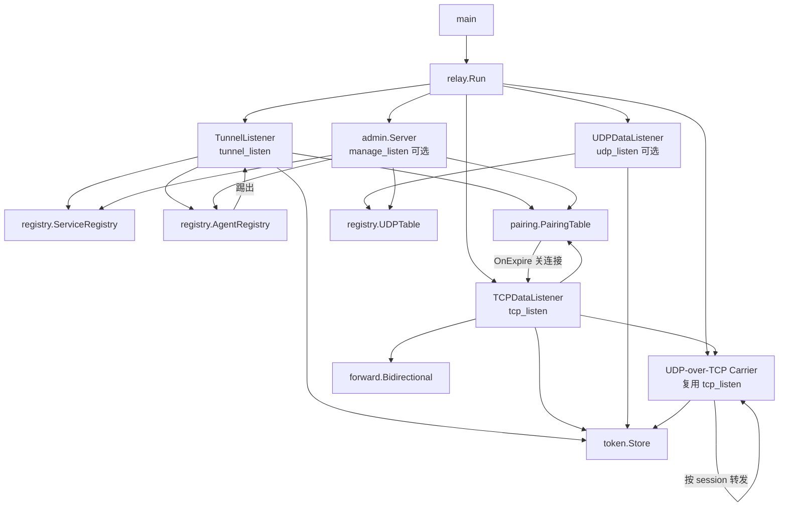
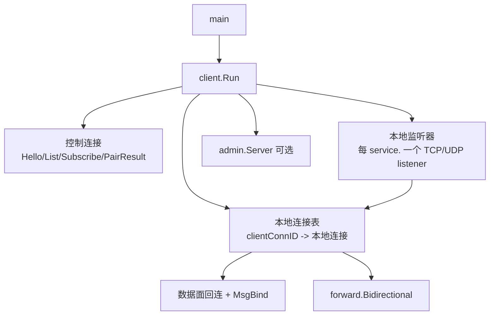

# PairLink 架构说明

> 权威版本。阶段 2 的三个子代理按本文与 `docs/contract.md` 分工实现，不得改动已冻结包。

## 1. 设计目标与边界

- **单二进制三模式**：`-relay` / `-agent` / `-client`，读同一份 ini 的不同段。
- **控制面与数据面严格分离**：控制面跑自定义 JSON 帧信令；数据面是哑管道。
- **鉴权不可绕过**：隧道 `auth_token` + 数据面一次性令牌双重校验；数据面无令牌不放行。
- **本地服务零改造**：agent 连本地目标、client 开本地监听，第三方只看到普通 TCP/UDP。
- **资源清理可靠**：所有清理走"关闭连接 → 转发退出 → 表项删除"既有路径；
  超时清理由单一 ticker 驱动，不产生 per-connection goroutine。
- **不是 P2P**：所有流量经过 relay，relay 掌握配对关系。

## 2. 目录与包职责

| 路径 | 归属 | 职责 |
| --- | --- | --- |
| `main.go` | 阶段1（冻结） | flag 解析、模式选择、config 加载校验、signal context、调用三个 `Run`、Windows 服务子命令 |
| `internal/config` | 阶段1（冻结） | 自写 ini 解析、默认值、按模式校验、`service.<ID>` 有序映射 |
| `internal/logx` | 阶段1（冻结） | `log/slog` 构造、级别/格式、`Component`、文件日志 |
| `internal/protocol` | 阶段1（冻结） | 帧编解码、消息结构体、错误码、版本协商 |
| `internal/token` | 阶段1（冻结） | 一次性配对令牌（SHA-256 存储、常量时间比较、TTL） |
| `internal/pairing` | 阶段1（冻结） | `PairingKey`、`PairingTable`（两侧顺序不确定） |
| `internal/registry` | 阶段1（冻结） | `ServiceRegistry`、`AgentRegistry`、`UDPTable` |
| `internal/forward` | 阶段1（冻结） | `Bidirectional` 半关闭转发、空闲超时包装、ctx 看护 |
| `internal/admin` | 阶段1（冻结） | 管理页框架、统一布局、CSRF、pprof 挂载 |
| `internal/service` | 阶段1（冻结） | Windows SCM 集成（跨平台可编译） |
| `internal/relay` | 阶段2（独占） | relay 全部实现 |
| `internal/agent` | 阶段2（独占） | agent 全部实现 |
| `internal/client` | 阶段2（独占） | client 全部实现 |
| `internal/version` | 阶段4（新增） | 唯一版本号常量（`Version = "v0.5.0"` / `Number = "0.5.0"`），main 与三模式管理页共用 |
| `docs/`、`README.md` | 阶段1（冻结，阶段3 追加验证结果） | 规范与使用说明 |

依赖方向（箭头表示 import）：

```mermaid
graph LR
  main --> config
  main --> logx
  main --> service
  main --> relay
  main --> agent
  main --> client
  relay --> config & logx & protocol & token & pairing & registry & forward & admin
  agent --> config & logx & protocol & token & pairing & forward & admin
  client --> config & logx & protocol & token & pairing & forward & admin
  token --> pairing
  registry --> pairing
  registry --> protocol
```



**禁止反向依赖**：阶段1 包不得 import `internal/relay`、`internal/agent`、`internal/client`。
三个模式包之间也不得互相 import（避免把另一个模式的配置段/状态带进来）。

## 3. 三种模式的进程内对象图

### 3.1 relay



- 三个监听器类型名**固定**：`TunnelListener`、`TCPDataListener`、`UDPDataListener`（spec 第 8 节），
  由阶段 2 在 `internal/relay` 中实现，命名不得改动。
- `TunnelListener` 负责控制面：一连接一 goroutine（读循环）+ 心跳写 goroutine（可选合并到写锁）。
- `TCPDataListener` 每 accept 一个连接就起一个 goroutine：读一帧 Bind → 按 `carrier` 分流：
  - `carrier` 为空/`tcp`：`PairingTable.Claim` → 成功后 `forward.Bidirectional`；
  - `carrier=udp-over-tcp`：校验令牌后把连接转为 UDP 隧道帧解析循环（可复用多个 UDP 会话）。
- `UDPDataListener` 只在配置了 `udp_listen` 时存在，是单 goroutine 读循环 + `UDPTable`；
  不 per-packet 起 goroutine。
- UDP over TCP 模式（未配置 `udp_listen`）不需要 UDP socket：所有 UDP 会话都在
  `tcp_listen` 的连接上以隧道帧复用，relay 按会话标识转发到对端承载连接。
- 管理页的"踢出"先写 `MsgKicked`（让被踢端知道原因，`event=kicked`），再关闭
  `registry.Agent.Control` 或数据连接；会话/表项的清理仍走既有路径，不另写清理逻辑。

### 3.2 agent

```mermaid
graph TD
  M[main] --> AG[agent.Run]
  AG --> CC[控制连接<br/>Hello/Register/Incoming/Heartbeat]
  AG --> HC[心跳 ticker]
  AG --> AD[admin.Server 可选]
  AG --> DP[数据面回连<br/>native UDP socket 或 TCP carrier]
  DP --> FWD[forward.Bidirectional]
  FWD --> LOCAL[本地目标<br/>net.Dial / net.DialUDP]
  AG --> UE[本地 UDP 会话表<br/>map[PairingKey]session]
  AG --> CAR[UDP over TCP 承载连接<br/>udp_mode=tcp_tunnel]
  CAR --> FWD
  AD --> CC
  AD --> UE
```

- 每个 `MsgIncoming` 起一个配对 goroutine（有上限保护），成功后进入转发；结束即退出。
- agent 同时维护多个服务：`cfg.Server.All()` 里的每个服务都注册到控制连接。
- agent 的 UDP 侧需要一个本地会话 map（配对键 → 本地 UDP socket 或 carrier session），
  用 `sync.Mutex` 保护，空闲超时用 `[server] udp_session_timeout`。
- `udp_mode=native`：每个 UDP 配对 `net.DialUDP` 到 `udp_listen`，发 Bind 数据报；
  `udp_mode=tcp_tunnel`：复用一条到 `tcp_listen` 的承载连接，首帧
  `Bind{carrier:"udp-over-tcp"}`，后续会话用 `protocol.WriteUDPTunnelFrame` 复用。

### 3.3 client



- `client_conn_id` **由 client 生成**（决策见 §7.2）；client 维护
  `connID → 本地连接/状态` 表，`MsgPairResult` 到达后取出连接发起数据面绑定。
- 本地监听失败（端口占用）应返回错误而不是静默跳过（阶段 2 决定是否 fatal；建议 fatal）。

## 4. 连接注册表：数据结构与并发保护

### 4.1 服务注册表 `ServiceRegistry`

```go
type ServiceRegistry struct {
    mu       sync.RWMutex          // 读多写少
    services map[string]ServiceEntry // key = service_id
    revision uint64                // 每次变更 +1
    subs     map[int]func(Event)   // 订阅者
    nextSubID int
    now      func() time.Time
}
```

- 读操作（`Get`/`List`/`ListByAgent`/`Revision`/`Len`）持 `RLock`；
- 写操作（`Register`/`Unregister`/`UnregisterAgent`）持 `Lock`，**在锁内**完成 map 变更与
  `revision++`，**在锁外**依次调用订阅回调（避免回调重入死锁）；
- 对外只返回值拷贝（`ServiceEntry` 是值类型，无指针泄漏）；
- `List` 每次按 `ID` 排序后返回新切片，调用方可随意修改。

### 4.2 agent 注册表 `AgentRegistry`

```go
type AgentRegistry struct {
    mu     sync.RWMutex
    agents map[string]*Agent
}
```

- `Add` 存**副本**（含 `Services` 切片深拷贝），调用方后续修改入参不影响注册表；
- `Get`/`List` 返回值拷贝；`Touch`/`SetServices` 持写锁原地更新；
- `Agent.Control` 是 `registry.Conn` 接口（`Close() error` + `RemoteAddr() net.Addr`），
  与 `net.Conn` 解耦，便于测试伪造，也便于管理页踢出。

### 4.3 待配对表 `PairingTable`

```go
type PairingTable struct {
    mu      sync.Mutex
    timeout time.Duration
    now     func() time.Time
    entries map[PairingKey]*entry   // agent/client, createdAt, deadline, completed
    OnExpire func(key PairingKey, side Side, peer any)
}
```

- 单把 `sync.Mutex`：临界区只做 map 操作，不做 IO；
- 时间全部来自 `now()`，测试可注入假时钟；
- **没有 per-entry timer**：超时由调用方单一 ticker 调 `Sweep(now)`；
- `OnExpire` 在锁外调用，用于关闭超时占位的连接；
- 完成的条目保留一个 `timeout` 窗口再被清理，用于拒绝重放（`ErrAlreadyPaired`）。

### 4.4 UDP 会话表 `UDPTable`

```go
type UDPTable struct {
    mu         sync.Mutex
    sessions   map[PairingKey]*udpSession
    byEndpoint map[netip.AddrPort]PairingKey  // 反查索引，O(1)
    now        func() time.Time
}
```

- 双向索引保证"按源地址反查"是 O(1)；`Remove`/`Sweep` 必须同时清理两个索引；
- `netip.AddrPort` 是可比较值类型，天然适合做 map key；IPv4-mapped 地址统一 `Unmap()`；
- 端点是值类型，快照返回拷贝；
- `Sweep(now, timeout)` 返回被清理的配对键，供上层发 `MsgKicked`/写日志。

### 4.5 令牌表 `token.Store`

```go
type Store struct {
    mu      sync.Mutex
    ttl     time.Duration
    now     func() time.Time
    entries map[string]*entry  // key = pairing key string
}
type entry struct { hash [32]byte; issuedAt, expiresAt time.Time; consumed bool }
```

- 只存 SHA-256；`Validate` 用 `subtle.ConstantTimeCompare`；
- `Consume` 幂等；`Sweep` 由单一 ticker 驱动；
- 令牌与配对键强绑定（map 索引即键，摘要必须匹配）。

### 4.6 UDP over TCP 承载表（relay，阶段 2 自建）

未配置 `udp_listen` 时，UDP 数据面复用 `tcp_listen`。阶段 2 的 relay 需要自己维护
（冻结包不提供，因为它不是通用能力）：

```go
type carrierSession struct {
    key       pairing.PairingKey
    agent     *carrierConn // 可为 nil（未报到）
    client    *carrierConn
    full      bool
    agentID   string
    createdAt time.Time
    lastSeen  time.Time
}
type carrierConn struct {
    conn net.Conn
    out  *tunnelqueue.Queue // 阶段 6C：单 writer goroutine + 有界发送队列
}
// session -> carrierSession、carrierConn -> 该连接上的 session 集合
```

- 每 accept 一条 `carrier=udp-over-tcp` 的 TCP 连接，起一个读循环 goroutine + 一个 writer goroutine；
- 每收到一帧：`session` 为空 → 控制帧（`MsgError`/`MsgBindOK`）；非空 → 查会话表转发；
- 写对端承载连接**只入队**（`internal/tunnelqueue`）：读循环绝不因慢对端阻塞；整帧单次
  `Write`；控制帧走独立优先队列；队列满时丢弃并计数（`event=tunnel_drop`，限速 WARN）；
- 承载连接断开时删除其上所有会话登记，对端数据帧因查不到会话被丢弃；
- 会话半开超时用 `pair_timeout`，完整会话空闲用 `udp_session_timeout`。

## 5. goroutine 生命周期与清理规则

| 位置 | goroutine | 退出条件 | 清理动作 |
| --- | --- | --- | --- |
| 控制面连接 | 读循环 + 可选写循环 | 对端关闭 / 读错误 / `heartbeat_timeout` / ctx 取消 / `MsgKicked` | 关闭控制连接、`AgentRegistry.Remove`、`ServiceRegistry.UnregisterAgent`、关闭该 agent 下未完成数据连接、`PairingTable.Remove` |
| TCP 数据面连接 | 读 Bind 帧 goroutine（同步） | 读到帧 / 读超时（`pair_timeout`） | 校验失败即关连接；成功转交 `forward.Bidirectional` |
| 已配对转发 | `forward.Bidirectional` 内 2 个 copy + 1 个 ctx 看护 | 任一侧 EOF（另一侧排空后）/ 异常错误 / ctx 取消 / idle 超时 | 返回前关闭两端；返回后 `PairingTable.Remove(key)`；写日志 |
| 待配对清理 | 1 个 ticker（进程级） | ctx 取消 | 停止 ticker，`Sweep` 收尾 |
| 令牌清理 | 1 个 ticker（进程级，建议 1s） | ctx 取消 | 停止 ticker |
| UDP 数据面（原生） | 1 个读循环 + 1 个清理 ticker | ctx 取消 / 监听关闭 | 停止循环，`UDPTable.Sweep` |
| UDP over TCP 承载 | 每连接 1 个读循环 + 1 个 writer（`tunnelqueue`） | 连接关闭 / 帧非法 / ctx 取消 / 队列关闭 | `Queue.Close()` 先停止入队、排空（上限 2s）后关连接；删除该连接全部会话登记 |
| UDP over TCP 会话 | 不单独起 goroutine（仅表项） | 半开 `pair_timeout` / 空闲 `udp_session_timeout` | 删除表项、通知对端（可选） |
| 管理页 | `net/http` 内部 goroutine | `admin.Server.Shutdown` | `ctx` 取消即 Shutdown（框架已实现） |
| agent/client 心跳 | 每条控制连接 1 个 ticker（重连即重建） | 该连接结束 / ctx 取消 | `serveControl` 等它退出后再换连接（不泄漏） |
| agent/client 重连监督 | 1 个（`Run` 所在 goroutine） | ctx 取消 / 踢出 / 永久错误 | 退避等待可被 ctx 取消；返回即 `Run` 返回 |
| agent 本地 UDP | 每会话 1 个读循环 | 本端/对端关闭 / 空闲超时 | 删除本地会话表项、关闭 socket |

硬性规则：

1. **每个 goroutine 必须有明确的退出信号**（ctx、连接关闭或 ticker stop）。
2. **不在锁内做 IO**，尤其不在持锁时 `Close()` 对端（可能阻塞）。
3. `forward.Bidirectional` 返回即代表两个 copy goroutine 与看护 goroutine 都已退出，
   阶段 2 不得再为同一对连接起后台 goroutine。
4. 清理顺序统一为：**关连接 → 等转发返回 → 删表项**。禁止先删表项再关连接
   （否则新一轮同键报到会与旧连接抢配对）。
5. goroutine 泄漏由测试侧 `go.uber.org/goleak` 兜底（v0.5.0 起）；不再使用
   `runtime.NumGoroutine()` 计数 + 固定容差，`pprof` 仅用于人工排查。

### 5.1 测试策略：goleak 兜底 goroutine 泄漏

v0.4.0 及以前，`internal/{agent,client,relay,forward,tunnelqueue}` 与 `test/`
的用例用 `runtime.NumGoroutine()` 记录基线、轮询等待回落，并允许 `+2` 容差。
这种断言依赖进程内 goroutine 的瞬时快照：`-race` 全量并行时，测试框架、
子进程回收等基础设施的短暂 goroutine 会让计数短暂偏高，已因此误报两次。

v0.5.0 起统一改为 `go.uber.org/goleak`：

- 每个相关测试包在 `TestMain` 里调用 `goleak.VerifyTestMain(m)`，等整包所有
  用例（含 `t.Cleanup` 的 `Run` 关停、监听器关闭、子进程 Kill+Wait）结束后
  再按栈帧判定；不再做数字比较，也没有 `+2` 容差。
- `test/`（顶层 e2e）的 `TestMain` 在 `m.Run()` 之后走同一入口；e2e 有真实
  子进程与监听端口，但 `os/exec.(*Cmd).Wait` 由 `childProc.kill` 的
  `Kill+Wait` 保证结束、产品 `Run` 的 `net/http` goroutine 必须随 Run 退出，
  因此**不添加任何 ignore**。只有确属测试基础设施的 goroutine 才能用
  `IgnoreTopFunction` / `IgnoreAnyFunction` 排除，并必须在代码注释里写明是
  哪个 goroutine、为什么不是产品泄漏。
- 报出 `internal/{relay,agent,client,forward,tunnelqueue}` 栈帧即视为真实
  泄漏，先修产品代码，禁止用 ignore 掩盖。
- 反向验证：临时在用例里 `go func(){ time.Sleep(time.Hour) }()`，`go test`
  应输出 `goleak: Errors on successful test run: found unexpected goroutines`
  且退出码非 0；验证后已删除临时代码。

## 6. 日志字段约定

统一用 `log/slog`（`internal/logx`），**不要自造格式**。Key 固定为：

| key | 类型 | 说明 |
| --- | --- | --- |
| `mode` | string | `relay` / `agent` / `client`（`logx.Config.Mode` 自动附加） |
| `agent_id` | string | relay 分配或对端声明的 agent ID |
| `client_id` | string | relay 分配的 client ID |
| `service_id` | string | 服务ID |
| `pairing_key` | string | `service_id/client_conn_id` |
| `remote` | string | 对端地址 `ip:port` |
| `event` | string | 事件名（稳定，便于检索），见下表 |
| `err` | error | 错误对象（slog 会输出 error 字符串） |
| `component` | string | `logx.Component` 附加，如 `tunnel`/`tcp-data`/`udp-data`/`admin` |
| `detail` | string | 补充信息（配置警告等） |

**SEC-M2 日志卫生（阶段 8C）**：任何**对端可控**的字符串（`MsgHello.client_name`、对端声明的
`agent_id`/`client_name`、`MsgError.code/message/detail`、`MsgKicked.reason`、管理页 `Host`/`Origin`）
写日志前必须经 `logx.CleanN(s, 64)`：替换非法 UTF-8 → `?`、删除 `unicode.IsControl`（含 `\n\r\t\0`）、
按 rune 截断到 64 字符并追加 `…`。这样 1 MiB 的 `client_name` 只会产生一行 < 512 B 的日志，
既防日志放大，也防 `\n` 伪造日志行。**不要**把原始值直接交给 `slog`。

建议事件名（阶段 2 沿用，保持可检索）：

`start`、`exit`、`config_warning`、`admin_start`、`tunnel_accept`、`hello_ok`、`auth_failed`、
`version_mismatch`、`service_register`、`service_registered`、`service_unregister`、`service_list`、
`subscribe`、`service_resync`、`connect_request`、`pair_issue`、`bind_ok`、`bind_fail`、
`pair_complete`、`pair_timeout`、`pair_replay`、`data_addr`、`data_open`、`data_close`、
`idle_timeout`、`udp_session_open`、`udp_session_close`、`udp_evict`、`heartbeat_timeout`、
`kick`、`server_shutdown`、`service_start`、`service_stop`、
`conn_reject`（SEC-D2 超限，5s 限速）、`incoming_drop`（agent 并发通知超限）、
`bind_dup_drop`（重复报到丢弃）、`carrier_read_timeout`（承载半帧读超时）、
`admin_denied`（Host/Origin/CSRF 校验失败）、`admin_action`/`admin_action_failed`（审计）。

日志级别约定：

- `Debug`：逐包/逐帧细节（默认关闭）；
- `Info`：连接建立/注册/通知/配对/断开/踢出等关键事件；
- `Warn`：可恢复异常（配置不完整、令牌校验失败、重放、超时清理）；
- `Error`：不可恢复错误（监听失败、控制连接异常、内部错误）。

## 7. 关键设计决策（spec 第 11 节自由度）

### 7.1 客户端连接 ID 的生成方

**由 client 生成**：`client_conn_id` 为 8 字节 `crypto/rand` 的 hex（16 字符），满足
`[a-z0-9-_]{1,64}`。理由：client 在发起 `ConnectRequest` 前就需要把本地连接与 ID 绑定；
若由 relay 生成，需要多一个信令往返且要处理 ID 分配失败。

### 7.2 relay 侧会话 ID

`agent_id = "a-" + 16 hex`，`client_id = "c-" + 16 hex`，由 `crypto/rand` 生成。
仅用于日志、注册表与管理页展示，不参与鉴权。

### 7.3 管理页 HTML 组织

`internal/admin` 提供统一布局（内联 CSS、utf-8、顶栏 mode/version/运行时长、刷新开关）与页面
注册机制；每个模式只写主体 HTML（`<section>` 片段），不重复写 `<html>`。
写操作只有 `Action`（默认 POST + 一次性 CSRF 令牌），第一阶段唯一写操作是 relay 的踢出。

**v0.5.0 渲染层（html/template）**：布局、索引页与三种模式的页面主体全部改为
`html/template` 预编译（`template.Must`，解析失败启动期即 panic），不再用
`fmt.Fprintf` + 手写 `EscapeString` 拼串。约定：

- 框架值（标题/模式/版本/运行时长/刷新开关/导航/提示条）与页面数据（服务 ID、`tcp/udp:host:port`
  端点、客户端连接 ID、错误信息）一律作为普通 `string`/`bool` 传入模板，由上下文感知转义处理
  （HTML 文本、属性、URL 各按上下文改写）；**只有页面主体本身**允许 `template.HTML`。
- 整页先渲染到 `bytes.Buffer`，成功后才 `WriteHeader(200)+Write`；渲染失败回 500 并记
  `event=admin_render_failed`，不会写出半截页面（`Server.WritePage`）。
- "页面是否含表单"由页面数据实现 `admin.FormReporter`（`ShowForms() bool`）报告，或由
  `admin.Page.ShowForms` 提供；**不再扫描生成后的 HTML**（旧实现用 `bytes.Contains("<form")`）。
- `WriteHTML`/`CSRFInput`/`NoticeBar` 保留为兼容入口（各模式页面在迁移前使用）。

**P1-2 刷新策略**：只读页默认 `1s` 自动刷新；**可写实例或页面正文含表单时默认暂停**
（否则整页重载会清空正在输入的表单），顶栏链接 `?refresh=1` 恢复、`?refresh=0` 强制关闭。

**SEC-M1 写 Action 门禁**（`internal/admin/guard.go`）：在任何写 Action 执行前校验
`Host` ∈ {`127.0.0.1[:port]`, `[::1][:port]`, `localhost[:port]`}，且 `Origin`（若存在）
必须等于 `http://` + 同一 Host；失败回 403 并记 `admin_denied`。所有响应（含 404）统一加
CSP `default-src 'none'; style-src 'unsafe-inline'; form-action 'self'; frame-ancestors 'none'`、
`X-Frame-Options: DENY`、`X-Content-Type-Options: nosniff`、`Referrer-Policy: no-referrer`、
`Cache-Control: no-store`。`/debug/pprof/*` 单独放宽 `script-src 'unsafe-inline'`/`img-src`
（否则 pprof 图表不可用），业务页面策略不变。这层与"manage_listen 必须回环"共同构成管理页边界（没有账号体系）。

### 7.4 令牌与超时策略

默认 `token_ttl=15s`、`pair_timeout=10s`、`idle_timeout=300s`、`udp_session_timeout=60s`、
`heartbeat_timeout=90s`；均可通过 ini 覆盖。UDP 的令牌复用语义见 `docs/protocol.md` §5.2。

### 7.5 日志输出与 Windows 服务

- 前台模式：stdout/stderr（slog text/json）。
- Windows 服务模式：日志落到 **exe 同目录的 `pairlink-<mode>-YYYY-MM-DD.log`**
  （`service.LogPath` 只给基名 `pairlink-<mode>.log`，`internal/logx` 追加**本地日期**后缀；
  写入时发现日期变化就切文件）。
- **命名与清理规则（v0.5.0）**：`<base>-YYYY-MM-DD<ext>`（无扩展名时不加点）；
  `[common] log_keep_days`（默认 7，0 = 永久保留，负数校验失败）控制启动与每次切文件时
  对**同目录、同基名、严格匹配 `<base>-YYYY-MM-DD[.ext]`** 且日期早于 `today - keepDays`
  的日文件清理（不同基名/无日期/格式非法/同名目录绝不删），删除失败只 WARN；
  清理失败 WARN 走独立 handler 直达文件（slog handler 在 Write 期间持锁，不能在 Write
  里回调同一 logger）。各包内 `logx.New` 的日志经 `logx.SetDefaultOutput` 指向同一日文件，
  不再重定向 `os.Stderr`/`os.Stdout`（代价：panic 栈等裸 stderr 输出不落盘）。

### 7.6 TLS 策略（阶段 6G：E7 显式开关）

TLS 是否启用由**三层**决定，优先级从高到低：

1. **显式 `tls` 开关**：`[relay]` / `[server]` / `[client]` 各一个，取值 `auto`（默认）|
   `true`（强制 TLS）| `false`（强制明文）；大小写不敏感，只接受这三个字面量
   （`on` / `yes` / `1` 等一律启动校验失败）；
2. **`auto` 时按材料推断**：完全复刻阶段 1~6 的旧行为；
3. **校验材料**（`tls_cert`/`tls_key`、`tls_ca`、`tls_insecure_skip_verify`）只在允许 TLS 时生效。

#### relay 监听侧

| `tls` | 证书材料 | 结果 |
| --- | --- | --- |
| `auto`（默认） | `tls_cert` + `tls_key` 均非空 | `tls.Listen`（TLS 1.2+） |
| `auto` | 都为空，且监听**非回环** | **启动校验失败**（SEC-T2：必须配置证书或显式 `tls = false`） |
| `auto` | 都为空，且监听回环 | 明文 + WARN（仅本机调试） |
| `auto` | 只有一个 | 明文 + WARN（必须成对）；非回环时同样是**启动校验失败** |
| `true` | `tls_cert` + `tls_key` 均非空 | `tls.Listen`（TLS 1.2+） |
| `true` | 任一为空 | **启动校验失败**（配置错误，提示补 `tls_cert`/`tls_key`） |
| `false` | 任意（含已配证书） | 明文；配了证书则 WARN（"证书被忽略"） |

文件不存在仍只 WARN（允许先写配置后拷证书），但 `true` 时路径**必须非空**。

#### agent/client 拨号侧

| `tls` | `tls_ca` | `tls_insecure_skip_verify` | 结果 |
| --- | --- | --- | --- |
| `auto`（默认） | 空 | false | **明文** |
| `auto` | 非空 | false | TLS，`RootCAs` 只含该 CA |
| `auto` | 空 | true | TLS，跳过校验 + WARN |
| `auto` | 非空 | true | TLS，`RootCAs` 只含该 CA 且跳过校验 + WARN |
| `true` | 非空 | false | TLS，`RootCAs` 只含该 CA |
| `true` | 空 | false | TLS，**`RootCAs = nil`（系统根证书）**，标准校验 |
| `true` | 任意 | true | TLS，跳过校验 + WARN（`tls=true` 时开关多余，但仍生效） |
| `false` | 任意 | 任意 | **明文**；配了材料则 WARN（`tls_ca` / insecure 被忽略） |

- `ServerName` 始终取 `relay_addr` 的 host，证书必须包含该主机名或 IP SAN。
  **公网 CA 场景的安全写法**：relay 用公网证书，agent/client 只写 `tls = true`（不配 `tls_ca`），
  由系统根证书完成标准校验，不需要也不应该打开 `tls_insecure_skip_verify`。
- 两侧配置不匹配（relay 明文而 agent/client TLS，或反之）→ TLS 握手失败（relay 侧表现为
  读帧失败），agent/client 的 `Run` 返回可读错误并退出；TLS 握手失败按永久错误处理（不重连），
  不做协议探测/自动降级。
- 数据面 TLS 由 `data_tls` 三态控制（阶段 8D / SEC-T1，见下一节）：默认跟随隧道判定，
  TCP 数据面（含 `MsgBind`/`pairing_token`/业务字节/udp-over-tcp 承载）复用隧道证书；
  原生 UDP 仍是明文（无 DTLS）。端到端加密仍由第三方协议自己完成。
- **SEC-A1**：`auth_token` 为空时只允许回环来源接入（`127.0.0.0/8`/`::1`），非回环回
  `auth_failed`；非回环 `tunnel_listen` + 空 token 启动校验失败。比较用 SHA-256 + 常量时间。
- **SEC-T2**：`auto`/未写 + 非回环 `tunnel_listen` + 无成对证书 = 启动失败，错误信息明确给出
  "配置证书"或"显式 `tls = false` 承担明文风险"两个选项；回环监听保持 WARN。
- agent/client 的 `auto` 无 CA 明文路径会 WARN："当前明文连接 relay；公网部署请 tls = true"。
  这是刻意的可见降级，不能静默。

#### 数据面 TLS 连接建立路径（阶段 8D / SEC-T1）

```
relay 启动:
  prepareTLS()
    tunnelTLS = tls=true || (auto && cert+key)
    dataTLS   = auto ? tunnelTLS : data_tls
    tlsCfg    = 证书 + MinVersion 1.2（隧道与数据面共用）
  tcp_listen → plain listener 或 tls.Listen(tlsCfg)
  HelloOK{data_tls: dataTLS}（始终下发，含 false）

agent/client 握手:
  tls 决定隧道（auto/true/false，沿用 §7.6）
  HelloOK.data_tls:
    auto  → 跟随（nil = 旧 relay → 明文 + WARN）
    true  → 必须 TLS；nil/false → permanent error
    false → 强制明文；true → permanent error
  dataTLSCfg = config.ClientTLSConfig(tls_ca, insecure, host)（与隧道同一份）

数据面拨号:
  tcpDataAddr（HelloOK.tcp_data_port）
  dataTLS ? tls.Client(handshake, MinVersion 1.2) : 裸 TCP
  → MsgBind 报到 / 业务字节 / udp-over-tcp 承载帧都在同一 TLS 连接内
```

- relay 的 accept 循环不做握手（`tls.Listener` 语义），明文连接在 `handleDataConn` 首次读帧时
  握手失败 → 关闭并 WARN `event=data_plane_tls_handshake_fail`；该日志是"旧端连新 relay"的
  主要诊断信号。
- 原生 UDP（`udp_mode = native`）不受 `data_tls` 影响，仍是明文（无 DTLS）；需要加密 UDP
  时应使用 `udp_mode = tcp_tunnel`，其承载帧随 TCP 数据面 TLS 一起加密。
- 归属状态来源（SEC-A2）：在线 owner 取 `ServiceRegistry`（`AgentID`）；在线判定取
  `AgentRegistry.Get` + 心跳判死；最近归属取 `ServiceRegistry.recent`（注销/换主时记录，
  容量 1024、最旧淘汰）。三者都在 relay 内存中，重启即丢失（与既有内存态语义一致）。

> **兼容性**：默认 `auto` 与阶段 6 之前 100% 一致，旧 ini 不改一个字也能跑。
> 注意 `auto` 下"没配 `tls_ca` = 明文"仍是历史行为；新部署建议显式写 `tls = true`，
> 让"漏配 CA 静默降级为明文"不再可能发生（`tls = true` 时用系统根证书或直接失败）。


### 7.7 UDP 数据面承载模式

`[relay] udp_listen` 是**可选**的，由此产生两种模式（由 relay 判定并下发 `udp_mode`）：

| 模式 | 触发条件 | 数据面 | 优点 | 缺点 |
| --- | --- | --- | --- | --- |
| `native` | 配置了 `udp_listen` | 原生 UDP 数据报 | 无队头阻塞、延迟最低 | 公网多开一个 UDP 端口 |
| `tcp_tunnel` | 未配置 `udp_listen` | 复用 `tcp_listen` 的 TCP 承载连接，UDP 隧道帧复用多个会话 | 少一个公网端口，穿透只放行 TCP 的防火墙更容易 | **队头阻塞**：一条 TCP 上的丢包/阻塞会拖慢所有复用会话；实时语音/游戏等敏感场景应配置 `udp_listen` |

- 两种模式的令牌、配对键、超时语义一致；agent/client 根据 `HelloOK` / `ServiceRegistered` /
  `ServiceList` 的 `udp_mode` 选择接入方式。
- 阶段 2 的 relay 在启动时派生模式：
  `if cfg.Relay.UDPListen != "" → native else tcp_tunnel`。
- `UDPTable` 只用于 `native`；`tcp_tunnel` 的会话表由 relay 自己维护（见 §4.6）。

### 7.8 运行期健壮性（阶段 6C）

| 机制 | 位置 | 要点 |
| --- | --- | --- |
| 控制连接自动重连 | `internal/agent/reconnect.go`、`internal/client/reconnect.go`、`internal/reconnect` | `[server]/[client] reconnect`（默认 true）；base 1s ×2、cap `reconnect_max_backoff`（默认 60s）、±20% 抖动；等待可被 ctx 取消；重连后重新 Hello + 重注册/重拉列表 + 重建心跳；重连期间关闭在途会话（`reason=reconnect`），不做迁移；踢出/停机/鉴权失败/版本不匹配/TLS 握手失败不重连 |
| 订阅 proto 热切换 | `internal/client/listener.go` | 关旧监听 → 原地址按新协议重开；失败则回滚旧协议（本地服务不消失）；在途连接不受影响；`service_missing` 的 TCP 占位在服务出现后被热切换纠正 |
| 承载连接发送队列 | `internal/tunnelqueue` | 单 writer goroutine + 有界队列（数据 1024 帧 / 8 MiB，控制 256 帧且优先）；读循环只入队；整帧单次 Write；入队即复制 payload；满则丢弃并限速 WARN（`event=tunnel_drop`）；关闭时先停止入队再排空（上限 2s）后关连接 |
| 原生 UDP 报到重传 | `internal/agent/data.go`、`internal/client/session_udp.go`、`internal/relay/udp_data.go` | 每 ~300ms 重发 Bind（最多 3 次）；relay 半开幂等重复回 BindOK；Full 后丢弃同一配对键的重复 Bind 帧（帧头嗅探，其余数据报不解析） |

重连的退出语义：只有 ctx 取消（返回 nil）、`MsgServerShutdown`（nil）、`MsgKicked` /
鉴权失败 / 版本不匹配 / TLS 握手失败 / `reconnect=false` 下的断开（返回错误）会结束 `Run`；
其余断开都进入退避重连，进程保持存活。

### 7.9 管理页动态配置（阶段 7）

**门禁**：`internal/admin` 在 `New(addr, …)` 时用 `IsLoopbackListen(addr)` 计算 `Writable`：
只有 `127.0.0.0/8`、`::1`、`localhost` 才允许写；非回环时布局渲染只读红条，
所有 `/action/*` 在方法校验之后直接 403，CSRF 不消费、Handler 不执行。

**写请求的统一路径**（三种模式一致）：

```
POST /action/<name> + 一次性 CSRF
  → 门禁（非回环 403）
  → OnlyPostFields 白名单（未知字段 400）
  → 严格值校验（duration>0 / service_id 正则 / host:port / 长度≤256）
  → 持久化 config.PatchValue / DeleteKey（同目录临时文件 + Rename 原子替换）
  → 成功后更新运行时（relay 五参数）或先改运行时再持久化（agent/client 事务式流程）
  → 审计日志 event=admin_action
  → 303 回本页 ?ok=<msg>（失败 ?err=<msg>）
```

顺序取舍：

- relay 五个参数：**先写 ini，成功才改运行时**；写盘失败时运行时保持原值并报
  "运行时未改变"，避免"只改了一半"。
- agent：先改运行期服务表 → 向 relay 注册/注销并等确认（3s）→ 成功才写 ini；
  relay 拒绝/超时回滚内存；写 ini 失败回滚内存并尽力反向注册/注销。
- client：先开关/切换监听 → 成功才写 ini；写盘失败关闭新监听、恢复旧监听与映射。

**ini 读写与原子性**（`internal/config/ini.go`、`patch.go`）：

- 解析与写回都走 `gopkg.in/ini.v1`（v0.5.0 起，见 `docs/contract.md` §3.10）：
  键名/段名大小写不敏感、只支持整行注释（值里的 `;`/`#` 属于值）、未知键按 `Validate` 报错。
  写回是"读整份 → `SetValue`/`DeleteKey` → 原子替换"，因此**注释与原有排版会归一**
  （这是有意的取舍：不再维护行级补丁，换来更可靠的解析与更少的自研代码）。
- 进程内包级 `patchMu` 串行化，HTTP handler 并发写同一 ini 不会互相覆盖；
  跨进程（编辑器/另一实例）不在保证范围，可能后写覆盖先写。
- 原子写：`os.CreateTemp`（同目录）→ 写入 → `Sync` → `Chmod` → `Close` → `os.Rename`
  → **父目录 `fsync`**（`patch_unix.go`；Windows 无此语义，`patch_windows.go` 空实现）；
  任一步失败删除临时文件，原文件保持完整。
- 参数校验拒绝含换行/方括号的段名与含换行的键/值，防止行注入。

**审计字段**（`internal/admin/notice.go`）：`event=admin_action`、`remote`、`action`、
`target`、`old`、`new`（值截断到 200 字符并去掉控制字符）；被门禁拒绝记
`event=admin_action_denied`，失败记 `event=admin_action_failed`。不含令牌/密钥。

**协议**：agent 增删服务新增 0x13/0x14（`docs/protocol.md` §4.15），不升版本；
`agent.controlConn` 用"单在途请求 + 确认通道"把 relay 的注册/注销确认从 `controlLoop`
交给管理页 goroutine（`agent.regMu` 串行化），控制连接关闭/重连时唤醒等待方并回滚。

### 7.10 安全边界与阶段 8C 的限流/配额

**帧长度**（SEC-D1/P0-1）：网络入口统一 `ReadFrameWithLimit(conn, NetworkPayloadLimit=64 KiB)`；
`ParseFrameLimit(data, limit)` 只用于"已完整读入内存的 UDP 数据报"，要求声明长度 == 实际长度；
`MaxPayload=1 MiB` 只用于 `EncodeFrame` 等内存路径。对端用 5 字节帧头声明大长度不会触发分配。

**连接/配额**（SEC-D2，`internal/relay/connlimit.go`、`internal/agent/control.go`）：

| 限制 | 默认 | 作用点 | 超限行为 |
| --- | --- | --- | --- |
| `max_conns` | 1024 | 隧道 accept + TCP 数据面 accept | 立即 `Close`，WARN `conn_reject`（5s 限速） |
| `max_conns_per_ip` | 128 | 同上（按 `remoteHost` 归一） | 同上 |
| `max_pending_pairs` | 4096 | `ConnectRequest`（配对占位 `pairs.Len()` + 未消费令牌 `tokens.Len()`） | `MsgError{code:"too_many_pending"}` |
| 单连接未完成请求 | 64 | `tunnelConn.pending`（按配对键占用，消费/超时释放） | `too_many_pending` |
| agent 并发 `MsgIncoming` | 256 | `agent.incomingSem` | 丢弃通知，WARN `incoming_drop` |
| 承载帧读超时 | `max(30s, 2×udp_session_timeout)` | `carrierConn.readLoop` 逐帧 deadline | 关连接 + 清理该连接全部会话（SEC-M4） |

**日志限速**：`conn_reject`、UDP 鉴权失败 `bind_fail` 均 5 秒最多一条 WARN（其余降 Debug），
避免未认证流量放大日志（P2-1/P2-2）。

**阶段 8C/8D 的安全边界**（详见 README §10.1，`docs/review-security.md` 顶部）：

| 编号 | 风险 | 状态 | 说明 |
| --- | --- | --- | --- |
| SEC-T1 | 数据面（TCP）无 TLS，公网明文 | **已修复（v0.4.0）** | `data_tls` 三态，TCP 数据面复用隧道证书与 TLS 1.2；原生 UDP 的加密见 SEC-D3 |
| SEC-A2 | 服务名先注册者得，可被抢占 | **已修复（v0.4.0）** | `service_allow` 白名单 + `max_services_per_agent` + 在线归属/离线接管；未配白名单仅 WARN |
| SEC-D3 | 原生 UDP 会话可被源地址伪造/抢注 | **已修复（v0.5.0）** | 原生 UDP 默认 DTLS-PSK（`udp_dtls = true`，HKDF(auth_token) 派生，pairing_key 作 identity），无 `auth_token` 者无法握手；详见 §7.11 |

### 7.11 原生 UDP 的 DTLS 数据面与按 IP 限速（v0.5.0）

**DTLS-PSK（SEC-D3）**：`[relay] udp_listen` 配置且 `udp_dtls = true`（默认）时，原生 UDP
数据面的外层是 DTLS 1.2 + PSK，内层仍是原帧格式与 `MsgBind` 鉴权。

- **单 socket、多对端**（`internal/relay/udp_dtls.go`）：一个 `net.UDPConn` 由唯一读循环
  `ReadFromUDP`；按源地址查 `peers[addr]`，投递到该对端的报文队列（`packetio.Buffer`，
  上限 32 个数据报，满则丢弃——UDP 语义允许丢包，绝不阻塞读循环）。每个对端一个虚拟
  `net.PacketConn`（`ReadFrom` 返回固定对端地址、`WriteTo` 忽略地址、deadline 只作用于本对端），
  交给 `dtls.Server` 完成握手。对端表有全局上限 4096，空闲 1s 粒度清理。
- **首包预筛**：只看 13 字节 DTLS 记录头（content type 20–23 + 版本 `0xFEFC/FEFD/FEFF`），
  v0.4.0 明文端与随机垃圾不会为每个数据报建一个"握手中的对端"（每个对端一个 goroutine）。
  预筛不是安全判断，伪造记录头仍会进入握手，由 PSK 决定成败。
- **密钥**：`PSK = HKDF-SHA256(ikm=auth_token, salt=nil, info="pairlink-udp-dtls/v1|"+pairing_key)`，
  32 字节；PSK identity = `pairing_key`。派生实现集中在 `internal/udpdtls`（三端共用一份，
  参数改动会让三端一起变，不会出现"只改一端"的握手失败）。relay 的 `PSK` 回调对 identity 做
  `pairing.ParsePairingKey` 校验，非法即返回错误（**绝不回退到全局/默认密钥**）。
  因此持有 `auth_token` 是完成握手的必要条件，也就同时挡住了会话抢注与数据报注入。
- **agent/client 侧**（`internal/{agent,client}/udp_dtls.go`）：对 relay UDP 端口建
  `dtls.Client`，把原 socket 包成 `net.PacketConn`；握手完成后走原有帧收发路径，
  断开按现有会话清理回收。
- **重放与 MTU**：依赖 DTLS 记录层的抗重放窗口；DTLS 记录受路径 MTU 约束，
  大数据报会 IP 分片（丢一片即整报丢失），需要大报文用 `udp_mode = tcp_tunnel`。
- **可观测**：握手失败 `event=udp_dtls_handshake_fail`（5s 限速 WARN）、
  `udp_dtls = false` 启动 WARN `event=udp_dtls_disabled`、对端达上限 WARN。

**按 IP 签发限速**（`internal/relay/tunnel.go` + `internal/config`）：`token_rate_per_ip`
（默认 10/s）与 `token_burst_per_ip`（默认 30）用 `golang.org/x/time/rate` 做**按来源 IP**
的令牌桶；超限不签发配对令牌并记 `event=token_rate_limited`（限速 WARN）。限速器表按最后一次
使用时间过期清理，随 relay 的 sweep 循环回收，不会无界增长。`token_rate_per_ip = 0` 关闭限速。

## 8. 可观测性

- `[common] pprof = true` 时在 `manage_listen` 挂 `/debug/pprof/`（`internal/admin` 已实现，
  使用独立 mux，不污染 `DefaultServeMux`）。生产环境建议关闭或只监听 `127.0.0.1`。
- 管理页展示运行时长；阶段 2 页面应展示注册表/配对表/会话表快照（`Snapshot`/`List`）。
- goroutine 泄漏排查：`curl http://127.0.0.1:9000/debug/pprof/goroutine?debug=1`，
  或阶段 3 的 `runtime.NumGoroutine` 对比。
