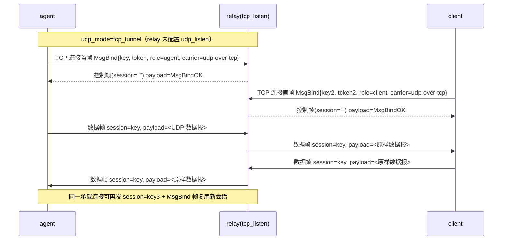
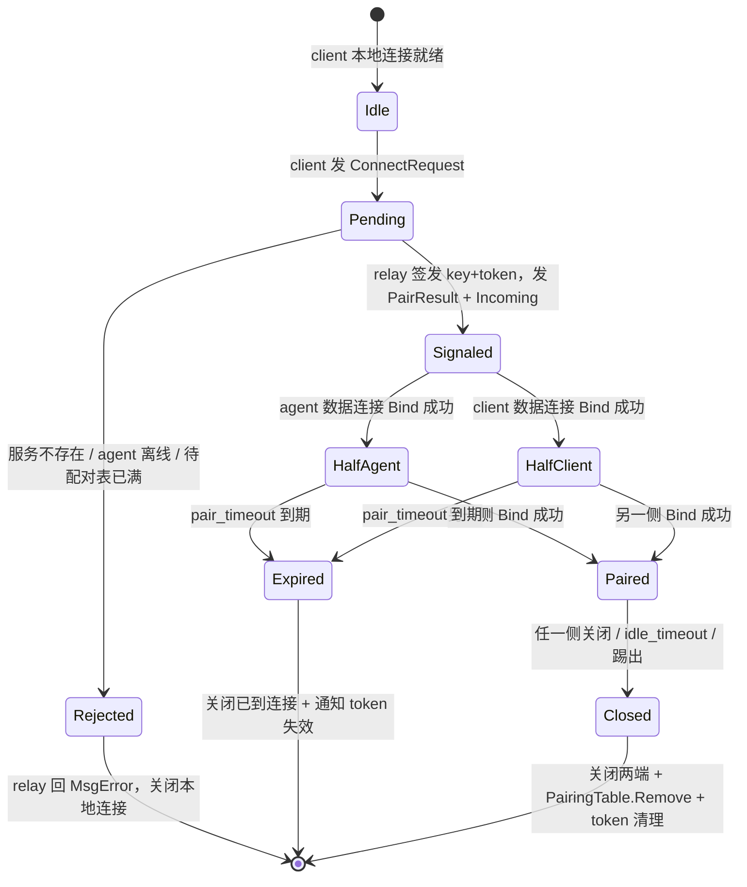
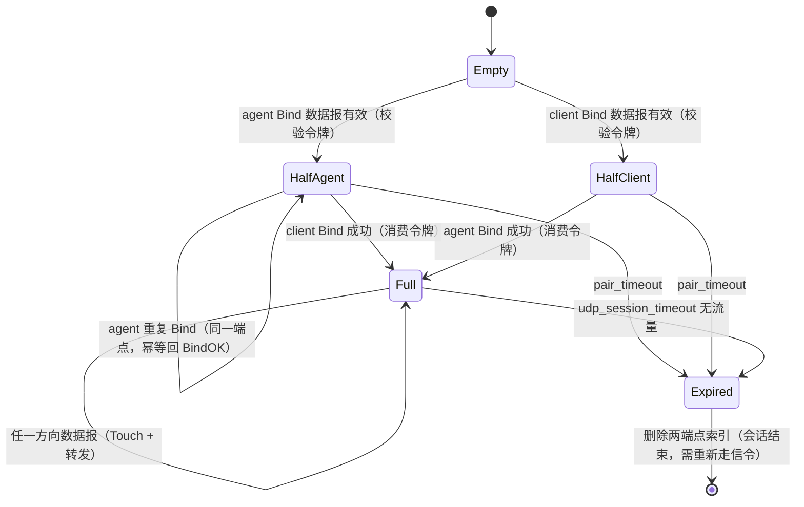
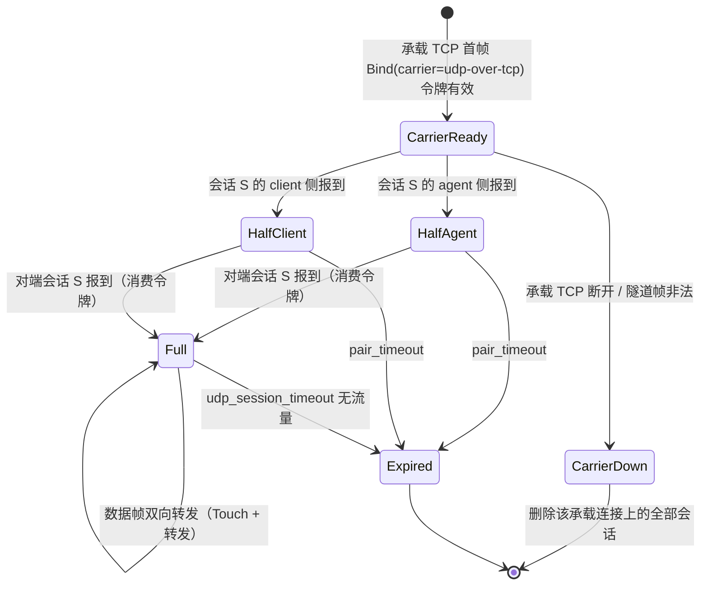
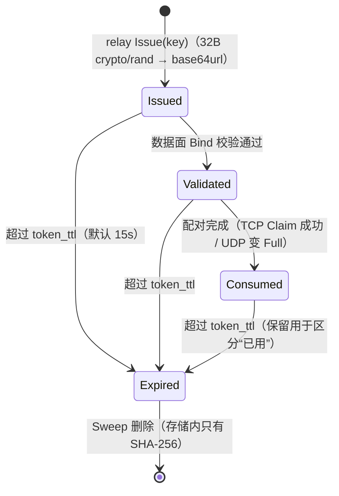
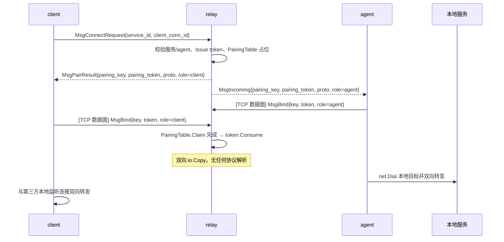

# PairLink 隧道协议规范

> 本文是**权威线格式文档**。阶段 2 的 relay / agent / client 必须与本文一致；
> 任何字段或语义变更都属于契约变更（见 `docs/contract.md`）。
>
> 实现位置：`internal/protocol`（帧编解码与消息结构体，已冻结）。

## 1. 分层与两条通道

| 通道 | 端口配置 | 传输 | 内容 |
| --- | --- | --- | --- |
| 控制面（隧道） | `[relay] tunnel_listen` | TCP（建议 TLS） | 全部信令消息，见第 3 节 |
| TCP 数据面 | `[relay] tcp_listen` | TCP 裸字节流 | 建立瞬间 1 帧 `MsgBind`，之后纯透传 |
| UDP 数据面（原生） | `[relay] udp_listen`（可选） | UDP 数据报 | 首个数据报是 `MsgBind` 帧，之后纯透传 |
| UDP over TCP | 复用 `[relay] tcp_listen` | TCP + UDP 隧道帧 | 没有 `udp_listen` 时，UDP 数据报封装在 TCP 连接中 |

控制面与数据面**端口分离、职责分离**：数据面 relay 不解析任何上层协议（HTTP/SSH/RDP…），
只在 TCP 连接建立瞬间读取恰好一帧报到消息。

UDP 数据面承载模式由 relay 决定并通过 `udp_mode` 下发：

- `udp_mode = native`：配置了 `[relay] udp_listen`，UDP 数据面直接走原生 UDP 端口；
- `udp_mode = tcp_tunnel`：未配置 `udp_listen`，不监听 UDP 端口，UDP 数据报封装在
  `tcp_listen` 的 TCP 连接中（UDP over TCP，见 §2.1）。

## 2. 帧格式

所有信令消息与数据面报到消息共用同一种帧，称为 **PairLink 帧**：

```
 0        1                                5                         5+n
 +--------+--------------------------------+-------------------------+
 | type   | payload_len (uint32, big-endian)| payload (UTF-8 JSON)    |
 +--------+--------------------------------+-------------------------+
   1 byte              4 bytes                     n bytes
```

| 字段 | 长度 | 说明 |
| --- | --- | --- |
| `type` | 1 字节 | 消息类型，见第 3 节；`0x01`..`0x14` 已定义 |
| `payload_len` | 4 字节 | 大端无符号整数，payload 字节数 |
| `payload` | n 字节 | JSON 对象（UTF-8）；空消息可为 0 字节或 `{}` |

约束（`internal/protocol` 已强制）：

- **内存上限** `payload_len` 上限 **1 MiB**（`protocol.MaxPayload`），超限立即返回
  `ErrPayloadTooLarge`，不分配对应内存，防内存放大。
- **网络入口上限 64 KiB**（`protocol.NetworkPayloadLimit`）：隧道控制面、TCP/UDP 数据面
  报到帧、agent/client 控制连接一律用 `ReadFrameWithLimit(r, NetworkPayloadLimit)` 读取，
  远小于 `MaxPayload`。对端只发 5 字节帧头声明 1 MiB 时，读取方在**读完帧头后立即**
  返回 `ErrPayloadTooLarge` 并关闭连接，不会按声明长度预分配（SEC-D1 / P0-1）。
  `MaxPayload` 仅用于 `EncodeFrame`（内存编码）等非网络入口。
- **UDP 数据报用 `ParseFrameLimit(data, limit)`**：先要求 `len(data) >= 5`，再要求
  「`payload_len` 与数据报实际剩余字节数**完全相等**」，任何截断/多帧拼接都返回
  `ErrFrameLengthMismatch`（或超限时的 `ErrPayloadTooLarge`）；校验通过后才切出 payload
  （零拷贝子切片）。网络数据报**禁止**直接用 `ParseFrame`，否则 5 字节数据报声明
  1 MiB 就能触发内存放大。
- 写帧使用**单次 `Write`**（帧头与负载拼在一个 buffer 中），避免并发写导致帧交错。
- 读帧先读 5 字节帧头，校验长度后再分配负载。
- 未知 `type` 在帧层**不报错**（前向兼容），由 `protocol.Decode` 返回 `ErrUnknownType`；
  阶段 2 的默认处理是：控制面收到未知类型 → 记日志并忽略（或回 `bad_request` 后关闭）；
  数据面首帧不是 `MsgBind` → 直接关闭/丢弃。
- JSON 字段名统一小写下划线；未列出的字段必须忽略（前向兼容），不得因未知字段报错。

### 2.1 UDP over TCP 隧道帧（仅 `udp_mode = tcp_tunnel`）

当 relay 没有配置 `udp_listen` 时，UDP 数据面复用 TCP 数据面连接。连接通过
`MsgBind{carrier:"udp-over-tcp"}` 完成首帧报到后，relay 把该连接**从纯透传切换为
UDP 隧道帧解析模式**；此后该 TCP 连接上传输的就是 UDP 隧道帧，可以复用多个 UDP 会话：

```
 0                    4          5                5+s              5+s+n
 +--------------------+----------+----------------+----------------+
 | len (uint32, BE)   | sess_len | session (ASCII) | payload        |
 +--------------------+----------+----------------+----------------+
        4 bytes          1 byte        s bytes          n bytes
```

| 字段 | 长度 | 说明 |
| --- | --- | --- |
| `len` | 4 字节 | 其后字节数：`1 + s + n`；范围 `1..MaxUDPTunnelFrameLen`（65665） |
| `sess_len` | 1 字节 | 会话标识长度 `s`（0..129）；**读侧同样校验**，`s > 129` 返回 `ErrBadUDPTunnelFrame` 并关闭承载连接 |
| `session` | s 字节 | 会话标识 = 配对键 `"serviceID/clientConnID"`；**空串表示控制帧** |
| `payload` | n 字节 | 数据报字节（n ≤ 65535）；控制帧时是一个完整 PairLink 帧 |

约束：

- `protocol.WriteUDPTunnelFrame(w, session, payload)` / `ReadUDPTunnelFrame(r)` 是唯一编解码入口；
  写帧同样单次 `Write`，避免多 goroutine 交错。
- `session` 必须与 relay 当前配对表/会话表里的配对键完全一致；relay 收到非法/未知会话的数据帧
  直接丢弃并记日志。
- 控制帧（`session=""`）的 payload 是一个完整 PairLink 帧：`MsgBindOK`（承载连接/会话就绪）
  或 `MsgError`（报告单个会话的错误而不中断整条承载连接）。
- TCP 连接是字节流：一个帧可能被拆到多次 `Read`，实现必须用 `io.ReadFull` 语义读取。
- 一条承载连接上可同时存在多个会话；relay 按 `session` 分别转发到对端的承载连接。
- 单帧上限 65665 字节（129 字节会话标识 + 65535 字节数据报 + 1 字节长度），
  超限视为协议错误并关闭该承载连接（防内存放大）。
- 写侧推荐（阶段 6C 起三端统一）：**单 writer goroutine + 有界发送队列**，读循环只入队，
  绝不因慢对端阻塞；控制帧（`session=""`）走独立的优先队列，避免被数据洪泛饿死；
  队列满时按策略丢弃并计数（`event=tunnel_drop`，限速 WARN），关闭时先停止入队、
  排空（有上限）再关连接。帧仍必须**整帧单次 `Write`**，不得拆帧或与其它 goroutine 交错。
- **帧头属于 PairLink 封装，不违反"数据面不解析上层协议"原则**：UDP 数据报的字节原样
  作为 payload，不解析其内容。唯一的例外是原生 UDP 的重复报到检测：只嗅探 5 字节帧头
  判断"是不是同一配对键的 MsgBind 帧"（见 §5.2.1 第 4 条）。

## 3. 消息一览

| type | 名称 | 方向 | 用途 |
| --- | --- | --- | --- |
| `0x01` | `MsgHello` | agent/client → relay | 接入，声明角色、token、协议版本 |
| `0x02` | `MsgHelloOK` | relay → agent/client | 接入成功，分配 ID 与心跳建议 |
| `0x03` | `MsgRegisterService` | agent → relay | 注册服务 |
| `0x04` | `MsgServiceRegistered` | relay → agent | 注册确认 |
| `0x05` | `MsgListServices` | client → relay | 查询服务列表 |
| `0x06` | `MsgServiceList` | relay → client | 服务列表 + revision |
| `0x07` | `MsgSubscribe` | client → relay | 订阅/取消订阅服务变更 |
| `0x08` | `MsgServiceEvent` | relay → client | 服务变更推送 |
| `0x09` | `MsgConnectRequest` | client → relay | 请求接入某服务 |
| `0x0A` | `MsgPairResult` | relay → client | 下发配对键 + 一次性令牌 |
| `0x0B` | `MsgIncoming` | relay → agent | 接入通知（配对键 + 令牌） |
| `0x0C` | `MsgBind` | agent/client → relay | 数据面报到（TCP/UDP 通用） |
| `0x0D` | `MsgBindOK` | relay → agent/client | UDP 报到成功应答；**TCP 不发** |
| `0x0E` | `MsgHeartbeat` | 双向 | 心跳 |
| `0x0F` | `MsgHeartbeatAck` | 双向 | 心跳应答 |
| `0x10` | `MsgError` | 双向 | 错误响应 |
| `0x11` | `MsgKicked` | relay → agent/client | 被管理页踢出 |
| `0x12` | `MsgServerShutdown` | relay → agent/client | relay 即将停机 |
| `0x13` | `MsgUnregisterService` | agent → relay | 主动注销服务（阶段 7） |
| `0x14` | `MsgServiceUnregistered` | relay → agent | 注销确认（阶段 7） |

## 4. 消息字段定义

> JSON tag 即线格式字段名。未标注“可选”的字段在正常流程中必须出现；
> 接收方对缺失字段按零值处理并自行判断是否回 `bad_request`。

### 4.1 `MsgHello`（0x01）

| 字段 | 类型 | 必填 | 说明 |
| --- | --- | --- | --- |
| `role` | string | 是 | `"agent"` 或 `"client"` |
| `token` | string | 是 | 与 `[relay] auth_token` 比较；relay 未配置时放行并 WARN |
| `version` | int | 是 | 必须等于 `protocol.ProtocolVersion`（当前 1） |
| `client_name` | string | 否 | 仅日志/展示 |

`AgentID`/`ClientID` **由 relay 生成**（见 `docs/architecture.md` 的决策记录），
格式 `a-<16 hex>` / `c-<16 hex>`，满足 `[a-z0-9-_]{1,64}`。

### 4.2 `MsgHelloOK`（0x02）

| 字段 | 类型 | 必填 | 说明 |
| --- | --- | --- | --- |
| `agent_id` | string | role=agent 时是 | relay 分配的会话 ID |
| `client_id` | string | role=client 时是 | relay 分配的会话 ID |
| `version` | int | 是 | relay 协议版本 |
| `heartbeat_seconds` | int | 否 | 建议心跳间隔（秒）；双方取 `min(本地 heartbeat, 本字段)` |
| `udp_mode` | string | 是（relay v0.3.0+ 必发；旧 relay 缺省时按 `native` 回退并 WARN） | `native` / `tcp_tunnel`；agent/client 据此选择 UDP 数据面接入方式 |
| `tcp_data_port` | int | 是 | relay `tcp_listen` 的端口，用于推导数据面拨号地址 |
| `udp_data_port` | int | 否 | relay `udp_listen` 的端口；`0`/缺省表示未启用原生 UDP |
| `data_tls` | bool | 否 | relay v0.4.0+ 必发，表示 TCP 数据面是否要求 TLS；agent/client `data_tls = auto` 时跟随该值。**缺省 = 旧 relay（≤ v0.3.1）**：按明文处理并 WARN，S 端显式 `data_tls = true` 时报永久错误 |

`data_tls` 使用指针语义（Go 侧 `*bool` + `omitempty`）区分"未下发"与"显式 false"：
旧 relay 不下发该字段，新端按明文回退并 WARN；新 relay 始终下发（哪怕值为 `false`）。

### 4.3 `MsgRegisterService`（0x03）/ `MsgServiceRegistered`（0x04）

| 字段 | 类型 | 说明 |
| --- | --- | --- |
| `service_id` | string | 服务ID，`[a-z0-9-_]{1,64}` |
| `proto` | string | `tcp` 或 `udp` |
| `local_hint` | string | 仅日志/管理页展示，relay 不使用（服务注册请求） |
| `udp_mode` | string | 仅 `MsgServiceRegistered`：`native` / `tcp_tunnel`，agent 据此选择 UDP 数据面承载 |

`MsgServiceRegistered` 回显 `service_id` 与 `proto`。同一 agent 重复注册同一 ID 视为更新，
relay 推送 `updated` 事件。

**注册被拒绝（v0.4.0 / SEC-A2）**：relay 回 `MsgError{code: "bad_request", detail: <code>}`，
`detail` 是稳定机器码，agent 据此给出可读提示：

| `detail` | 触发条件 | 消息要点 |
| --- | --- | --- |
| `service_denied` | 服务名不在 `[relay] service_allow` | 提示白名单未列出该服务名 |
| `service_limit` | 该 agent 已注册服务数达到 `max_services_per_agent`（默认 64，0 = 不限） | 消息带上限数值 |
| `service_conflict` | 同名服务已由**另一个在线** agent 注册 | 提示原 owner 在线、拒绝抢占 |

归属规则：同 owner 重复注册 = 覆盖（不计数、不事件冲突）；异 owner 且原 owner 离线 =
允许接管，relay 记录 `service_takeover` WARN（含旧/新 owner）并推送 `updated` 事件。
主动 `MsgUnregisterService` 视为释放服务名，不产生接管事件。

### 4.4 `MsgListServices`（0x05）/ `MsgServiceList`（0x06）

`MsgListServices` 无字段。

| `MsgServiceList` 字段 | 类型 | 说明 |
| --- | --- | --- |
| `services` | array | `[{service_id, proto, agent_id, online}]`，按 `service_id` 升序 |
| `revision` | uint64 | relay 注册表版本号，单调自增 |
| `udp_mode` | string | `native` / `tcp_tunnel`，client 据此选择 UDP 数据面承载 |

`MsgServiceEvent` 不带 `udp_mode`（模式在连接生命周期内不变，以 `HelloOK`/`ServiceList` 为准）。

### 4.5 `MsgSubscribe`（0x07）/ `MsgServiceEvent`（0x08）

`MsgSubscribe`：`{"enable": true}` 订阅，`{"enable": false}` 取消订阅。relay 默认不推送。

订阅成功后 relay 会**立即下发一次全量 `MsgServiceList`**（当前注册表快照）作为推送基线；
此后只在 `revision` 严格连续时推单条 `MsgServiceEvent`。一旦发现 revision 断档（推送队列满
丢弃事件）或乱序（多个写入者并发 dispatch），relay 不再补发单条事件，而是**再发一次全量
`MsgServiceList`** 让 client 整体重同步。因此 client 必须能在任意时刻接受主动下发的
`MsgServiceList` 并替换本地视图（`revision` 更旧时忽略）。

`MsgServiceEvent`：

| 字段 | 类型 | 说明 |
| --- | --- | --- |
| `event` | string | `added` / `removed` / `updated` |
| `service` | object | 同 `ServiceInfo` |
| `revision` | uint64 | 变更后的版本号；客户端可据此丢弃乱序/旧事件 |

### 4.6 `MsgConnectRequest`（0x09）

| 字段 | 类型 | 说明 |
| --- | --- | --- |
| `service_id` | string | 目标服务ID |
| `client_conn_id` | string | **client 生成**的连接ID，`[a-z0-9-_]{1,64}`，全局唯一建议用 8 字节随机 hex |

### 4.7 `MsgPairResult`（0x0A，relay→client）

| 字段 | 类型 | 说明 |
| --- | --- | --- |
| `pairing_key` | string | `"<service_id>/<client_conn_id>"` |
| `pairing_token` | string | 一次性令牌，base64url 无填充（43 字符） |
| `proto` | string | `tcp` / `udp`，决定连哪个数据面端口 |
| `role` | string | 恒为 `"client"` |

### 4.8 `MsgIncoming`（0x0B，relay→agent）

| 字段 | 类型 | 说明 |
| --- | --- | --- |
| `pairing_key` | string | 同上 |
| `pairing_token` | string | 同一个一次性令牌 |
| `proto` | string | `tcp` / `udp` |
| `role` | string | 恒为 `"agent"` |
| `client_addr` | string | client 的公网地址，仅展示 |

### 4.9 `MsgBind`（0x0C，数据面报到帧）

| 字段 | 类型 | 说明 |
| --- | --- | --- |
| `pairing_key` | string | 配对键 |
| `pairing_token` | string | 一次性令牌 |
| `role` | string | `"agent"` / `"client"`，决定占哪一侧 |
| `carrier` | string | 承载方式：`tcp`（默认，纯透传）或 `udp-over-tcp`（UDP over TCP） |

- **TCP（carrier 为空或 `tcp`）**：连接建立后**立即发送且只发送这一帧**；relay 用
  `pair_timeout` 作为读帧 deadline。成功配对后 relay **不发送任何字节**（不回 BindOK），
  保证字节流不被污染。
- **原生 UDP（`udp_mode=native`）**：第一个数据报携带该帧，`carrier` 为空；relay 校验通过后
  登记 `(IP,Port)` 并回 `MsgBindOK`。
- **UDP over TCP（`udp_mode=tcp_tunnel`）**：连接首帧携带 `carrier="udp-over-tcp"` 与该会话的
  配对键+令牌；relay 校验通过后把连接切换为 UDP 隧道帧解析模式，并回一个
  `session=""` 的控制帧（payload 为 `MsgBindOK`）表示承载连接就绪。后续其它 UDP 会话
  复用同一条承载连接：发送 `session=<配对键>`、payload 为 `MsgBind` 帧的控制/会话帧即可
  （见 §4.14）。

`MsgBind` 的 `carrier` 只影响**该 TCP 连接**后续的解析方式；同一条连接上不会切换模式。

### 4.10 `MsgBindOK`（0x0D，relay→agent/client，仅 UDP）

| 字段 | 类型 | 说明 |
| --- | --- | --- |
| `pairing_key` | string | 完成报到的配对键 |

`MsgBindOK` 本身也是一个完整帧数据报（5 字节帧头 + JSON）。

阶段 6C 起：**同一端点重复报到会重复回 `MsgBindOK`**（幂等，见 §5.2.1 第 4/6 条）。
远端的正确用法是"收到即就绪，重复收到只更新就绪状态"，不要求按序号去重。

### 4.11 `MsgHeartbeat`（0x0E）/ `MsgHeartbeatAck`（0x0F）

均为空消息。收到 `MsgHeartbeat` 必须尽快回 `MsgHeartbeatAck`；收到 Ack 更新 `LastSeen`。

### 4.12 `MsgError`（0x10）

| 字段 | 类型 | 说明 |
| --- | --- | --- |
| `code` | string | 错误码，见第 6 节 |
| `message` | string | 人类可读信息（中文） |
| `detail` | string | 可选补充信息 |
| `client_conn_id` | string | 可选关联 ID（阶段 4 新增，向后兼容、不升版本） |

`detail` 的两种约定（程序可依赖）：

1. **UDP over TCP 承载连接上的会话级错误**：`detail` 是**配对键字符串**
   （`"serviceID/clientConnID"`）。peers 只按此字段把错误归属到某条 UDP 会话：
   - agent/client 收到 `session=""` + `MsgError` 时，若能 `pairing.ParsePairingKey(detail)`
     且该会话存在 → 只关闭该会话，**不关闭整条承载连接**；
   - 解析失败/找不到会话 → 只记日志、保留全部会话（UDP 允许丢包，最终由超时收敛）；
   - peers **不解析** `detail` 里的其它内容，也不把 `message` 当协议字段。
2. **服务注册拒绝（v0.4.0 / SEC-A2）**：`code = "bad_request"`，`detail` 是稳定机器码
   `service_denied` / `service_limit` / `service_conflict`（见 §4.3）；agent 可据此显示
   白名单/上限/归属冲突的可读提示。
3. 其它场景（握手/踢出等）的 `detail` 不保证稳定，不应被程序解析。

`client_conn_id` 的约定：

- relay 针对某个 `MsgConnectRequest` 回错误（`service_not_found`、`no_agent_online`、
  `too_many_pending`、`bad_request`、`internal` 等）时**填入该请求的 client_conn_id**；
- client 收到带该字段的 `MsgError` → 精确关闭对应本地连接/会话；字段为空（旧 relay）
  或匹配不到仍在等待的连接 → 回退到"最早进入等待状态"的 FIFO 近似匹配；
- 与 `ConnectRequest` 无关的错误（如 agent 注册失败）**不得**填该字段，避免 client 误关
  正在等待的其它本地连接；
- 旧 client 会忽略未知字段，行为不变；旧 relay 不填该字段，新 client 走 FIFO 回退。
  因此这是**向后兼容的可选字段**，`ProtocolVersion` 保持 1。

### 4.13 `MsgKicked`（0x11）/ `MsgServerShutdown`（0x12）

| 字段 | 类型 | 说明 |
| --- | --- | --- |
| `reason` | string | 原因，仅日志/展示 |

收到 `MsgKicked` / `MsgServerShutdown` 后，agent/client 必须关闭对应控制连接与其下所有
数据连接，且**不自动重连**（踢出）；`MsgServerShutdown` 可按实现退避重连。

### 4.14 UDP over TCP 的会话建立（`udp_mode = tcp_tunnel`）

承载连接的生命周期：



规则：

1. **承载连接首帧**必须是 `MsgBind{carrier="udp-over-tcp"}`，其中的配对键/令牌对应
   **第一个会话**；relay 校验通过后该连接进入帧解析模式，并回控制帧 `MsgBindOK`。
2. 同一连接上新增会话：发送 UDP 隧道帧 `session=<配对键>`，payload 为**完整的 `MsgBind` 帧**
   （`carrier="udp-over-tcp"`，带该会话的令牌）。relay 校验通过后登记该会话。
3. 会话两侧都完成登记后，两端各自发送的 `session=<配对键>` 数据帧互相转发；
   只有单侧登记时，数据帧丢弃（UDP 允许丢包），不缓存。
4. 任一侧的承载 TCP 连接断开：relay 删除该连接上的全部会话登记（对端后续数据帧被丢弃），
   由 `udp_session_timeout`/配对超时最终清理。
5. 会话令牌与原生 UDP 一致：第一次登记时 `Validate`，两侧都登记后 `Consume`；
   已完成会话的重复 `MsgBind` 视为幂等（不改变会话状态），不中断承载连接。
   **已登记会话再收到同一配对键的 `MsgBind` 帧时，relay 直接丢弃该帧（记 `bind_dup_drop`），
   绝不转发给对端**（与原生 UDP 的重复报到处理一致，P2-7）。
6. 单会话错误（令牌无效/会话不存在/已配对）用控制帧 `session=""` + `MsgError` 回报，
   **不要关闭整条承载连接**（除非帧结构本身非法）。
7. 一条承载连接上的帧是**串行**的：写方必须保证整帧原子写出（`WriteUDPTunnelFrame` 已保证），
   读方用 `io.ReadFull` 读取；不同会话的数据帧可以交错，但不能拆帧。

### 4.15 `MsgUnregisterService`（0x13）/ `MsgServiceUnregistered`（0x14）

阶段 7 新增，用于 agent 管理页**删除**服务时主动注销旧注册。
修改服务不走注销：直接重新发送 `MsgRegisterService`（relay 按 update 处理并推送 `updated` 事件）。

| 字段 | 类型 | 说明 |
| --- | --- | --- |
| `service_id` | string | 待注销 / 已注销的服务ID，`[a-z0-9-_]{1,64}` |

规则：

1. 只有 `role=agent` 的控制连接可以发送 `MsgUnregisterService`；
   client 发送回 `bad_request`。
2. relay 校验该 `service_id` 属于当前 agent（`ServiceRegistry.Unregister(id, agentID)`）：
   - 服务不存在或 owner 不符 → `MsgError{code:"bad_request"}`，**不得**删除服务；
   - 成功 → 删除注册项、派发 `removed` 事件（订阅者可见）、更新该 agent 的服务列表，
     并回 `MsgServiceUnregistered{service_id}`。
3. agent 收到 `MsgServiceUnregistered` 后才认为注销成功；超时/`MsgError` 时保持本地
   服务表与原 ini 不变（页面显示错误）。
4. 错误码复用第 6 节的 `bad_request` / `internal`，不新增错误码。
5. 该消息**不提升 `ProtocolVersion`**：旧 relay 收到未知类型 `0x13` 会按 §2 的
   "未知 type 记日志并忽略"处理，不会回确认 → 新 agent 的删除/修改会超时失败。
   因此**在 agent 管理页增删服务需要 relay v0.3.0+**；只读页面与其它功能不受影响。

## 5. 状态机

### 5.1 TCP 配对状态机



关键不变量（阶段 2 必须遵守）：

1. **一个配对键最多成功配对一次**。已完成的键在 `pair_timeout` 保留窗口内再次报到返回
   `already_paired`（阶段 2 应直接关闭连接，因为 TCP 数据面不能回错误帧）。
2. **令牌恰好消费一次**：`token.Store.Consume` 只在 `PairingTable.Claim` 返回完整 `Pair`
   时调用；之后同一令牌再校验返回 `ErrConsumed`。
3. **配对完成前 relay 不向任何一侧写业务字节**：TCP 数据面没有 BindOK，避免污染透传；
   错误只能通过关闭连接表达。
4. **超时清理只由单一 ticker 驱动**（`pair_timeout/2` 周期调用 `PairingTable.Sweep`），
   不使用 `time.After` 为每个配对建 goroutine。
5. **资源归属**：数据连接由 relay 的 TCPDataListener accept 并持有；配对成功后的
   `forward.Bidirectional` 返回即关闭两端，随后 `PairingTable.Remove(key)` 与
   `token.Store` 的过期清理（Sweep）负责最终回收。
6. **报到帧只读一次**：TCP 用 `io.LimitedReader`/按帧读完后不得再读；之后所有字节原样
   `io.Copy`，包括后续可能出现的同类型字节。

### 5.2 UDP 会话状态机（两种承载模式）

UDP 数据面有两种承载模式，共同点是"两侧各完成一次报到，两侧齐了才转发"；
区别在于报到走 UDP 数据报还是 TCP 承载连接上的 UDP 隧道帧。

#### 5.2.1 原生 UDP（`udp_mode = native`，配置了 `udp_listen`）



关键不变量：

1. **按源地址反查**：`Full` 之后收到数据报用 `UDPTable.LookupByEndpoint` 找配对键与对端，
   不再解析帧内容。
2. **只有 `Full` 会话才转发**；`peer` 为零值表示对端未报到，必须丢弃（`LookupByEndpoint`
   对半注册也会返回 `ok=true`，阶段 2 需检查 `peer.IsValid()`）。
3. **不做源地址漂移**：同一侧端点改变一律拒绝（`ErrUDPEndpointConflict`），由上层超时清理
   后重新接入（spec 允许）。
4. **令牌语义（UDP 特化）**：UDP 无连接，报到帧可能丢包重发，因此：
   - **半会话阶段对同一侧、同一端点的重复 `MsgBind`：幂等**——relay 在"按源地址反查"一步
     命中该端点后，嗅探 5 字节帧头确认是同一配对键的 `MsgBind`，**再次回 `MsgBindOK`**
     （令牌只校验不消费，与首次登记一致）。这样 BindOK 丢包时 agent/client 的 300ms 重发
     能得到应答，不必等 `pair_timeout` 后重走控制面配对；
   - 会话变 `Full` 的那一刻调用一次 `token.Store.Consume`；
   - `Full` 之后的数据报按端点索引转发，relay **不做内容解析**；唯一例外是帧头嗅探：
     若数据报的第一个字节是 `MsgBind` 且能解析出**同一配对键**，则**丢弃、不转发**
     （否则这个报到帧会被当作业务数据污染对端数据流），并记 debug 日志
     （`event=bind_dup_drop`）。其它数据报（包括看起来像 Bind、但配对键不同的）照常原样
     转发；
   - 令牌仍受 `token_ttl` 约束，过期后任何**新的**（未登记端点的）Bind 都返回
     `invalid_token`，必须重新走控制面 `ConnectRequest`。
5. **超时两级**：半会话用 `pair_timeout`（阶段 2 用 `UDPTable.Snapshot` 筛选 `!Complete &&
   now-CreatedAt > pair_timeout` 后 `Remove`）；完整会话用 `udp_session_timeout` 调
   `UDPTable.Sweep`。
6. **报到重传与 BindOK 重复应答（阶段 6C）**：agent/client 发 `MsgBind` 后，若在
   `pair_timeout` 内每约 **300ms** 仍未收到应答，就**重发报到帧，最多 3 次**；
   收到 `MsgBindOK` **或首个业务数据报**即视为就绪。relay 侧对应地：半开会**重复回**
   `MsgBindOK`（幂等），`Full` 后丢弃重复的 Bind 帧（见第 4 条）。
   - 为什么可以重复回而不算协议违规：UDP 报到本身没有事务状态，重复应答只是让对端
     "确认自己已就绪"，不会改变会话映射；
   - 遗留边界：若 BindOK 与随后转发的业务数据报在网络中**乱序**（同一 socket 顺序写出，
     实际几乎不可能），先到的业务数据报仍会被 agent/client 当作首包正常处理，而迟到的
     BindOK 会被当作业务数据转给本地目标；双方都不为此额外解析每个数据报。

#### 5.2.2 UDP over TCP（`udp_mode = tcp_tunnel`，未配置 `udp_listen`）



关键不变量：

1. **每条承载 TCP 连接只有一个模式**：首帧 `MsgBind{carrier:"udp-over-tcp"}` 决定该连接进入
   帧解析模式；不允许多次切换。首帧的配对键/令牌对应"第一个会话"。
2. **会话标识 = 配对键**：隧道帧 `session` 必须是 `serviceID/clientConnID`；relay 用
   `pairing.ParsePairingKey` 校验，未知/非法会话的数据帧直接丢弃。
3. **会话登记**：会话首次出现时，payload 是完整的 `MsgBind` 帧；relay 校验角色与令牌后
   登记该会话（`HalfAgent`/`HalfClient`），两侧齐了才进入 `Full` 并 `Consume` 令牌。
4. **只有 `Full` 会话才转发**；半会话收到的数据帧丢弃，不缓存（UDP 允许丢包）。
5. **单会话错误不杀连接**：令牌无效/会话不存在/已配对 → 回控制帧（`session=""` +
   `MsgError`），继续服务该连接上的其它会话；只有隧道帧结构非法才关闭承载连接。
6. **承载连接断开 = 该连接全部会话失效**：relay 删除相关会话登记；对端后续数据帧被丢弃，
   由 `udp_session_timeout`/`pair_timeout` 最终收敛。agent/client 应重建承载连接并重新
   走控制面配对（第一版不做自动迁移）。
7. **队头阻塞**：同一 TCP 连接上的所有会话共享一个字节流，任一帧阻塞会拖慢其它会话；
   实时性敏感场景应配置 `udp_listen` 使用原生 UDP（见 README 取舍说明）。

## 6. 错误码

| code | 常量 | 含义 | 典型触发 | 连接处理 |
| --- | --- | --- | --- | --- |
| `auth_failed` | `ErrCodeAuthFailed` | 接入密钥错误 | `Hello.token` 与 `auth_token` 不符 | relay 回错误后关闭控制连接 |
| `unsupported_version` | `ErrCodeUnsupportedVersion` | 协议版本不匹配 | `Hello.version != 1` | 回错误后关闭 |
| `bad_request` | `ErrCodeBadRequest` | 报文结构非法 | 缺字段、角色非预期、service_id 非法 | 回错误；严重时关闭 |
| `service_not_found` | `ErrCodeServiceNotFound` | 服务未注册 | ConnectRequest 的 service_id 不存在 | 回错误，client 关闭本地连接 |
| `no_agent_online` | `ErrCodeNoAgentOnline` | 服务存在但 agent 不在线 | agent 控制连接已断但服务项未清 | 回错误 |
| `too_many_pending` | `ErrCodeTooManyPending` | 待配对表已满 | 超过 relay 上限（实现自定，如 4096） | 回错误 |
| `pair_timeout` | `ErrCodePairTimeout` | 配对超时 | 只到一侧 / 数据面报到超时 | 控制面回错误；数据面直接关闭 |
| `invalid_token` | `ErrCodeInvalidToken` | 令牌错误/过期/已用/不匹配 | 数据面 Bind 校验失败 | 数据面关闭（TCP）或丢弃（UDP）+ 可选控制面通知 |
| `already_paired` | `ErrCodeAlreadyPaired` | 该配对键已完成 | 重复报到 | 数据面关闭/丢弃 |
| `internal` | `ErrCodeInternal` | relay 内部错误 | 签发令牌失败等 | 回错误 |

注意：**纯透传 TCP 数据面永远不发送 `MsgError`**（会污染透传），只关闭连接；需要告知原因时
通过控制面发 `MsgError` 或记日志。原生 UDP 数据面可把错误帧作为独立数据报（可选，阶段 2
可只丢弃 + 日志）。UDP over TCP 承载连接可以用控制帧（`session=""` + `MsgError`）报告
单会话错误，不会污染数据帧，也不会中断其它会话。

阶段 7 的 `MsgUnregisterService`/`MsgServiceUnregistered` 复用上述错误码，不新增码值：
服务不存在或 owner 不符一律回 `bad_request`（不泄露服务归属细节）。

## 7. 令牌生命周期



- 签发：`token.NewStore(token_ttl)`，每个 relay 进程一个；配对键为索引。
- 绑定：令牌与配对键绑定，换键校验失败（`ErrInvalid`）。
- 校验：`subtle.ConstantTimeCompare` 比较 SHA-256，存储不保存明文。
- 消费：幂等；消费后校验返回 `ErrConsumed`，重复使用被拒绝。
- 过期：`Sweep()` 由单一 ticker（建议 1s）驱动，返回清理数量。
- 重放窗口：`token_ttl` + `pair_timeout` 保留窗口；窗口内重复报到返回 `already_paired`。
- 失败处理：签发失败 → `internal`；数据面校验失败 → 关闭/丢弃，TCP 不回错误。
- **UDP over TCP**：承载连接首帧的令牌对应"第一个会话"；同一连接上后续会话用各自
  `MsgBind` 帧里的令牌。令牌校验/消费规则与原生 UDP 一致（半开校验、两侧齐了消费）。
  第一版**不引入**额外的 carrier 令牌：承载连接的首会话本身就是鉴权凭据。

## 8. 心跳与超时

| 参数 | 配置键 | 默认 | 作用 |
| --- | --- | --- | --- |
| 心跳间隔 | `[server]`/`[client] heartbeat` | 30s | 控制面发 `MsgHeartbeat` 的周期 |
| 心跳判死 | `[relay] heartbeat_timeout` | 90s | 超过该时间未收到任何控制面消息 → 关闭控制连接、注销服务、清理配对 |
| 配对超时 | `[relay] pair_timeout` | 10s | 待配对表占位 / 数据面报到读帧 deadline / UDP 半会话 / UDP over TCP 半会话 |
| 数据面空闲 | `[relay] idle_timeout` | 300s | TCP 双向转发无流量 → 关闭（`forward.WithIdleTimeout`） |
| UDP 会话 | `[relay] udp_session_timeout` | 60s | 完整 UDP 会话（原生或 over TCP）空闲清理 |
| 客户端等待配对 | `[client] pair_timeout` | 10s | 从 `ConnectRequest` 到数据面绑定成功 |
| agent 本地 UDP 清理 | `[server] udp_session_timeout` | 60s | agent 侧本地 UDP 转发会话空闲 |
| client 本地 UDP 清理 | `[client] udp_session_timeout` | 60s | client 侧本地 UDP 转发会话空闲（阶段 4 起可配置） |
| 拨号超时 | `[server]`/`[client] dial_timeout` | 10s | 连接 relay / 本地目标超时 |
| UDP 报到重发间隔 | 内置常量 | 300ms | 原生 UDP 的 `MsgBind` 在未收到应答时的重发间隔（阶段 6C） |
| UDP 报到最多重发 | 内置常量 | 3 次 | 在 `pair_timeout` 内的最大重发次数；之后继续等剩余超时后放弃 |
| 重连退避基准 | 内置常量 | 1s | agent/client 控制连接重连的第 1 次等待（阶段 6C） |
| 重连退避上限 | `[server]`/`[client] reconnect_max_backoff` | 60s | 指数退避（×2 + ±20% 抖动）的上限；必须 > 0 |
| 隧道发送队列 | 内置常量 | 1024 帧 / 8 MiB（数据）、256 帧（控制） | UDP over TCP 承载连接的发送队列上限（阶段 6C） |

`HelloOK.heartbeat_seconds` 是建议值：实际间隔取 `min(本地配置, 建议值)`。
控制面任何合法消息都刷新 `LastSeen`（不仅是心跳）。

阶段 7 起 relay 的 `pair_timeout` / `idle_timeout` / `heartbeat_timeout` /
`udp_session_timeout` / `token_ttl` 可在管理页运行期修改（同时写回 ini）：
修改对**后续**连接/占位/清理生效；已建立的连接与已签发的令牌保留原超时。

## 9. 版本协商

- `protocol.ProtocolVersion = 1`；版本只在 `MsgHello` / `MsgHelloOK` 中出现。
- relay 收到 `Hello` 先 `protocol.CheckVersion`：
  - 不匹配 → 回 `MsgError{code: "unsupported_version"}` 后关闭（不做任何注册动作）。
- agent/client 收到 `HelloOK` 也校验 `version`，不匹配则主动断开并报错。
- 数据面 `MsgBind` 不含版本字段：版本在控制面阶段已经协商；数据面协议本身不演进
  （永远只是“一帧 JSON + 裸字节”）。
- 新增消息类型/字段属于向后兼容变更：旧端忽略未知类型与未知字段；
  修改既有字段语义才需要提升 `ProtocolVersion`。
- `udp_mode`（HelloOK / ServiceRegistered / ServiceList）与 `carrier`（Bind）、
  UDP 隧道帧都按**新增字段/新增承载方式**引入，不提升 `ProtocolVersion`；
  未识别 `udp_mode` 的一端应回退到 `native` 并在日志中 WARN。
- `MsgError.client_conn_id`（阶段 4）同为**新增可选字段**：旧 relay 不填、旧 client 忽略，
  不提升 `ProtocolVersion`。
- `MsgUnregisterService`（0x13）/ `MsgServiceUnregistered`（0x14，阶段 7）是**新增消息类型**：
  旧端遇到未知类型只记日志并忽略，因此可混跑；但**服务的新增/删除/修改需要 relay v0.3.0+**
  （旧 relay 不会回注销确认，agent 会在 3s 后超时并回滚）。
- `HelloOK.data_tls`（v0.4.0，阶段 8D）是**新增可选字段**，`ProtocolVersion` 仍为 1。
  但启用数据面 TLS 是**有意的运行时开关**，混跑行为如下（relay/agent/client 的 `data_tls`
  取值见 README §5.3–§5.5）：

  | relay | agent/client | 数据面结果 |
  | --- | --- | --- |
  | v0.4.0，`data_tls = true` | v0.4.0 `auto`/`true` | TLS，正常 |
  | v0.4.0，`data_tls = true` | v0.4.0 `false` | 明确失败：本端拒绝拨号（永久错误） |
  | v0.4.0，`data_tls = false` | v0.4.0 `true` | 明确失败：`HelloOK.data_tls=false`，拨号前即报错 |
  | v0.4.0，`data_tls = true` | 旧端（≤ v0.3.1） | 旧端按明文连 TLS 端口 → 握手失败；relay 记 `data_plane_tls_handshake_fail` |
  | 旧 relay（≤ v0.3.1，不下发 `data_tls`） | v0.4.0 `auto` | 明文 + WARN（与旧版行为一致） |
  | 旧 relay（≤ v0.3.1） | v0.4.0 `true` | 明确失败：relay 未启用数据面 TLS |
  | 旧 relay（≤ v0.3.1） | v0.4.0 `false` | 明文，正常 |

  即：**启用 `data_tls` 要求三端 ≥ v0.4.0**；不启用时新端与旧端可继续混跑。

## 10. 典型时序（TCP）


